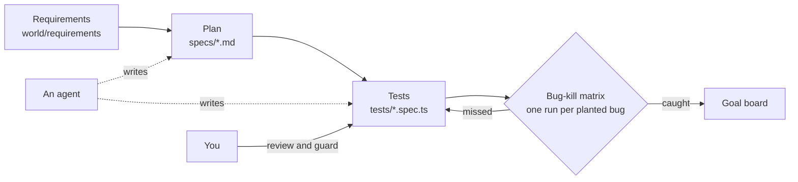

# Orientation: meet the shop

You test Pantry Run, a grocery delivery shop in the fictional city of Larkford. Shoppers book a one-hour
delivery slot, fill a basket (loose produce is sold by weight), and say what the store may do when an item is out
of stock. The shop ships with 16 planted bugs. Each one sits behind a switch, so a script can turn it on and ask:
did your tests notice?

In this orientation you set up the repo, place one order by hand, and run the finished suite to see the goal.
It takes about 15 minutes and you write no code.




## What you need

- Bun 1.4 or newer, and git.
- One coding agent, if you have one: Claude Code, VS Code with Copilot, Codex or opencode. Orientation needs none.
- No model key. The shop's one AI feature answers from recorded replies until you choose a live provider.

## Walkthrough

Set up. This installs packages, finds or downloads Chromium for Playwright, and seeds the shop.

```bash
bun install
bun run setup
```

Expect: `Ready: Bun 1.4.4, Playwright 1.65.0, Chromium installed. Shop data seeded.`

Meet the world: who shops here, what is out of stock, and which bugs are planted.

```bash
bun run world
bun run world bugs
```

Expect: `Products: 40, out of stock: MLK-WH2, GRN-OAT, PB-SMOOTH, JUI-ORA, EGG-6.` and then `16 bugs. BUGS=none is the fixed build. BUGS=release turns every bug on.`

Open the shop. Leave this terminal running and use a second one for the rest.

```bash
bun run shop
```

Expect: `Pantry Run ready on http://localhost:4173 (bugs: none)`


Now do the step [meet-the-shop](meet-the-shop/problem/README.md): place one order by hand. Then run the finished
system. It starts the shop once on the fixed build and once per planted bug, and runs the finished suite each
time. It takes a few minutes.

```bash
bun run board
```

Expect: `Reference suite: 16 of 16 planted bugs caught, fixed build green.`

That is the goal. Now see your own board. Your tests folder is empty, so nothing is caught yet.

```bash
bun run board 00-orientation/meet-the-shop/problem/tests
```

Expect: `No .spec.ts files in 00-orientation/meet-the-shop/problem/tests. Your board: 0 of 16 planted bugs caught.`

Check the step.

```bash
bun run verify meet-the-shop
```

Expect: `Done. All 6 rules pass.` and a `Progress:` line.

## Switching bugs on

`BUGS=weighted-price bun run shop` starts the shop with one bug on. `BUGS=release bun run shop` turns all 16 on.
`bun run world reset` puts the data back to the seed. The shop's store clock is frozen at a fixed time, so slot
rules behave the same on every machine. Tests move it with `POST /__test/clock`.

## Choosing a live model (optional)

Copy `.env.example` to `.env`, set `LLM_PROVIDER` to `anthropic`, `openrouter` or `openai`, and fill in that one
key. Then:

```bash
bun run models
```

Expect: `Every role answers.` On `replay`, the default, each line says `cost: none, recorded reply`.

When a command prints something you do not expect, look it up in [troubleshooting.md](troubleshooting.md).
