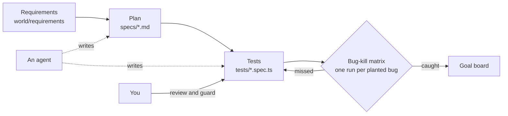

# Orientation: meet the shop

This part moves the first piece of the promise: you can run the shop and read the goal board.

You test Pantry Run, a grocery delivery shop in the made-up city of Larkford. Shoppers book a one-hour delivery
slot. They fill a basket, where loose fruit is sold by weight. They also say what the store may do when an item is
out of stock.

The shop ships with 16 planted bugs. Each one sits behind a switch, so a script can turn it on and ask: did your
tests notice? For example, `BUGS=slot-cutoff` lets shoppers book a slot after the 22:00 cutoff.

In this orientation you set up the repo and place one order in the browser. Then you give Claude Code its first
job, and run the finished suite to see the goal. You write no code.

**Before the commands.** A terminal is a window where you type a command and press Enter. The root
[Start here](../README.md#start-here) shows how to open one and how to get this folder. After you install
Claude Code, the habits you will use are on [one page](claude-code-ways-of-working.md).




## What you need

- Bun 1.4 or newer, and git.
- Claude Code, signed in with your own Claude account (Pro, Max or a Console account). You use it in a
  terminal (`claude`), in your editor through the Claude Code extension, or in the Code tab of Claude Desktop.
  The course is tested on Claude Code 2.1.322 and newer.
- No API key. Claude Code uses your Claude sign-in. The shop has one AI feature, the substitution suggester.
  It answers from a stand-in model with recorded replies, so it costs nothing.

## Walkthrough

Install Claude Code by the official method. On macOS, Linux or WSL:

```bash
curl -fsSL https://claude.ai/install.sh | bash
claude --version
```

Expect: a version such as `2.1.322 (Claude Code)`. On Windows PowerShell run `irm https://claude.ai/install.ps1 | iex`
instead, and Homebrew users can run `brew install --cask claude-code`.

Sign in. In the terminal, in this folder, type `claude`.

```bash
claude
```

Expect: Claude Code opens in the terminal. It asks if you trust the folder: say yes. Type `/login` and follow the
steps in the browser with your Claude account. It then says you are signed in. Type `/exit` to leave.

The habits you will use with Claude Code are on [one page](claude-code-ways-of-working.md).

Set up. This installs packages, finds or downloads Chromium for Playwright, and seeds the shop.

```bash
bun install
bun run setup
```

Expect: `Ready: Bun 1.4.4, Playwright 1.65.0, Chromium installed. Shop data seeded.`
If the course finds a Chromium already on your computer, the line says `Chromium at <path>` instead.

Check that the course can see Claude Code. This asks the `claude` command itself, so it works however you installed it.

```bash
bun run doctor
```

Expect: `Claude Code: 2.1.322` (or newer) and `Signed in: yes. Claude Code is ready for this course.`

Meet the world: who shops here, what is out of stock, and which bugs are planted.

```bash
bun run world
bun run world bugs
```

Expect: `Products: 40, out of stock: MLK-WH2, GRN-OAT, PB-SMOOTH, JUI-ORA, EGG-6.` and then `16 bugs. BUGS=none is the fixed build. BUGS=release turns every bug on.`

Open the shop. Leave this terminal running. Open a second terminal in the same folder for the rest: open a new terminal window, then type `cd agentic-qa-workshop`.

```bash
bun run shop
```

Expect: `Pantry Run ready on http://localhost:4173 (bugs: none)`


Now do the step [meet-the-shop](meet-the-shop/problem/README.md): place one order in the browser. Then run the finished
system. It starts the shop once on the fixed build and once per planted bug, and runs the finished suite each
time. It takes a few minutes.

```bash
bun run board
```

Expect: `Reference suite: 16 of 16 planted bugs caught, fixed build green.`

That is the goal. Now see your own board. Your tests folder is empty, so nothing is caught yet.

```bash
bun run board 00-orientation/meet-the-shop/problem/tests
```

Expect: `No .spec.ts files in 00-orientation/meet-the-shop/problem/tests. Your board: 0 of 16 planted bugs caught.`

Check the step.

Ask Claude Code:

```text
Run `bun run verify meet-the-shop` from the repo root and tell me what it printed. Do not change anything to make it pass.
```

Or run it yourself:

```bash
bun run verify meet-the-shop
```

Expect: `Done. All 6 rules pass.` and a `Progress:` line.

## Switching bugs on

`BUGS=weighted-price bun run shop` starts the shop with one bug on. `BUGS=release bun run shop` turns all 16 on.
`bun run world reset` puts the data back to the seed. The shop's store clock is frozen at a fixed time, so slot
rules behave the same on every machine. Tests move it with `POST /__test/clock`.

## Watch Claude Code do Part 1

The finished system is Claude Code itself. It uses the course's `CLAUDE.md`, settings and hook, and Playwright's
planner and generator agents. It plans and writes a suite for the shop in a fresh folder. Then the bug-kill matrix
scores what it wrote.

With Claude Code signed in, it makes a live run on your own Claude plan. Without it, it replays a recorded real
run, and says so in its first line.

```bash
bun run finished
```

Expect: lines for each tool Claude Code used, then `Finished run: plans cover 17 of 17 requirements` and how
many of the 6 slot and basket bugs its tests caught. The substitution bugs are left for Part 2.

When a command prints something you do not expect, look it up in [troubleshooting.md](troubleshooting.md).
