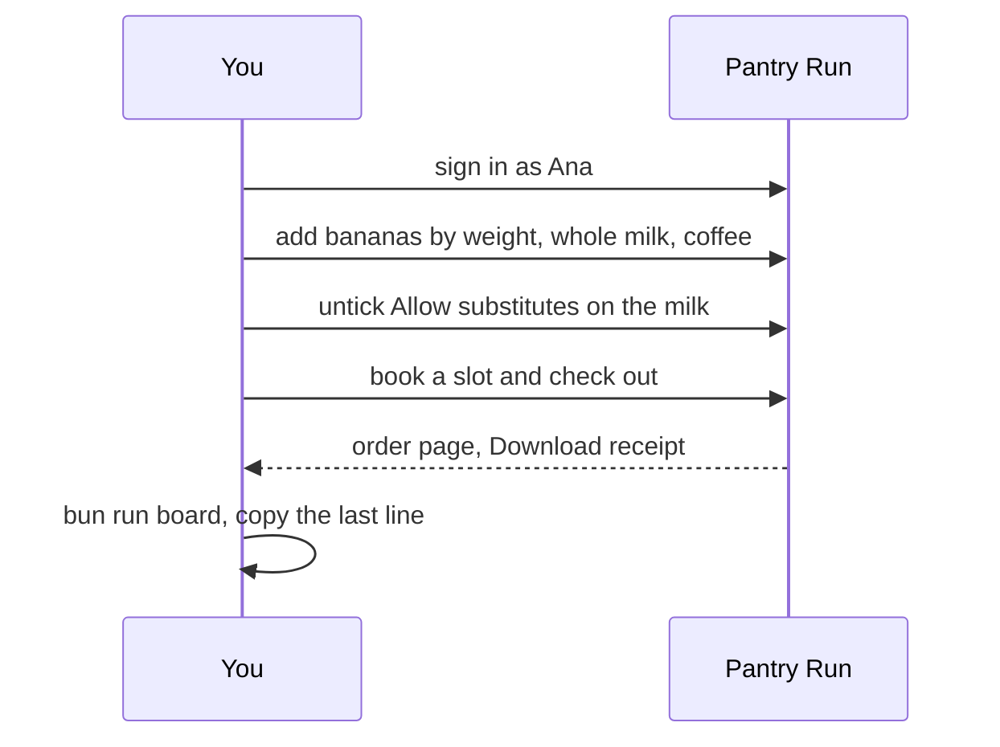
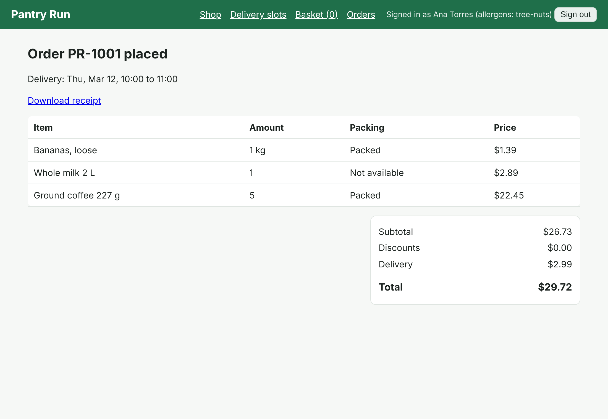

# Meet the shop

## The problem

You cannot judge a test suite until you know the shop it tests. Pantry Run has rules that hide real bugs: slots
close at 22:00 store time, bananas are priced by weight, and a shopper can say "no substitutes" for one item.
Testers who skip this step write tests that click buttons but check nothing that matters to a shopper.



## Your challenge

With `bun run shop` running, open http://localhost:4173 and place one order as Ana
(`ana@pantryrun.test`, password `pantry`):

1. Add **Bananas, loose** with a weight of 1 kg.
2. Add **Whole milk 2 L**. It is out of stock. In the basket, untick **Allow substitutes** on its line.
3. Add **Ground coffee 227 g** and set its quantity to 5, so the basket clears the $25.00 minimum.
4. Book any open delivery slot, then check out.
5. On the order page, click **Download receipt** and save the file in this folder as `receipt.json`.

Then run `bun run board` from the repo root and paste its last line into `goal.md`.

Look at the order page. The milk says "Not available": the store respected your choice. That one line is
requirement SUB-2, and one of the 16 planted bugs breaks it.



## Done when

- Bun is 1.4 or newer and Playwright can find a Chromium.
- `receipt.json` is in this folder, as the shop signed it.
- The order has a delivery slot and loose produce sold by weight.
- The whole milk line had substitutes switched off and says Not available.
- `goal.md` has the last line of the goal board.

```bash
bun run verify meet-the-shop
```

Expect: `Done. All 6 rules pass.` and a `Progress:` line.

## If you get stuck

| What you see | Fix |
|---|---|
| `FAIL receipt.json is in this folder and the shop signed it` | Save the downloaded file here unchanged. An edited receipt fails on purpose. |
| `FAIL a chilled out-of-stock item had substitutes switched off` | Untick the box before checkout, then place a new order and download its receipt. |
| Checkout is grey | The page says why: spend more, or book a slot first. |
| The basket redirects to Sign in | Sign in as `ana@pantryrun.test` with password `pantry`. |

## Words you will use

- **Planted bug**: a known fault the course can switch on, so a script can tell if your tests catch it.
- **Fixed build**: the shop with every bug off (`BUGS=none`). A good suite is green here.
- **Bug-kill matrix**: your suite run once per planted bug. Each red run is a bug caught.
- **Goal board**: the summary `bun run board` prints from the matrix.
- **Substitution**: a store picker replacing an out-of-stock item with a similar one.
