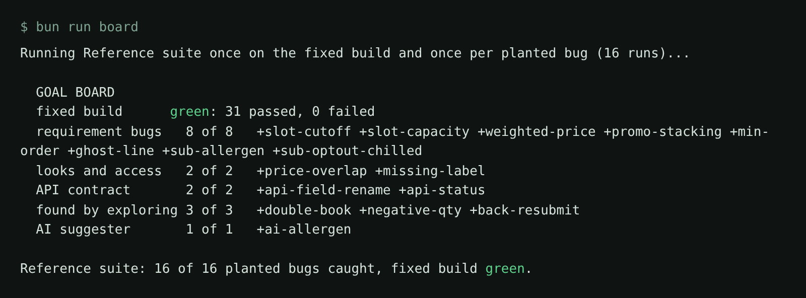
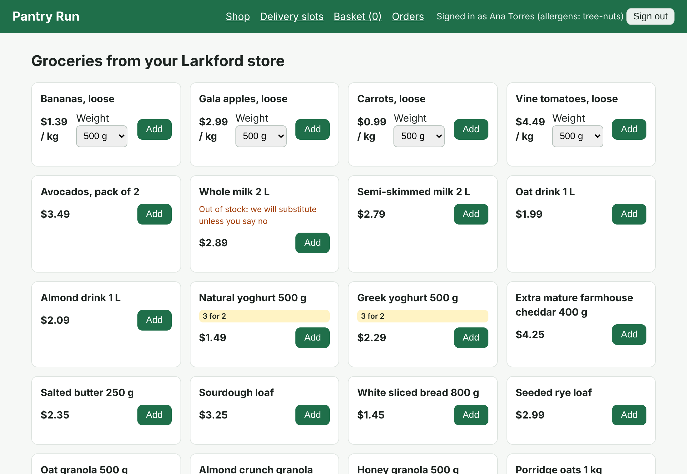
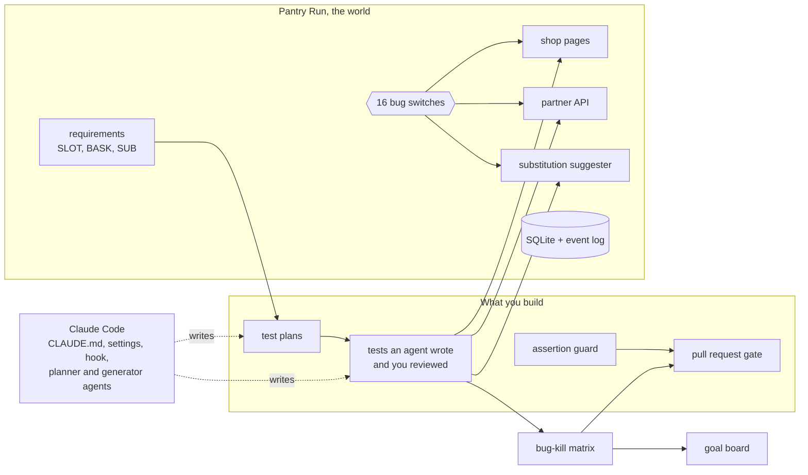

# Agentic QA: agents write your tests, you prove they work

An agent can write forty Playwright tests that all pass. This course is about the next question: would those
tests catch a real bug? You let agents plan, write and fix tests for a grocery delivery shop. Then you prove the
result with numbers a script prints: planted bugs caught, mutants killed, assertions kept.

## Start here

You do not need to know how to code. You need a terminal, Claude Code and this folder.

**What Claude Code is.** It is an assistant that works inside a project folder. It reads the files and writes
new ones. It asks before it runs a command or changes a file, and you say yes or no.

**What you do.** You paste prompts, read the plan it shows, and say yes or no. You write no code.

**1. Open a terminal.** On a Mac, press Command and Space, type Terminal and press Enter. On Windows, open
the Start menu, type PowerShell and press Enter. On Linux, open your Terminal app. A terminal is a window where
you type a command and press Enter. Later you will open a second one in the same way.

**2. Get the course.** Type these two lines in the terminal. The first copies the course to your computer. The
second moves into its folder.

```bash
git clone https://github.com/learnwithparam/agentic-qa-workshop
cd agentic-qa-workshop
```

Expect: no error. Git prints `Cloning into 'agentic-qa-workshop'...` and the second line prints nothing.

**3. Install Claude Code and sign in.** Follow the first steps of the
[orientation walkthrough](00-orientation/README.md#walkthrough).

**4. Learn the ways of working.** [Claude Code ways of working](00-orientation/claude-code-ways-of-working.md)
lists each habit the course teaches and links to the step where you try it.

## The promise

- **Objective.** You can get Claude Code to plan, write and review a Playwright suite, and prove it catches bugs.
- **Outcome.** You leave with a suite Claude Code wrote, a guard that stops weaker assertions, and a pull request
  gate.
- **Transformation.** Before: "the agent wrote 40 tests and they are all green". After: "the agent's tests catch
  7 of 8 planted bugs, and here is the board".
- **Goal.** The last step's check: one pull request gate that reports the bugs caught, the mutation score, the
  guard's log and the cost per kept test.

**Who it is for.** This course is for QA engineers, SDETs and test leads who own a web test suite. It is also for
developers who own their own tests. Do you run a manual regression sheet today? You can start here: you write no
code in this course. Already run Playwright in CI? The bug-kill matrix, the assertion guard and the MCP against CLI
measurement are where you learn something new.

**How you work.** You do every agent task in the real Claude Code, signed in with your own Claude account. You type
prompts, read the plan Claude Code shows, and say yes or no. Claude Code writes every file. The checks never call a
model. They read the plans, tests and runs that Claude Code leaves behind.

For example, in the first step you type this prompt, and Claude Code writes the seed test for you:

```text
Fill in tests/seed.spec.ts. It must reset Pantry Run, sign in as Ana and end on an empty basket.
```

## Run the finished system

```bash
bun install
bun run setup
```

Expect: `Ready: Bun 1.4.4, Playwright 1.65.0, Chromium installed. Shop data seeded.`
If the course finds a Chromium already on your computer, the line says `Chromium at <path>` instead.

```bash
bun run board
```

Expect: `Reference suite: 16 of 16 planted bugs caught, fixed build green.`

The board starts the shop once on the fixed build and once per planted bug, and runs the finished suite in
`reference/tests` each time. A bug counts as caught when the suite goes red with that bug on and is green with
every bug off.



Now watch Claude Code build that kind of suite. It uses the course's `CLAUDE.md`, settings and hook. It also
uses Playwright's planner and generator agents. It plans and writes tests for the shop in a fresh folder. Then the
bug-kill matrix scores what it wrote.

```bash
bun run doctor
bun run finished
```

Expect: `Signed in: yes. Claude Code is ready for this course.`, then one line per tool Claude Code used, then
`Finished run: plans cover 17 of 17 requirements` and how many of the 6 slot and basket bugs its tests caught.

Is Claude Code not signed in, or is this CI? Then the first line says `Replay:`. The script replays a recorded
real run from `world/recordings/`.

Open the shop itself:

```bash
bun run shop
```

Expect: `Pantry Run ready on http://localhost:4173 (bugs: none)`



You need no API key. Claude Code uses your Claude sign-in. The shop has one AI feature, the substitution
suggester. It answers from a stand-in model with recorded replies (see [the orientation](00-orientation/README.md)).

## The world and what you build

**Pantry Run** is a made-up grocery delivery shop in the made-up city of Larkford. Shoppers book a one-hour
delivery slot. They fill a basket, where loose fruit and vegetables are sold by weight. They also say what the
store may do when an item is out of stock.

- The shop's rules are in `world/requirements/` (SLOT, BASK and SUB).
- Its partner API is described in `world/openapi.yaml`.
- Its data lives in one SQLite file. You reset it with `bun run world reset`.

The shop ships with 16 planted bugs. Each one sits behind a switch. For example, `BUGS=weighted-price bun run
shop` starts the shop with the wrong price for bananas sold by weight. Here is what the 16 bugs break:

- 8 break a written requirement.
- 2 break looks and access, and 2 break the API contract.
- 3 break no written rule at all.
- 1 is in the AI suggester.

`bun run world bugs` lists them all.



## The parts

| Part                                                                                                     | Steps                                                                                                                     | Minutes | You prove                                                                                               |
| -------------------------------------------------------------------------------------------------------- | ------------------------------------------------------------------------------------------------------------------------- | ------- | ------------------------------------------------------------------------------------------------------- |
| [Orientation](00-orientation/README.md)                                                                  | meet-the-shop                                                                                                             | 15      | you can run the shop, place an order and read the goal board                                            |
| [1. Write tests with agents](parts/01-write-tests-with-agents/README.md)                                 | write-the-seed-test, plan-tests-from-requirements, generate-tests-from-the-plan, review-the-agent-tests                   | 55      | every written rule has a scenario, and the weak agent tests are fixed                                   |
| [2. Prove the tests catch bugs](parts/02-prove-the-tests-catch-bugs/README.md)                           | catch-the-seeded-bugs, kill-the-mutants, guard-the-assertions                                                             | 60      | at least 7 of 8 requirement bugs caught, mutation score 70 or more, a guard that rejects weakened tests |
| [3. Keep the suite healthy](parts/03-keep-the-suite-healthy/README.md)                                   | heal-a-renamed-button, stop-the-healer-hiding-a-bug, triage-the-flaky-tests, check-looks-and-access                       | 60      | healing that changes locators only, a regression kept red, zero flaky tests                             |
| [4. Test beyond the UI](parts/04-test-beyond-the-ui/README.md)                                           | test-the-order-api-contract, explore-with-an-agent, test-the-substitution-suggester                                       | 60      | the API contract, bugs no requirement names, and an AI feature judged by properties                     |
| [5. Run it as a team](parts/05-run-it-as-a-team/README.md)                                               | compare-mcp-and-cli, fuzz-the-api-from-the-schema, measure-the-agent-cost, gate-the-pull-request, write-the-team-playbook | 100     | one gate, measured cost, and the team's rules for agents                                                |
| [6. Redo a flow with Playwright Test Agents](parts/06-redo-a-flow-with-playwright-test-agents/README.md) | redo-the-flow-with-agents                                                                                                 | 15      | you can generate a plan and a spec with Playwright Test Agents and heal a renamed button                |

Orientation and parts 1 to 4 are the core (250 minutes). Part 5 is the extension for a full day or a cohort. Part 6 is optional homework.
`schedules.toml` maps the parts onto a one-day format, four evenings and a weekly cohort.

## How a step works

Each step lives in its own folder with three parts:

- `problem/` is your starting point. You start Claude Code here and give it the job.
- `solution/` is the end state Claude Code reached, with `prompts.md`: the prompts, the plan it showed and what
  to check. Read it after you pass.
- `wrong/` holds common mistakes. The check rejects each one.

When Claude Code is done, check the step:

Ask Claude Code:

```text
Run `bun run verify write-the-seed-test` from the repo root and tell me what it printed. Do not change anything to make it pass.
```

Or run it yourself:

```bash
bun run verify write-the-seed-test
```

Expect: `PASS` and `FAIL` lines, each `FAIL` with a `Try next:` sentence, then a `Progress:` line.

`bun run verify part <part-name>` checks a whole part. `bun run verify --report` writes `verify-report.json`
for cohort grading. The rules every course repo follows are in [STANDARD.md](STANDARD.md).

## The project

Ship a public repo where Claude Code wrote most of the suite, and a CI gate proves it works. The gate shows the
bug-kill grid, the mutation score, the assertion guard's log and a cost per kept test. Scripts make all four
numbers; nobody types them in. A hiring manager reads the top of your README and sees a number, not a claim.

## Read before you start

| Read                                                                                                                                                             | Why                                                            | Minutes |
| ---------------------------------------------------------------------------------------------------------------------------------------------------------------- | -------------------------------------------------------------- | ------- |
| [The Playwright healer agent prompt](https://raw.githubusercontent.com/microsoft/playwright/main/packages/playwright/src/agents/playwright-test-healer.agent.md) | What the healer is allowed to change, in its own words.        | 3       |
| [Mutate test kata README](https://raw.githubusercontent.com/vmzakharov/mutate-test-kata/master/README.md)                                                        | Why passing tests and high coverage prove less than they seem. | 10      |
| [Playwright MCP README, top section](https://raw.githubusercontent.com/microsoft/playwright-mcp/main/README.md)                                                  | Why the browser tool an agent uses is a choice with a cost.    | 6       |

## Claude Code in this course

Every agent step runs in the real Claude Code, in the `claude` command, the editor extension or the Code tab
in Claude Desktop. Sign in with your own Claude account. The course never asks for an API key. The habits it
teaches are on [one page](00-orientation/claude-code-ways-of-working.md).

You build Claude Code's setup and the work it does with it. For example: `CLAUDE.md`, the permissions in
`.claude/settings.json`, hooks, Playwright's planner, generator and healer agents, and runs with `claude -p`.

| Command                         | What it does                                                                                                                             |
| ------------------------------- | ---------------------------------------------------------------------------------------------------------------------------------------- |
| `bun run doctor`                | Asks `claude` for its version and whether it is signed in. Tested on Claude Code 2.1.322 and newer.                                      |
| `bun run finished`              | A live `claude -p` run on a fresh copy of `world/finished/template` when Claude Code is signed in; otherwise a replay of a recorded run. |
| `bun run finished --replay all` | Replays every recorded run and scores each, so you see how much one run differs from the next.                                           |
| `bun test`                      | Tests the course's hook with the exact JSON Claude Code sends it, and checks the recordings. No model needed.                            |
