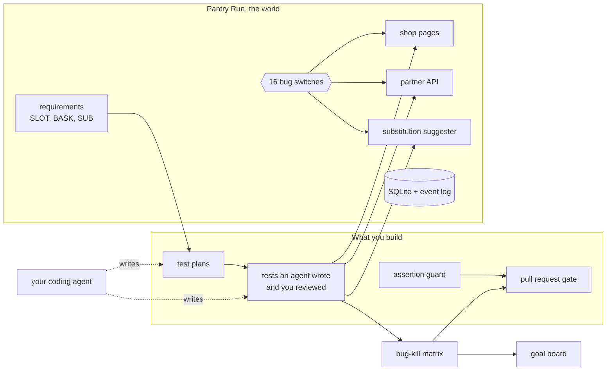

# Agentic QA: agents write your tests, you prove they work

An agent can write forty Playwright tests that all pass. This course is about the question that comes next:
would those tests catch a real bug? You let agents plan, write and heal tests for a grocery delivery shop, and
you prove the result with numbers a script prints: planted bugs caught, mutants killed, assertions kept.

**Who it is for.** QA engineers, SDETs and test leads who own a web test suite, and developers who own their own
tests. If you run a regression sheet by hand today, you can start here: orientation needs no code. If you already
run Playwright in CI, the bug-kill matrix, the assertion guard and the MCP against CLI measurement are where you
learn something new.

**What you leave with.** A suite an agent wrote that catches the planted bugs it should, a guard that stops any
agent from weakening an assertion, and a pull request gate that reports four numbers instead of "tests written by
AI". It works with Claude Code, VS Code with Copilot, Codex or opencode, and the checks never call a model.

## Run the finished system

```bash
bun install
bun run setup
```

Expect: `Ready: Bun 1.4.4, Playwright 1.65.0, Chromium installed. Shop data seeded.`

```bash
bun run board
```

Expect: `Reference suite: 16 of 16 planted bugs caught, fixed build green.`

The board starts the shop once on the fixed build and once per planted bug, and runs the finished suite in
`reference/tests` each time. A bug counts as caught when the suite goes red with that bug on and is green with
every bug off.


Open the shop itself:

```bash
bun run shop
```

Expect: `Pantry Run ready on http://localhost:4173 (bugs: none)`


No model key is needed. The shop's one AI feature, the substitution suggester, answers from recorded replies
until you set a live provider in `.env` (see [the orientation](00-orientation/README.md)).

## The world and what you build

**Pantry Run** is a fictional grocery delivery shop in the fictional city of Larkford. Shoppers book a one-hour
delivery slot, fill a basket where loose produce is sold by weight, and say what the store may do when an item is
out of stock. Its rules are in `world/requirements/` (SLOT, BASK and SUB), its partner API in
`world/openapi.yaml`, and its system of record is one SQLite file you reset with `bun run world reset`.

The shop ships with 16 planted bugs, each behind a switch: `BUGS=weighted-price bun run shop`. Eight break a
written requirement, two break looks and access, two break the API contract, three break no written rule at all,
and one is in the AI suggester. `bun run world bugs` lists them.



## The parts

| Part | Steps | Minutes | You prove |
|---|---|---|---|
| [Orientation](00-orientation/README.md) | meet-the-shop | 15 | you can run the shop, place an order and read the goal board |
| [1. Write tests with agents](parts/01-write-tests-with-agents/README.md) | write-the-seed-test, plan-tests-from-requirements, generate-tests-from-the-plan, review-the-agent-tests | 55 | every written rule has a scenario, and the weak agent tests are fixed |
| [2. Prove the tests catch bugs](parts/02-prove-the-tests-catch-bugs/README.md) | catch-the-seeded-bugs, kill-the-mutants, guard-the-assertions | 60 | at least 7 of 8 requirement bugs caught, mutation score 70 or more, a guard that rejects weakened tests |
| [3. Keep the suite healthy](parts/03-keep-the-suite-healthy/README.md) | heal-a-renamed-button, stop-the-healer-hiding-a-bug, triage-the-flaky-tests, check-looks-and-access | 60 | healing that changes locators only, a regression kept red, zero flaky tests |
| [4. Test beyond the UI](parts/04-test-beyond-the-ui/README.md) | test-the-order-api-contract, explore-with-an-agent, test-the-substitution-suggester | 60 | the API contract, bugs no requirement names, and an AI feature judged by properties |
| [5. Run it as a team](parts/05-run-it-as-a-team/README.md) | compare-mcp-and-cli, fuzz-the-api-from-the-schema, measure-the-agent-cost, gate-the-pull-request, write-the-team-playbook | 100 | one gate, measured cost, and the team's rules for agents |

Orientation and parts 1 to 4 are the core (250 minutes). Part 5 is the extension for a full day or a cohort.
`schedules.toml` maps the parts onto a one-day format, four evenings and a weekly cohort.

## How a step works

Each step lives in its own folder with `problem/` (your starting point), `solution/` (a sample, for after you
pass) and `wrong/` (common mistakes the check rejects). Work in `problem/`, then:

```bash
bun run verify write-the-seed-test
```

Expect: `PASS` and `FAIL` lines, each `FAIL` with a `Try next:` sentence, then a `Progress:` line.

`bun run verify part <part-name>` checks a whole part. `bun run verify --report` writes `verify-report.json` for
cohort grading. The rules every course repo follows are in [STANDARD.md](STANDARD.md).

## The project

Ship a public repo where an agent wrote most of the suite and a CI gate proves it works: the bug-kill grid, the
mutation score, the assertion guard's log and a cost per kept test, all generated by scripts, none typed by hand.
A hiring manager reads the top of your README and sees a number, not a claim.

## Read before you start

| Read | Why | Minutes |
|---|---|---|
| [The Playwright healer agent prompt](https://raw.githubusercontent.com/microsoft/playwright/main/packages/playwright/src/agents/playwright-test-healer.agent.md) | What the healer is allowed to change, in its own words. | 3 |
| [Mutate test kata README](https://raw.githubusercontent.com/vmzakharov/mutate-test-kata/master/README.md) | Why passing tests and high coverage prove less than they seem. | 10 |
| [Playwright MCP README, top section](https://raw.githubusercontent.com/microsoft/playwright-mcp/main/README.md) | Why the browser tool an agent uses is a choice with a cost. | 6 |

## Models

The shop calls a model in one place, through `config/llm.ts`. `config/models.ts` is the only file that names a
model; code asks for a role (`fast`, `smart`, `judge`). `LLM_PROVIDER` picks `replay` (the default, no key),
`anthropic`, `openrouter`, `openai` or `ollama`, with one key in a git-ignored `.env`. `bun run models` sends one
tiny call per role and prints pass or fail, never a key.
