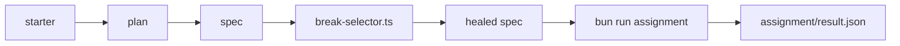

# Assignment: generate and heal one flow's tests with Playwright Test Agents

This assignment is optional in the live session and expected as homework. It is the closing part of the course:
[Part 6, Do it with the tools teams run](../parts/06-do-it-with-the-tools-teams-run/README.md).

## The task

Work in `parts/06-do-it-with-the-tools-teams-run/01-redo-the-flow-with-agents/problem/`. The starter is the course
repo as it is, plus `assignment/break-selector.ts`, a script that renames one button in a spec. Use Playwright's
planner, generator and healer agents on the flow "book a delivery slot". Then write `CHOICE.md`.

No containers are needed. The shop and the browser already run from the course's own Bun scripts, so this
assignment has no compose file.



## Done when

The check script `checks/assignment.ts` tests each line and writes `assignment/result.json`. The file holds one
`pass` or `fail` per line, and the Playwright version it found.

- `@playwright/test` resolves to 1.65.0.
- A plan file exists for the chosen flow.
- The generated spec passes.
- After the scripted selector break, the healed spec passes.

```bash
bun run assignment
```

Expect: `Done. All Done-when lines pass.` and `assignment/result.json` with four `pass` lines.

## Rubric

A person reads these lines. There are no points.

- The generated spec covers the assertions of the hand-written one.
- `CHOICE.md` says when a hand-written spec is the better choice.
- The healer changed locators only.

## Submit

Push a branch named `assignment` and submit its URL. The grader reruns `bun run assignment`.
