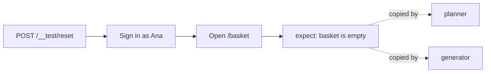
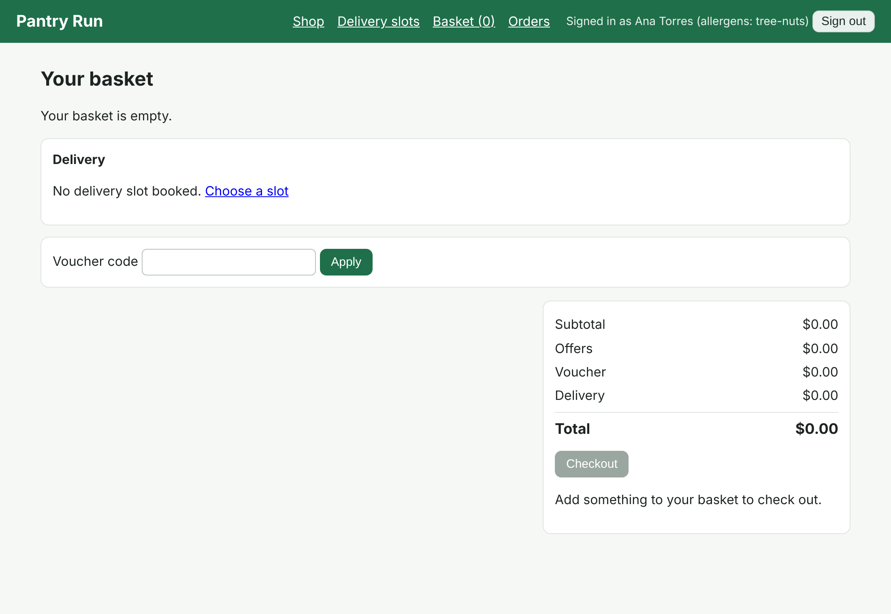

# Write the seed test

## The problem

Playwright's planner and generator agents start from one file: the seed test, the first test an agent runs. It opens the app in a known state, and the agent copies its style.

For example:

- No reset: tests pass once, then fail on run two.
- No sign-in: the agent explores the Sign in page, not the basket.



## Watch it done

Your seed should end here:



## Your turn

Get Claude Code to finish `tests/seed.spec.ts` in this folder. You type no test code. When it is done, the seed must:

1. Reset the shop with `request.post("/__test/reset")`.
2. Sign in on the Sign in page as `ana@pantryrun.test`, password `pantry`.
3. Open `/basket` and expect the empty basket.

Start Claude Code in this folder:

```bash
claude
```

Expect: Claude Code opens and asks to trust this folder. Say yes.

Then type this prompt:

```text
Fill in tests/seed.spec.ts. It must reset Pantry Run with request.post("/__test/reset"),
sign in on /signin as ana@pantryrun.test with password pantry, then open /basket and
expect the empty basket. Use getByLabel and getByRole, not CSS. Show me your plan first.
```

Read the plan before you say yes. Say no if the plan adds an item to the basket, or has no `expect`.

Then run the seed three times in a second terminal in this folder. Playwright starts the shop for you.

```bash
bunx playwright test --repeat-each=3
```

Expect: `3 passed`

## Do it on your work

Pick one app your team owns. Ask Claude Code for a seed that resets it and signs in. Read the plan before you say yes.

## Done when

- `tests/seed.spec.ts` resets the shop through `POST /__test/reset` and has at least one `expect`.
- It passes 3 runs in a row on the fixed build.
- The shop's event log shows a reset and a sign-in as Ana on every run, and every run ends on an empty basket.
- `tests/saved-sign-in.spec.ts` saves the sign-in to a file, and a second test starts signed in from it. Steps: [the second half](MORE.md).

Ask Claude Code:

```text
Run `bun run verify write-the-seed-test` from the repo root and tell me what it printed. Do not change anything to make it pass.
```

Or run it yourself:

```bash
bun run verify write-the-seed-test
```

Expect: `Done. All 8 rules pass.`

## Solution

The finished answer is in `solution/`. Read it after you pass, not before.

## If you get stuck

| What you see                                  | Fix                                                                                      |
| --------------------------------------------- | ---------------------------------------------------------------------------------------- |
| `FAIL it passes 3 runs in a row`              | Read the first error. A missing reset often fails on the second run.                     |
| `FAIL every run ends on an empty basket page` | The seed must not add anything. Tell Claude Code to open `/basket` last and add nothing. |
| `Timed out waiting ... config.webServer`      | Start the shop with `bun run shop` in another terminal, then run again.                  |

## Words you will use

- **Seed test**: the first test an agent runs. The agent copies its style.
- **`request`**: Playwright's tool for web calls with no browser.
- **`expect`**: a check in a test. A test with no `expect` passes whatever the page shows.
- **Plan**: the list of changes Claude Code shows before it edits files. You approve or reject it.
