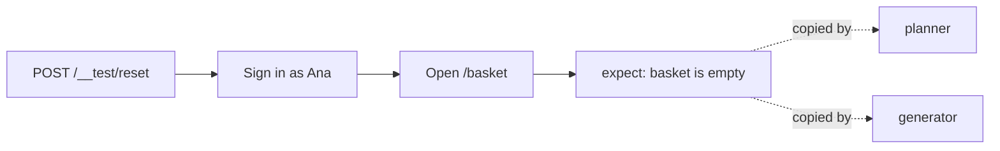

# Write the seed test

## The problem

Playwright has a planner agent and a generator agent. Both start every session from one file: the seed test.
A seed test is the first test an agent runs. It opens the app in a known state, and the agent copies its style.

A bad seed spreads into every test the agents write. For example:

- A seed that does not reset the shop data gives tests that pass once and fail on the second run.
- A seed that does not sign in sends the agent to explore the Sign in page instead of the basket.



## Your challenge

Get Claude Code to finish `tests/seed.spec.ts` in this folder. You type no test code: you write the prompt and
review the plan. Today the file has an empty test. When Claude Code is done, the seed must:

1. Reset the shop with `request.post("/__test/reset")`.
2. Sign in on the Sign in page as `ana@pantryrun.test`, password `pantry`.
3. Open `/basket` and expect the empty basket.

Start Claude Code in this folder:

```bash
claude
```

Expect: Claude Code opens. The first time, it asks if you trust this folder. Say yes.

Then type this prompt:

```text
Fill in tests/seed.spec.ts. It must reset Pantry Run with request.post("/__test/reset"),
sign in on /signin as ana@pantryrun.test with password pantry, then open /basket and
expect the empty basket. Use getByLabel and getByRole, not CSS. Show me your plan first.
```

Read the plan before you say yes. Say no if the plan adds an item to the basket, or has no `expect`.

Then run the seed three times in a second terminal, in this folder. Playwright starts the shop if it is not
running yet.

```bash
bunx playwright test --repeat-each=3
```

Expect: `3 passed`

This is where your seed should leave the browser:


## Done when

- `tests/seed.spec.ts` resets the shop through `POST /__test/reset` and has at least one `expect`.
- It passes 3 runs in a row on the fixed build.
- The shop's event log shows a reset and a sign-in as Ana on every run, and every run ends on an empty basket.

```bash
bun run verify write-the-seed-test
```

Expect: `Done. All 6 rules pass.`

## If you get stuck

| What you see                                  | Fix                                                                                                      |
| --------------------------------------------- | -------------------------------------------------------------------------------------------------------- |
| `FAIL it passes 3 runs in a row`              | Read the first error. A missing reset often fails on the second run. |
| `FAIL every run ends on an empty basket page` | The seed must not add anything. Tell Claude Code to open `/basket` last and add nothing.                 |
| `Timed out waiting ... config.webServer`      | Start the shop with `bun run shop` in another terminal, then run again.                                  |
| `getByLabel("Email")` finds nothing           | The test is not on `/signin`. Tell Claude Code to go to `/signin` first.                                 |

## Words you will use

- **Seed test**: the first test an agent runs. The agent copies its style.
- **`request`**: Playwright's built-in tool for web calls inside a test, when no browser is needed.
- **`expect`**: a check in a test. A test with no `expect` passes whatever the page shows.
- **Event log**: `events.jsonl`, the shop's record of what happened. The checks read it.
- **Plan**: the list of changes Claude Code shows before it edits files. You approve or reject it.
