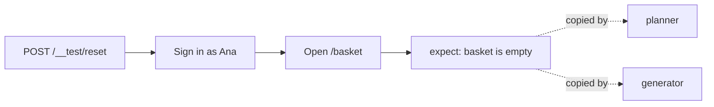
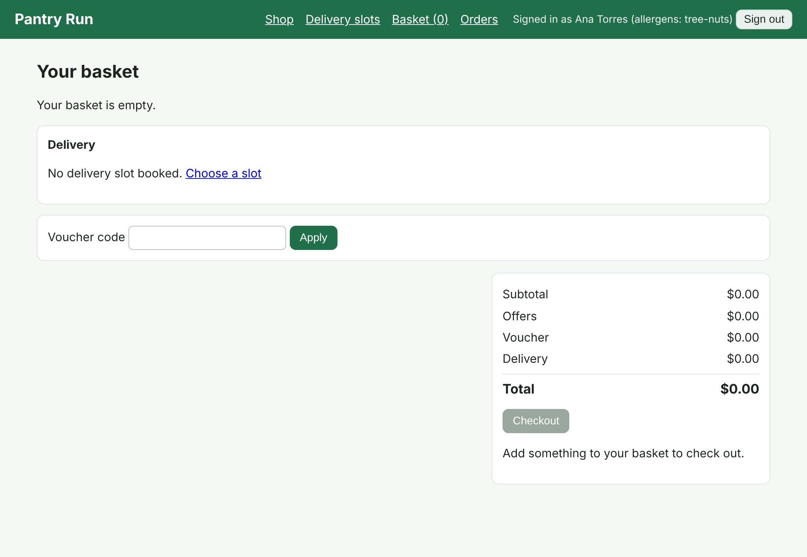

# Write the seed test

## The problem

Playwright's planner and generator agents start every session from one file: the seed test. They run it to
open the app, and they copy its style into every test they write. A seed that skips the data reset gives you
tests that pass on a clean shop and fail on the second run. A seed with no sign-in sends the agent to explore a
login page instead of the basket.



## Your challenge

Finish `tests/seed.spec.ts` in this folder. It is the file `bunx playwright init-agents` writes, with an empty
test. Make it:

1. Reset the shop with `request.post("/__test/reset")`.
2. Sign in on the Sign in page as `ana@pantryrun.test`, password `pantry`.
3. Open `/basket` and expect the empty basket.

Ask Claude Code, or write it yourself. Start `claude` in this folder and ask:
`Fill in tests/seed.spec.ts so it resets Pantry Run, signs in as Ana and ends on an empty basket.`

Run it from this folder. Playwright starts the shop if it is not already running.

```bash
bunx playwright test --repeat-each=3
```

Expect: `3 passed`

This is where your seed should leave the browser:



## Done when

- `tests/seed.spec.ts` resets the shop through `POST /__test/reset` and has at least one `expect`.
- It passes 3 runs in a row on the fixed build.
- The shop's event log shows a reset and a sign-in as Ana on every run, and every run ends on an empty basket.

```bash
bun run verify write-the-seed-test
```

Expect: `Done. All 6 rules pass.`

## If you get stuck

| What you see                                  | Fix                                                                                            |
| --------------------------------------------- | ---------------------------------------------------------------------------------------------- |
| `FAIL it passes 3 runs in a row`              | Run the command above and read the first error. A missing reset often fails on the second run. |
| `FAIL every run ends on an empty basket page` | The seed must not add anything. Open `/basket` last.                                           |
| `Timed out waiting ... config.webServer`      | Start the shop yourself with `bun run shop` in another terminal.                               |
| `getByLabel("Email")` finds nothing           | You are not on `/signin`. Go there first with `page.goto("/signin")`.                          |

## Words you will use

- **Seed test**: the test an agent runs first to reach a known starting point, and copies the style of.
- **`request`**: Playwright's built-in HTTP client inside a test, for calls that need no browser.
- **`expect`**: an assertion. A test with no `expect` passes whatever the page shows.
- **Event log**: `events.jsonl`, the shop's record of what happened. Checks read it.
