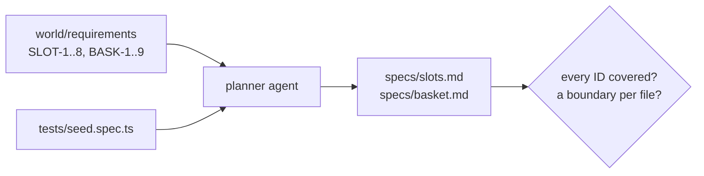

# Plan tests from requirements

## The problem

An agent can write forty tests before you finish reading the rules. Writing tests is cheap. Knowing what to test
is not.

Playwright's planner agent is asked for happy paths, edge cases and error handling. But nothing checks that every
written rule got a scenario. For example, a plan that skips SLOT-3 (slots close at 22:00) gives a suite that can
never catch a cutoff bug, however many tests it has.



## Your challenge

Get Claude Code to write two test plans in `specs/`: `slots.md` and `basket.md`. You write no plan text. You
write the prompt, read the plan, and send Claude Code back for what is missing.

Every scenario needs a heading, numbered steps, an Expected part, and two lines the course checks:

- **Covers:** the requirement IDs, such as `SLOT-2`.
- **Kind:** `happy`, `boundary` (where a rule flips: 20 orders, 22:00, $25.00) or `negative` (what must not work).

First add Playwright's agents to this folder, then start Claude Code here:

```bash
bunx playwright init-agents --loop=claude
claude
```

Expect: `init-agents` writes `.claude/agents/` and `.mcp.json`, then Claude Code opens.

Type this prompt:

```text
Use the playwright-test-planner agent to plan tests for Pantry Run from
../../../../world/requirements/slots.md and basket.md. Use tests/seed.spec.ts as the seed.
Save specs/slots.md and specs/basket.md. Under every scenario heading add two lines, like this:
**Covers:** SLOT-2
**Kind:** boundary
Kind is happy, boundary or negative. Every SLOT and BASK ID must be covered at least once,
and each file needs at least one boundary or negative scenario.
```

Then read the plans next to the requirements. Agents often skip the rule that needs a clock or a weight. When a
rule is missing, do not edit the plan. Send Claude Code back with a prompt like this:

```text
specs/slots.md has no scenario for SLOT-3, the 22:00 cutoff. Add a boundary scenario
at 21:59 and at 22:00, with Covers and Kind lines.
```

## Done when

- `specs/slots.md` and `specs/basket.md` exist with scenarios.
- Every scenario has a Covers line with real IDs, a Kind, numbered steps and an expected result.
- Every SLOT and every BASK requirement is covered at least once.
- Each plan has at least one boundary or negative scenario.

```bash
bun run verify plan-tests-from-requirements
```

Expect: `Done. All 7 rules pass.`

## If you get stuck

| What you see                               | Fix                                                                                                              |
| ------------------------------------------ | ---------------------------------------------------------------------------------------------------------------- |
| `FAIL every SLOT requirement is covered`   | Compare the IDs in the Covers lines with `world/requirements/slots.md`. Ask Claude Code to add the missing ones. |
| `FAIL every scenario has a Covers line`    | The planner does not add Covers on its own. Put the Covers rule in your prompt and ask again.                    |
| `FAIL each plan has at least one boundary` | Ask for a scenario just below and just at each number in a rule.                                                 |
| `init-agents` replaced `.mcp.json`         | It writes one in this folder. Keep your own copy elsewhere.                                 |

## Words you will use

- **Test plan**: scenarios in plain words, before any code. Agents and people both read it.
- **Requirement ID**: the label on one written rule, such as SLOT-3. It ties a test to a rule.
- **Boundary case**: a test at the point where a rule changes its answer. For example, 21:59 and 22:00.
- **Coverage (of requirements)**: every written rule has at least one scenario. It is not code coverage.
