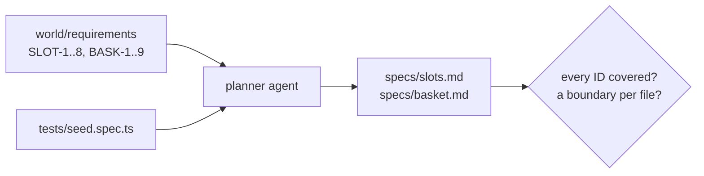

# Plan tests from requirements

## The problem

An agent can write forty tests before you read the rules. Writing tests is cheap. Knowing what to test is not.

Playwright's planner agent is asked for happy paths, edge cases and error handling. Nothing checks that every rule got a scenario. A plan that skips SLOT-3 (slots close at 22:00) gives a suite that never catches a cutoff bug.



## Watch it done

A finished plan has a heading, numbered steps, an Expected part, and two lines the course checks:

- **Covers:** the requirement IDs, such as `SLOT-2`.
- **Kind:** `happy`, `boundary` (where a rule flips: 20 orders, 22:00, $25.00) or `negative` (what must not work).

## Your turn

Get Claude Code to write `specs/slots.md` and `specs/basket.md`. You write the prompt and send Claude Code back for what is missing.

First add Playwright's agents to this folder, then start Claude Code here:

```bash
bunx playwright init-agents --loop=claude
claude
```

Expect: `init-agents` writes `.claude/agents/` and `.mcp.json`, then Claude Code opens.

Type this prompt. The `@` before a path makes Claude Code read that real file:

```text
Use the playwright-test-planner agent to plan tests for Pantry Run from
@../../../../world/requirements/slots.md and @../../../../world/requirements/basket.md. Use tests/seed.spec.ts as the seed.
Save specs/slots.md and specs/basket.md. Under each plan title add a Source line
with the requirements file. Under every scenario heading add two lines, like this:
**Covers:** SLOT-2
**Kind:** boundary
Kind is happy, boundary or negative. Every SLOT and BASK ID must be covered at least once,
and each file needs at least one boundary or negative scenario.
```

Read the plans next to the requirements. Agents often skip rules that need a clock or a weight. If one is missing, send Claude Code back:

```text
specs/slots.md has no scenario for SLOT-3, the 22:00 cutoff. Add a boundary scenario
at 21:59 and at 22:00, with Covers and Kind lines.
```

## Do it on your work

Pick one rule in an app your team owns. Ask Claude Code for one plan with a Covers line for that rule. Read the plan before you keep it.

## Done when

- `specs/slots.md` and `specs/basket.md` exist with scenarios.
- Every scenario has a Covers line with real IDs, a Kind, numbered steps and an expected result.
- Every SLOT and every BASK requirement is covered at least once.
- Each plan has at least one boundary or negative scenario.
- Each plan has a Source line that names the requirements file you gave Claude Code with `@`.

Ask Claude Code:

```text
Run `bun run verify plan-tests-from-requirements` from the repo root and tell me what it printed. Do not change anything to make it pass.
```

Or run it yourself:

```bash
bun run verify plan-tests-from-requirements
```

Expect: `Done. All 8 rules pass.`

## Solution

The finished answer is in `solution/`. Read it after you pass, not before.

## If you get stuck

| What you see                               | Fix                                                                                           |
| ------------------------------------------ | --------------------------------------------------------------------------------------------- |
| `FAIL every SLOT requirement is covered`   | Ask Claude Code to add the missing IDs from `world/requirements/slots.md`.                    |
| `FAIL every scenario has a Covers line`    | The planner does not add Covers on its own. Put the Covers rule in your prompt and ask again. |
| `FAIL each plan has at least one boundary` | Ask for a scenario just below and just at each number in a rule.                              |
| `init-agents` replaced `.mcp.json`         | It writes one in this folder. Keep your own copy elsewhere.                                   |

## Words you will use

- **Test plan**: scenarios in plain words, before any code.
- **Requirement ID**: the label on one written rule, such as SLOT-3. It ties a test to a rule.
- **Boundary case**: a test at the point where a rule changes its answer. For example, 21:59 and 22:00.
- **Coverage (of requirements)**: every written rule has a scenario. It is not code coverage.
