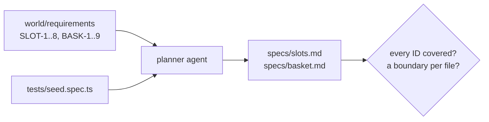

# Plan tests from requirements

## The problem

An agent can write forty tests before you finish reading the requirements. Writing is cheap; knowing what to
write is not. Playwright's own planner prompt asks for happy paths, edge cases and error handling, but nothing
checks that every written rule got a scenario. A plan that skips SLOT-3 (the 22:00 cutoff) gives you a suite that
can never catch a cutoff bug, however many tests it has.



## Your challenge

Write two test plans in `specs/`: `slots.md` and `basket.md`. Each scenario has a heading, numbered steps, an
Expected part, and two extra lines the course checks:

```markdown
#### 2.1 A full slot shows Full and cannot be booked
**Covers:** SLOT-2
**Kind:** boundary
```

`Kind` is `happy`, `boundary` (where a rule flips: 20 orders, 22:00, $25.00) or `negative` (what must not work).

In Claude Code: from this folder run `bunx playwright init-agents --loop=claude`, then start `claude` here and ask:
`Use the playwright-test-planner agent to plan tests for Pantry Run from ../../../../world/requirements/slots.md and basket.md. Use tests/seed.spec.ts. Save specs/slots.md and specs/basket.md. Under every scenario add **Covers:** with the requirement IDs and **Kind:** happy, boundary or negative.`

Then read the plan against the requirements. Agents often skip the rule that needs a clock or a weight. Ask
Claude Code to add the missing scenarios, or edit the plan yourself: the check reads the file, not who typed it.

## Done when

- `specs/slots.md` and `specs/basket.md` exist with scenarios.
- Every scenario has a Covers line with real IDs, a Kind, numbered steps and an expected result.
- Every SLOT and every BASK requirement is covered at least once.
- Each plan has at least one boundary or negative scenario.

```bash
bun run verify plan-tests-from-requirements
```

Expect: `Done. All 7 rules pass.`

## If you get stuck

| What you see | Fix |
|---|---|
| `FAIL every SLOT requirement is covered` | List the IDs in your Covers lines and compare with `world/requirements/slots.md`. |
| `FAIL every scenario has a Covers line` | The planner does not add Covers by itself. Add it to the prompt, or by hand. |
| `FAIL each plan has at least one boundary` | For each number in a rule, plan a scenario just below and just at it. |
| `init-agents` overwrote `.mcp.json` | It writes one in this folder. Keep your own copy elsewhere if you have one. |

## Words you will use

- **Test plan**: scenarios in plain words, before any code. Agents and people both read it.
- **Requirement ID**: the label on one written rule, such as SLOT-3. It ties a test to a rule.
- **Boundary case**: a test at the point where a rule changes its answer.
- **Coverage (of requirements)**: every written rule has at least one scenario. It is not code coverage.
