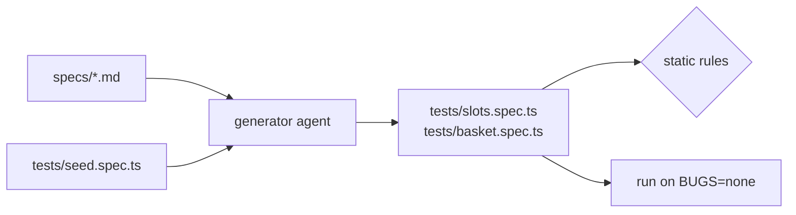
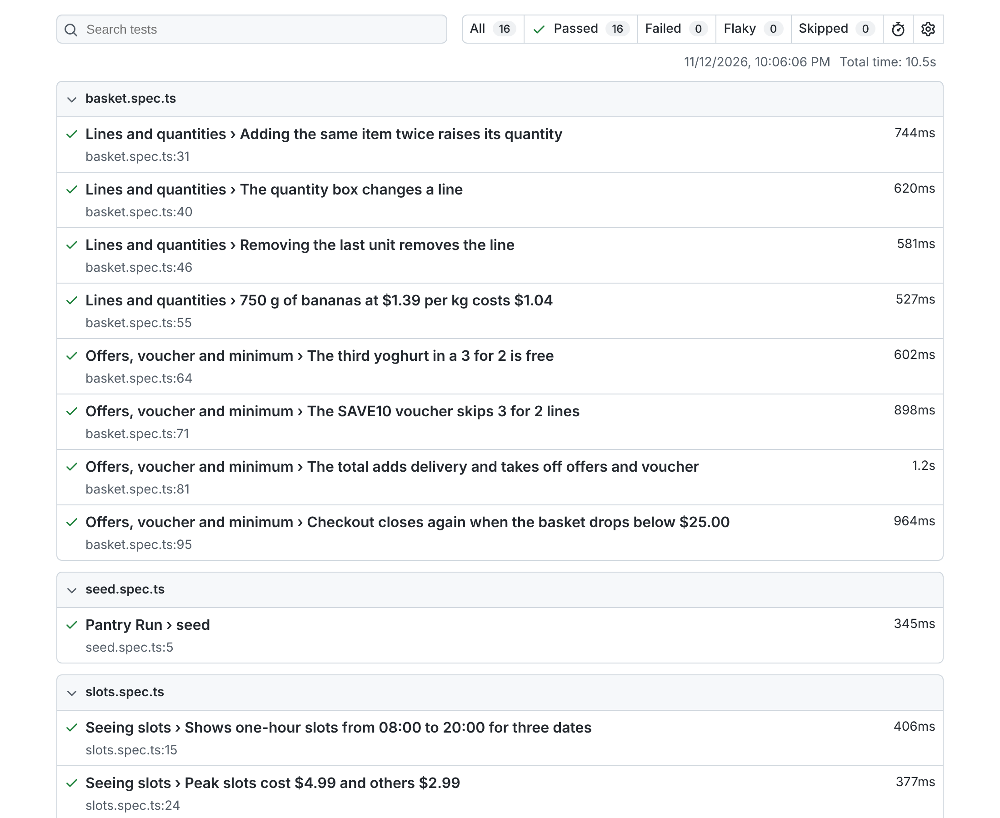

# Generate tests from the plan

## The problem

Agents write tests that pass today and break next sprint:

- A CSS selector such as `#slot-3` breaks when the layout changes.
- `waitForTimeout(1000)` hides a race, and fails on a slow machine.
- A test with no `expect` passes whatever the page shows.

Playwright's generator agent works from the plan, so every test points to its scenario.



## Watch it done

The finished tests pass on the fixed build. The HTML report shows every generated test green:



## Your turn

The plans are in `specs/`. Get Claude Code to turn every scenario into a test in `tests/`. You type prompts and review.

Add Playwright's agents to this folder and start Claude Code:

```bash
bunx playwright init-agents --loop=claude
claude
```

Expect: `init-agents` writes `.claude/agents/` and `.mcp.json`, then Claude Code opens.

Ask for one group of scenarios at a time:

```text
Use the playwright-test-generator agent on specs/slots.md, section 1, with
tests/seed.spec.ts as the seed. Keep each scenario's title as the test title.
Find elements with getByRole, getByLabel, getByText or getByTestId. No CSS or XPath,
no waitForTimeout, and every test needs an expect.
```

Then check every file for these five things:

- The file starts with `// spec: specs/<plan>.md`.
- Each test title matches its scenario's title.
- Elements use `getByRole`, `getByLabel`, `getByText` or `getByTestId`. No CSS, no XPath.
- No `waitForTimeout`. Let `expect` wait.
- Every test has an `expect`.

When one is wrong, tell Claude Code what to change. For example, say which line to fix. Then run the suite:

```bash
bunx playwright test --reporter=html
```

Expect: `16 passed` (15 scenarios and the seed), then the HTML report opens.

## Do it on your work

Pick one rule in an app your team owns. Ask for one generated test that goes red when that rule breaks.

## Done when

- `tests/` holds generated files, each with a `// spec:` line naming a plan that exists.
- Every plan scenario has a test with the same title.
- Every test has an `expect`, no test uses `waitForTimeout`, no test finds elements by CSS or XPath.
- Every test passes on the fixed build.

Ask Claude Code:

```text
Run `bun run verify generate-tests-from-the-plan` from the repo root and tell me what it printed. Do not change anything to make it pass.
```

Or run it yourself:

```bash
bun run verify generate-tests-from-the-plan
```

Expect: `Done. All 7 rules pass.`

## Solution

Read the finished answer in `solution/` after you pass.

## Go further

If you get stuck:

- **Title mismatch:** copy the title from the `####` heading. Numbers are ignored.
- **CSS found:** swap `locator("#slot-...")` for `getByRole("radio", { name: /Mar 12 09:00/ })`.
- **Radio not found:** slot names read like `Thu, Mar 12 09:00 to 10:00, $2.99`. Match part of it.

Words you will use: a **locator** is how a test finds an element. **Auto-waiting** means `expect` tries again until the page matches.
