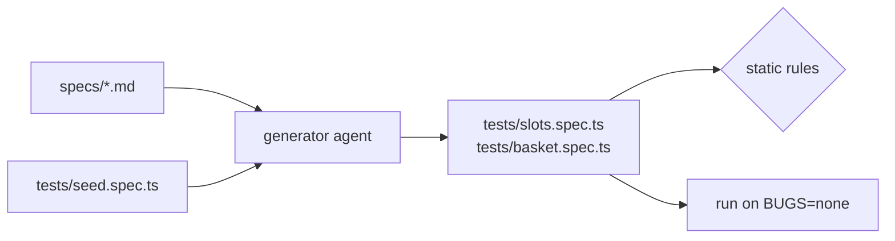

# Generate tests from the plan

## The problem

Agents write tests that pass today and break next sprint. For example:

- A CSS selector such as `#slot-3` breaks when someone changes the page layout.
- `waitForTimeout(1000)` waits one second to hide a race, and fails on a slow machine.
- A test with no `expect` passes whatever the page shows.

Each one costs you a morning later. Playwright's generator agent works from the plan, so every test points back to its scenario.



## Your challenge

The plans from the last step are in `specs/`. Get Claude Code to turn every scenario into a test in `tests/`.
You type prompts and review.

Add Playwright's agents to this folder and start Claude Code:

```bash
bunx playwright init-agents --loop=claude
claude
```

Expect: `init-agents` writes `.claude/agents/` and `.mcp.json`, then Claude Code opens.

Ask for one group of scenarios at a time. For example:

```text
Use the playwright-test-generator agent on specs/slots.md, section 1, with
tests/seed.spec.ts as the seed. Keep each scenario's title as the test title.
Find elements with getByRole, getByLabel, getByText or getByTestId. No CSS or XPath,
no waitForTimeout, and every test needs an expect.
```

Then read what came back. Check these five things in every file:

- The file starts with `// spec: specs/<plan>.md`.
- Each test title matches its scenario's title.
- Elements use `getByRole`, `getByLabel`, `getByText` or `getByTestId`. No CSS, no XPath.
- No `waitForTimeout`. Let `expect` wait.
- Every test has an `expect`.

When one is wrong, tell Claude Code what to change. Then run the suite:

```bash
bunx playwright test --reporter=html
```

Expect: `16 passed` (15 scenarios and the seed), then the HTML report opens.


## Done when

- `tests/` holds generated files, each with a `// spec:` line naming a plan that exists.
- Every plan scenario has a test with the same title.
- Every test has an `expect`, no test uses `waitForTimeout`, no test finds elements by CSS or XPath.
- Every test passes on the fixed build.

Ask Claude Code:

```text
Run `bun run verify generate-tests-from-the-plan` from the repo root and tell me what it printed. Do not change anything to make it pass.
```

Or run it yourself:

```bash
bun run verify generate-tests-from-the-plan
```

Expect: `Done. All 7 rules pass.`

## If you get stuck

| What you see                                              | Fix                                                                                                |
| --------------------------------------------------------- | -------------------------------------------------------------------------------------------------- |
| `FAIL every plan scenario has a test with the same title` | Ask Claude Code to copy the title from the `####` heading. Numbers are ignored.                    |
| `FAIL no test finds elements by CSS or XPath`             | Ask Claude Code to swap `locator("#slot-...")` for `getByRole("radio", { name: /Mar 12 09:00/ })`. |
| A radio cannot be found by name                           | Slot names read like `Thu, Mar 12 09:00 to 10:00, $2.99`. Tell Claude Code to match part of it.    |
| A test fails on the second run only                       | It depends on data another test made. Ask Claude Code to reset in `beforeEach`.                    |

## Words you will use

- **Generator agent**: the Playwright agent that turns a scenario into test code.
- **Locator**: how a test finds an element. Role and label locators match what a shopper sees.
- **Auto-waiting**: `expect` tries again until the page matches, so sleeps are not needed.
- **HTML report**: Playwright's page of results, one row per test.
