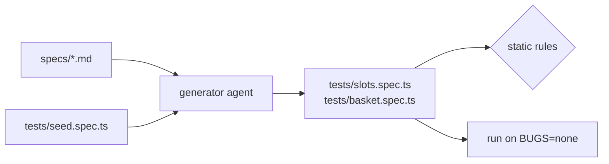
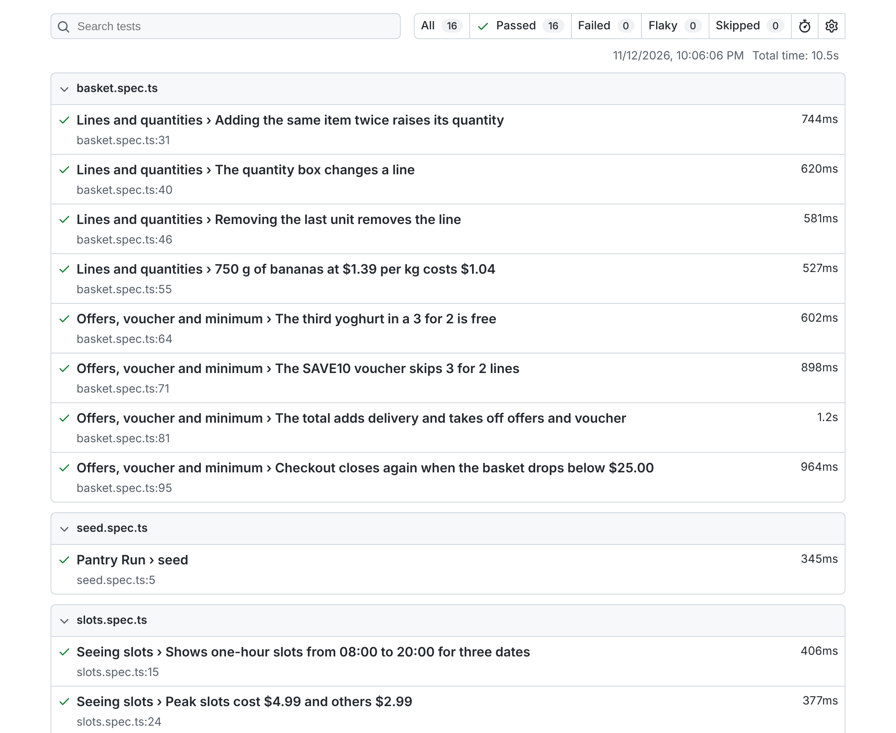

# Generate tests from the plan

## The problem

Agents write tests that pass today and break next sprint: CSS selectors tied to markup, `waitForTimeout(1000)`
to hide a race, a test with no `expect` at all. Each one costs a morning later. Playwright's generator agent is
told to log its steps from the plan, so every test can point back to the scenario it came from. You keep that
link and the habits that make tests last.



## Your challenge

The plans from the last step are in `specs/`. Turn every scenario into a test in `tests/`. Run
`bunx playwright init-agents --loop=claude` in this folder, start `claude` here, and ask the generator one
scenario group at a time, for example:
`Use the playwright-test-generator agent on specs/slots.md, section 1, with tests/seed.spec.ts as the seed. Keep each scenario's title as the test title.`

Then check what came back:

- Each file starts with `// spec: specs/<plan>.md`.
- Each test title matches its scenario's title.
- Elements are found with `getByRole`, `getByLabel`, `getByText` or `getByTestId`. No CSS, no XPath.
- No `waitForTimeout`. Let `expect` wait.
- Every test has an `expect`.

```bash
bunx playwright test --reporter=html
```

Expect: `16 passed` (15 scenarios and the seed), then the HTML report opens.



## Done when

- `tests/` holds generated files, each with a `// spec:` line naming a plan that exists.
- Every plan scenario has a test with the same title.
- Every test has an `expect`, no test uses `waitForTimeout`, no test finds elements by CSS or XPath.
- Every test passes on the fixed build.

```bash
bun run verify generate-tests-from-the-plan
```

Expect: `Done. All 7 rules pass.`

## If you get stuck

| What you see                                              | Fix                                                                                                   |
| --------------------------------------------------------- | ----------------------------------------------------------------------------------------------------- |
| `FAIL every plan scenario has a test with the same title` | Copy the title from the `####` heading. Numbering is ignored.                                         |
| `FAIL no test finds elements by CSS or XPath`             | Swap `locator("#slot-...")` for `getByRole("radio", { name: /Mar 12 09:00/ })`.                       |
| A radio cannot be found by name                           | Slot names read like `Thu, Mar 12 09:00 to 10:00, $2.99`. Match part of it with a regular expression. |
| A test fails on the second run only                       | It depends on data another test made. Reset in `beforeEach`.                                          |

## Words you will use

- **Generator agent**: the Playwright agent that turns a plan scenario into test code by driving the browser.
- **Locator**: how a test finds an element. Role and label locators match what a shopper sees.
- **Auto-waiting**: `expect` retries until the page matches or a timeout passes, so sleeps are not needed.
- **HTML report**: Playwright's page of results, one row per test.
