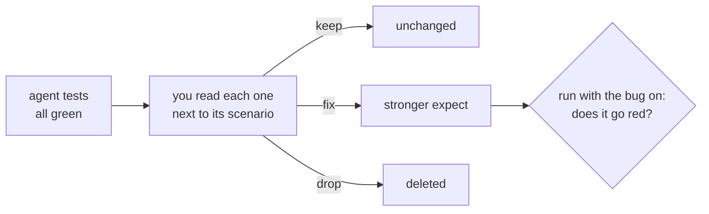

# Review the agent tests

## The problem

Every test in `tests/` was written by an agent, and every one is green. Some check what their title says. Some
check that a toast appeared and stop there. A green test that would stay green with the bug switched on is worse
than no test: it tells the release meeting that a rule is covered when it is not.



## Your challenge

Read every test in `tests/slots.spec.ts` and `tests/basket.spec.ts` next to its scenario in `specs/`. For each,
ask: if the rule in this title broke, would this test go red? Write one line per test in `qa/review.md`:

```markdown
- 750 g of bananas at $1.39 per kg costs $1.04: fix: only checked the toast
```

Then make each fix. To prove a fix, start the shop with the matching bug on, for example
`BUGS=weighted-price bun run shop`, run that one test, and watch it go red. Switch the bug off and watch it pass.

Three weak tests are planted here. Common signs: an `expect` on a toast or a visible element instead of a
number, and `expect(locator).toBeTruthy()`, which passes for any locator.

## Done when

- `qa/review.md` gives every agent test a verdict (keep, fix or drop), and every fix or drop says why.
- At least one test is marked fix or drop.
- Every test marked fix was changed; every test marked drop is gone.
- The suite passes on the fixed build and now catches `weighted-price`, `ghost-line` and `promo-stacking`.

```bash
bun run verify review-the-agent-tests
```

Expect: `Done. All 6 rules pass.`

## If you get stuck

| What you see                              | Fix                                                                                            |
| ----------------------------------------- | ---------------------------------------------------------------------------------------------- |
| `FAIL the reviewed suite now catches ...` | A test you marked fix still passes with the bug on. Make it check the number the shopper pays. |
| `FAIL every test marked fix was changed`  | The check compares with the agent's original. Edit the test, not only the review.              |
| You dropped a weak test                   | Then nothing checks that rule. A weak test is usually worth fixing.                            |

## Words you will use

- **Verdict**: keep, fix or drop, with a reason. It is your sign-off on agent work.
- **Weak assertion**: an `expect` that passes whether or not the rule holds.
- **Catch**: a test goes red when a planted bug is on, and green when it is off.
