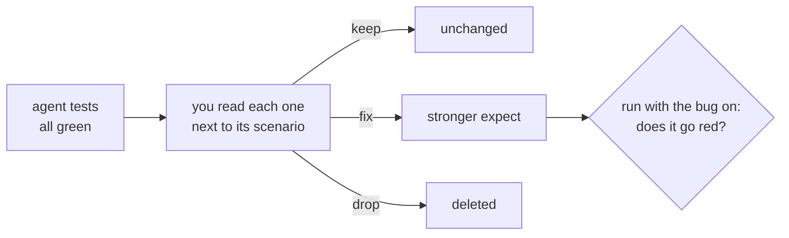

# Review the agent tests

## The problem

An agent wrote every test in `tests/`, and every test is green. Some check what their title says. Some check that
a message popped up, and stop there.

A green test that stays green with the bug switched on is worse than no test. It tells the release meeting that a
rule is covered when it is not. For example, a test called "750 g of bananas costs $1.04" that only checks a
message, and never the $1.04, passes even when the price is wrong.



## Your challenge

Three weak tests are planted here. Use Claude Code to find them, record a verdict for each test, and fix the weak
ones. You do not edit any file. You judge every verdict and every fix Claude Code proposes.

Start Claude Code in this folder:

```bash
claude
```

Expect: Claude Code opens in this folder.

Ask for the review first, and for no changes yet:

```text
Read every test in tests/slots.spec.ts and tests/basket.spec.ts next to its scenario in specs/.
For each test, ask: if the rule in this title broke, would this test go red?
Write one line per test in qa/review.md in this form:
- <test title>: keep | fix | drop: <why, in a few words>
Do not change any test yet. Show me the list.
```

Check the list yourself. Signs of a weak test: an `expect` on a message or a visible element instead of a number,
or `expect(locator).toBeTruthy()`, which passes for any locator. Reject a verdict you do not agree with.

Then ask for the fixes:

```text
Fix every test marked fix in qa/review.md. Make each one check the number or line
the shopper sees. Do not change any test marked keep.
```

Prove each fix. Start the shop with the matching bug on, run that one test, and watch it go red:

```bash
BUGS=weighted-price bun run shop
```

Expect: `Pantry Run ready on http://localhost:4173 (bugs: weighted-price)`

Then switch the bug off and watch the test pass.

## Done when

- `qa/review.md` gives every agent test a verdict (keep, fix or drop), and every fix or drop says why.
- At least one test is marked fix or drop.
- Every test marked fix was changed; every test marked drop is gone.
- The suite passes on the fixed build and now catches `weighted-price`, `ghost-line` and `promo-stacking`.

```bash
bun run verify review-the-agent-tests
```

Expect: `Done. All 6 rules pass.`

## If you get stuck

| What you see                              | Fix                                                                                                         |
| ----------------------------------------- | ----------------------------------------------------------------------------------------------------------- |
| `FAIL the reviewed suite now catches ...` | A test marked fix still passes with the bug on. Ask Claude Code to check the price the shopper pays.        |
| `FAIL every test marked fix was changed`  | The check compares with the agent's first version. Ask Claude Code to change the test, not only the review. |
| You dropped a weak test                   | Then nothing checks that rule. A weak test is usually worth fixing.                                         |

## Words you will use

- **Verdict**: keep, fix or drop, with a reason. It is your sign-off on agent work.
- **Weak assertion**: an `expect` that passes whether or not the rule holds.
- **Catch**: a test goes red when a planted bug is on, and green when it is off.
