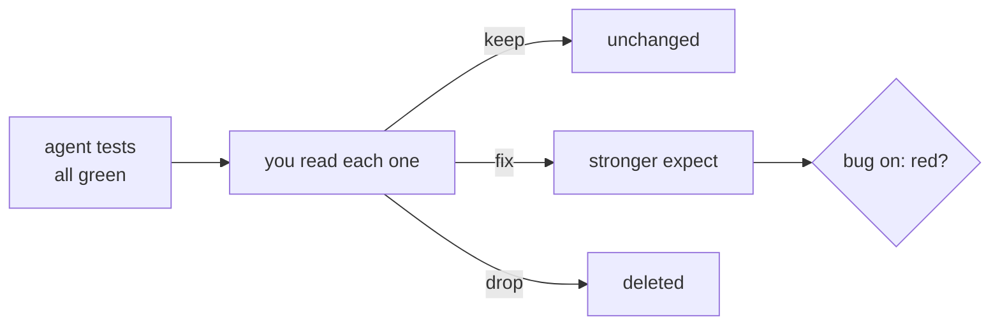

# Review the agent tests

## The problem

An agent wrote every test in `tests/`. All are green, but some check only a message.

A green test that stays green with the bug on is worse than no test. For example, a test called "750 g of bananas costs $1.04" checks only a message, so it passes even when the price is wrong.



## Watch it done

Each test gets one line in `qa/review.md`, in this form:

```text
- <test title>: keep | fix | drop: <why, in a few words>
```

## Your turn

Three weak tests are planted here. Use Claude Code to find and fix them. You judge every verdict.

Start Claude Code in this folder:

```bash
claude
```

Expect: Claude Code opens in this folder.

Ask for the review first, with no changes yet:

```text
Read every test in tests/slots.spec.ts and tests/basket.spec.ts next to its scenario in specs/.
For each test, ask: would it go red if its rule broke?
Write one line per test in qa/review.md in this form:
- <test title>: keep | fix | drop: <why, in a few words>
Do not change any test yet.
```

Check the list yourself. A weak test checks only a message, or uses `expect(locator).toBeTruthy()`, which passes for any locator.

Then ask for the fixes:

```text
Fix every test marked fix in qa/review.md. Check the number or line the shopper sees.
Do not change any test marked keep.
```

Prove each fix. Start the shop with the matching bug on, run that one test, and watch it go red:

```bash
BUGS=weighted-price bun run shop
```

Expect: `Pantry Run ready on http://localhost:4173 (bugs: weighted-price)`

Then switch the bug off.

## Keep your hand on the wheel

Use plan mode, so Claude Code reads but does not edit. Read each fix's diff. Press Esc to stop an unwanted change, and `/rewind` to undo one. Run `/clear` before a new review.

Then add a "How I reviewed" part at the end of `qa/review.md`, in your own words.

## Do it on your work

Pick one test in your own app. Ask whether it would go red if its rule broke.

## Done when

- `qa/review.md` gives every test a verdict, with a reason for each fix or drop.
- At least one test is marked fix or drop.
- Every fix was changed, and every drop is gone.
- The suite passes on the fixed build and catches `weighted-price`, `ghost-line` and `promo-stacking`.
- "How I reviewed" names your permission mode, your diff check, Esc, `/rewind` and `/clear`.

Ask Claude Code:

```text
Run `bun run verify review-the-agent-tests` and tell me what it printed. Do not change anything to make it pass.
```

Or run it yourself:

```bash
bun run verify review-the-agent-tests
```

Expect: `Done. All 9 rules pass.`

## Solution

Read the finished answer in `solution/` after you pass.

## Go further

If you get stuck:

- **A fix still passes:** ask Claude Code to check the price the shopper pays.
- **Fix not counted:** change the test, not only the review.
- **Dropped a weak test:** nothing checks that rule now.
