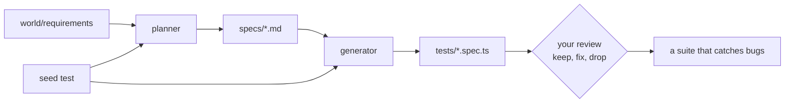

# Part 1: Write tests with agents

## The problem

Pantry Run's regression sheet has 120 rows and nobody has time to automate it. An agent can write tests faster
than anyone on the team. But speed is not the risk. The risk is a suite that is long, green and empty: tests
that click through the shop and check nothing a shopper would notice.

## Why it matters

Playwright ships three agents for this job: a planner, a generator and a healer. Read their prompts before you
run them. The planner is asked for "Happy path scenarios", "Edge cases and boundary conditions" and "Error
handling and validation"
([planner prompt](https://raw.githubusercontent.com/microsoft/playwright/main/packages/playwright/src/agents/playwright-test-planner.agent.md)),
and nothing checks that it covered every written rule. The healer is told to work on "Fixing
assertions and expected values" and, when stuck, to mark a test `test.fixme()` so it is skipped
([healer prompt, microsoft/playwright](https://raw.githubusercontent.com/microsoft/playwright/main/packages/playwright/src/agents/playwright-test-healer.agent.md)).
This part builds the habits that keep the planner and generator honest. Part 3 deals with
the healer.



| Step | Minutes | You produce | The check reads |
|---|---|---|---|
| [write-the-seed-test](01-write-the-seed-test/problem/README.md) | 10 | `tests/seed.spec.ts` | three runs against a private shop and its event log |
| [plan-tests-from-requirements](02-plan-tests-from-requirements/problem/README.md) | 20 | `specs/slots.md`, `specs/basket.md` | every SLOT and BASK ID covered, a boundary case per plan |
| [generate-tests-from-the-plan](03-generate-tests-from-the-plan/problem/README.md) | 15 | `tests/slots.spec.ts`, `tests/basket.spec.ts` | one test per scenario, no CSS or sleeps, green on the fixed build |
| [review-the-agent-tests](04-review-the-agent-tests/problem/README.md) | 10 | `qa/review.md` and fixed tests | a verdict per test, and the fixed suite catching 3 planted bugs |

Total: 55 minutes. Each step's folder is self-contained: work in its `problem/` folder.

## Which agent

Any of them. `bunx playwright init-agents --loop=<claude|vscode|codex|opencode|copilot>` writes the planner,
generator and healer for your tool into the folder you run it in. The checks read files and run tests, so they do
not know or care which agent wrote them. With no agent, every prompt in this part also works pasted into a chat
tool, or you can write the files by hand.

## Walkthrough

Start the shop in one terminal and leave it running.

```bash
bun run shop
```

Expect: `Pantry Run ready on http://localhost:4173 (bugs: none)`

Then, for each step, work in its `problem/` folder and check it from the repo root.

```bash
bun run verify write-the-seed-test
bun run verify plan-tests-from-requirements
bun run verify generate-tests-from-the-plan
bun run verify review-the-agent-tests
```

Expect: `Done.` on each step once its work is in place, and a `Progress:` line after each.

When all four pass, the whole part passes.

```bash
bun run verify part write-tests-with-agents
```

Expect: `Part write-tests-with-agents is done: 4/4 steps pass.`

## Recap

You can now hand an agent a seed and a set of requirements, read its plan against the rules, and judge its tests
by one question: would this go red if the rule broke? Part 2 answers that question for the whole suite at once.
