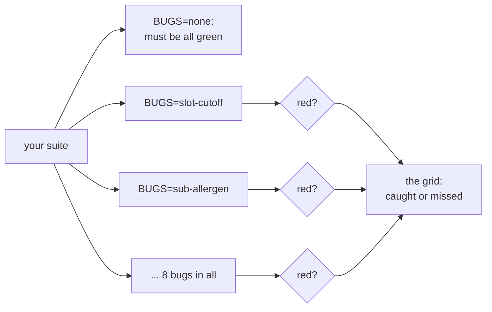
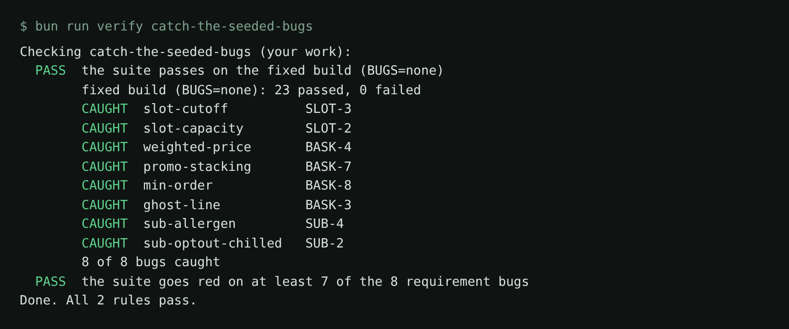

# Catch the seeded bugs

## The problem

The suite in `tests/` has 16 green tests. Green proves they run, not that they catch a bug.

Pantry Run plants 8 bugs that break a written rule, each behind a switch. A good suite goes red when a bug is
on. This one misses 2. For example, with `BUGS=sub-allergen` the picker swaps Oat granola for Almond crunch
granola. Ana declared tree nuts, and every test stays green.



## Your challenge

Get Claude Code to close the gap until the suite catches at least 7 of the 8 bugs. You write no test. You read
the grid, find the untested rule, and give Claude Code that job.

First, see the grid. From the repo root:

```bash
bun run verify catch-the-seeded-bugs
```

Expect: a grid with `6 of 8 bugs caught`, and a `missed` line for `sub-allergen` and `sub-optout-chilled`.

Both misses are substitution rules (SUB-2 and SUB-4). No test reads the packing note on an order.

Start Claude Code in this folder:

```bash
claude
```

Expect: Claude Code opens in this folder.

Give it the job:

```text
The suite in tests/ is green, but it never checks the substitution rules, so planted substitution bugs go through.
Read ../../../../world/requirements/substitutions.md.
First plan: write specs/substitutions.md in the same format as specs/basket.md, with a scenario for each of SUB-1 to SUB-6. Each scenario has **Covers:** and **Kind:** lines.
Then write tests/substitutions.spec.ts from that plan, in the style of tests/basket.spec.ts.
Each test must check what the shopper sees, for example the exact packing note on the order page ("Not available" or "Substituted with ..."), never only that the order was placed.
Ana (ana@pantryrun.test) declared tree nuts.
Run bunx playwright test and make sure every test passes on the fixed build. Do not change the existing tests.
```

Read each new test before you accept it. Which `expect` goes red if the rule breaks? Then run the grid again.



## Done when

- The suite passes on the fixed build (`BUGS=none`).
- The suite goes red on at least 7 of the 8 requirement bugs.

Ask Claude Code:

```text
Run `bun run verify catch-the-seeded-bugs` from the repo root and tell me what it printed. Do not change anything to make it pass.
```

Or run it yourself:

```bash
bun run verify catch-the-seeded-bugs
```

Expect: `8 of 8 bugs caught` (7 is enough), then `Done. All 2 rules pass.`

## If you get stuck

| What you see                                    | Fix                                                                                                                     |
| ----------------------------------------------- | ----------------------------------------------------------------------------------------------------------------------- |
| `missed sub-optout-chilled` after the new tests | The test checks the order was placed, not the packing note. Ask Claude Code to expect `Not available` on the milk line. |
| `FAIL the suite passes on the fixed build`      | A test expects what a buggy shop does. Read the failing test against the rule in the requirements.                      |
| Every bug is `CAUGHT` but the first rule fails  | A test that is always red catches everything and proves nothing. Fix it first.                                          |

## Words you will use

- **Planted bug**: a known fault you can switch on.
- **Bug-kill matrix**: the grid of caught and missed, one row per planted bug.
- **Caught**: the suite is green with the bug off and red with it on.
