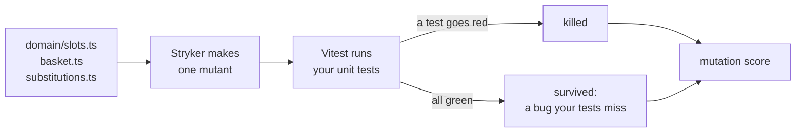
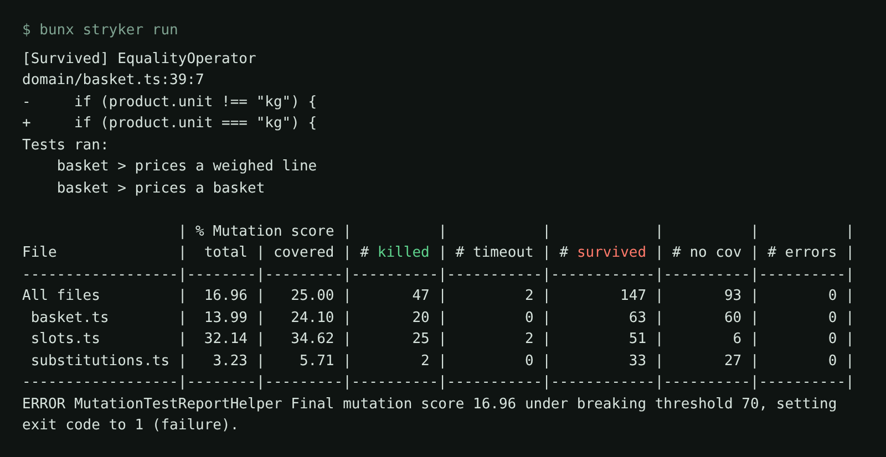

# Kill the mutants

## The problem

The bug-kill grid uses 8 bugs we planted. Real bugs are not on a list. Mutation testing gives you a second
measure. A tool called Stryker makes hundreds of small changes to the code, one at a time. Each changed copy is a **mutant**. For example, it turns `booked >= capacity` into `booked > capacity`,
which is the `slot-capacity` bug. Then it runs your unit tests. If a test goes red, the mutant is **killed**. If
every test stays green, the mutant **survived**: your tests would miss that bug.

The **mutation score** is the share of mutants your tests kill. Coverage says a line ran. The score says a test
would notice if it were wrong.



## Your challenge

`domain/` holds the shop's rules as plain code, with no tests. Get Claude Code to write Vitest unit tests and a
Stryker config, and to push the score to 70 or more. You read what survives and steer.

Start Claude Code in this folder:

```bash
claude
```

Expect: Claude Code opens in this folder.

Give it the job:

```text
Write Vitest unit tests for the shop rules in domain/slots.ts, domain/basket.ts and domain/substitutions.ts. Put one test file next to each: domain/slots.test.ts, domain/basket.test.ts and domain/substitutions.test.ts.
Every expect compares an exact value, such as a price in cents or a slot status. Test the edges of each rule, for example 21:59 and 22:00 for the cutoff, and 19 and 20 orders booked in a 20-order slot.
Then write stryker.config.json: the vitest test runner, mutate only those three files, and "thresholds": { "break": 70 }.
Run bunx vitest run, then bunx stryker run. For each survived mutant, add or fix a test that goes red on that change, until the score is 70 or more.
Do not change the domain code itself, only the .test.ts files and stryker.config.json.
```

A survived mutant looks like this. No test noticed when Stryker flipped the check for loose produce:



Reject two shortcuts: lowering `"break"`, and changing the domain code. The check runs your tests against its
own copy of the domain code.

## Done when

- `stryker.config.json` uses `vitest`, mutates the three files, and has `"break"` of 70 or more.
- Your unit tests pass on the fixed domain code.
- The mutation score on the three files is at least 70.
- Every test file kills at least one mutant.

```bash
bun run verify kill-the-mutants
```

Expect: `mutation score:` with a number of 70 or more, then `Done. All 4 rules pass.`

## If you get stuck

| What you see                                         | Fix                                                                                              |
| ---------------------------------------------------- | ------------------------------------------------------------------------------------------------ |
| `mutation score: 17.0`                               | The tests run the code but check little. Ask for exact values: `toBe(104)`, not `toBeDefined()`. |
| `FAIL your unit tests pass on the fixed domain code` | A test expects a wrong number. Ask Claude Code to explain that test against the rule.            |
| A mutant nobody can kill                             | Some mutants change nothing a caller sees. Skip it. 70 leaves room for these.                    |

## Words you will use

- **Mutant**: a copy of the code with one small change, like `>=` turned into `>`.
- **Killed**: at least one test went red on the mutant.
- **Survived**: every test stayed green. Your tests would miss that bug.
- **Mutation score**: killed mutants divided by all mutants, as a percent.
