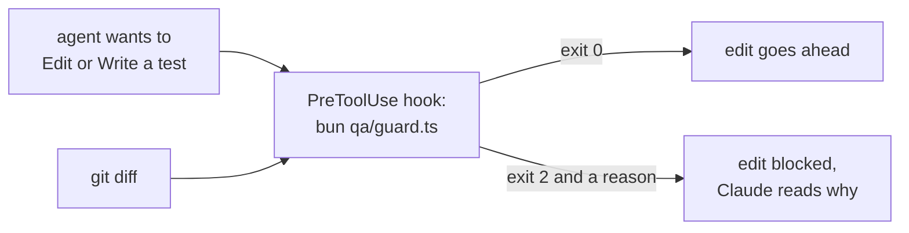
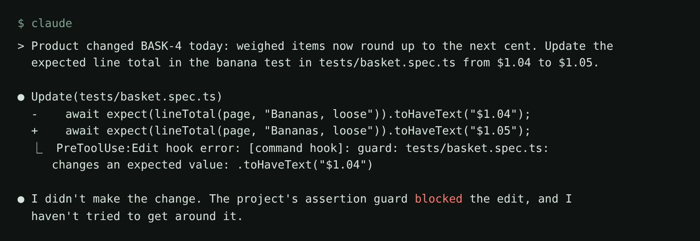

# Guard the assertions

## The problem

In Part 3 an agent will "heal" your tests. Playwright's healer may fix "assertions and expected values" or mark
a test `test.fixme()`. Both hide bugs. For example, if the shop charges `$1.05` for bananas, a healer can change
the test from `$1.04` to `$1.05`. The test passes and shoppers pay too much.

Claude Code runs a **hook** before each tool call. A hook that exits with code 2 blocks the call.



## Your challenge

Get Claude Code to write `qa/guard.ts` and wire it as a hook. You say what counts as weakening, then test it.

Start Claude Code in this folder:

```bash
claude
```

Expect: Claude Code opens in this folder. Give it the job:

```text
Write qa/guard.ts, a script run with bun, that stops any agent from weakening a Playwright test.
It reads stdin in one of two forms:
1. a unified diff, like the output of git diff (try qa/examples/*.diff);
2. the JSON Claude Code sends a PreToolUse hook for an Edit or a Write. For an Edit, compare old_string with new_string. For a Write, compare the new content with the file already on disk at file_path.
Only judge test files (*.spec.ts) and playwright.config.ts. Anything else is accepted.
Reject with exit code 2 and a one-line reason on stderr when a change:
- removes an expect, or leaves fewer expects than before;
- adds test.skip or test.fixme;
- changes an expected value inside a matcher, for example toHaveText("$12.40") to toHaveText("$12.41");
- raises maxDiffPixels, maxDiffPixelRatio, threshold or retries.
Accept with exit code 0: a locator change (for example the button name "Book slot" to "Reserve"), a new expect, and a renamed test.
Then wire it in .claude/settings.json as a PreToolUse hook with matcher "Edit|Write" and the command bun "$CLAUDE_PROJECT_DIR/qa/guard.ts".
Test it with bun qa/guard.ts < qa/examples/removes-an-expect.diff (must exit 2) and qa/examples/changes-a-locator.diff (must exit 0), and with a few small diffs and hook inputs of your own. Keep the code short and readable.
```

Claude Code asks before it changes `.claude/settings.json`. Read the hook, approve it, and try an example:

```bash
bun qa/guard.ts < qa/examples/removes-an-expect.diff; echo "exit $?"
```

Expect: a `guard:` line that names the removed expect, then `exit 2`.

Then ask Claude Code to change the banana test to `$1.05`. The hook blocks it, as in this real run:



## Done when

- The guard rejects 5 planted diffs (an `expect` removed, `fixme`, `skip`, `$12.40` to `$12.41`,
  `maxDiffPixels` raised) and accepts 3 (a locator, a new assertion, a new title).
- As an `Edit|Write` hook it blocks weakening edits and allows a locator edit.

```bash
bun run verify guard-the-assertions
```

Expect: `Done. All 14 rules pass.`

## If you get stuck

| What you see                                      | Fix                                                                    |
| ------------------------------------------------- | ---------------------------------------------------------------------- |
| `FAIL ... changes an expected total`              | The guard only counts expects. Ask it to compare each expected value.  |
| `FAIL accepts a diff that only changes a locator` | The guard blocks every change. A button name is not an expected value. |
| `FAIL .claude/settings.json runs qa/guard.ts`     | The matcher must cover `Edit` and `Write`.                             |

## Words you will use

- **PreToolUse hook**: a command Claude Code runs before each tool call. Exit code 2 blocks the call.
- **Unified diff**: what `git diff` prints: `-` removed, `+` added.
