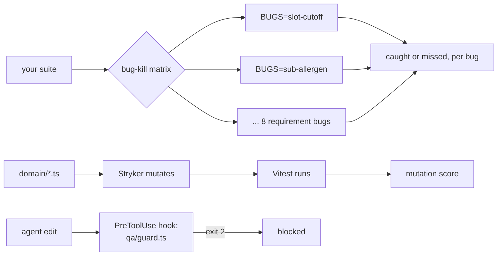

# Prove the tests catch bugs

This part moves the transformation: from "all green" to "catches 7 of 8 planted bugs", with numbers a script
prints.

## The problem

Every test is green. That proves the tests run, not that they would catch anything. With agent-written tests the
gap is wider, because nobody wrote them with a bug in mind.

For example, the suite you finished in Part 1 has 16 green tests. Switch on `BUGS=sub-allergen` and the store
picker gives Ana, who declared tree nuts, Almond crunch granola. All 16 tests stay green.

## Why it matters

The mutate-test kata puts the trap in one line: passing tests and high coverage "may be giving a false sense of
security due to low quality of the tests"
([vmzakharov/mutate-test-kata](https://raw.githubusercontent.com/vmzakharov/mutate-test-kata/master/README.md)).
Its tests cover close to 100% of the code, and the code is still full of bugs.

And the agent that will maintain your suite may weaken it. Playwright's healer prompt lists "Fixing assertions
and expected values" as a job. When it is stuck, it may "mark this test as test.fixme()"
([healer prompt, microsoft/playwright](https://raw.githubusercontent.com/microsoft/playwright/main/packages/playwright/src/agents/playwright-test-healer.agent.md)).

So this part gives you three numbers you can show in a review, all computed by a script:

| Number                      | Before (the Part 1 suite) | After this part                       |
| --------------------------- | ------------------------- | ------------------------------------- |
| Planted bugs caught         | 6 of 8                    | 8 of 8                                |
| Mutation score              | no unit tests             | 100 (the bar is 70)                   |
| Weakening edits let through | any                       | 0 of 5 planted, as a Claude Code hook |



In every step you type prompts and review. Claude Code makes each file below. The check reads what it made.

| Step                                                                | Minutes | Claude Code makes                                                        | The check reads                                                                                  |
| ------------------------------------------------------------------- | ------- | ------------------------------------------------------------------------ | ------------------------------------------------------------------------------------------------ |
| [catch-the-seeded-bugs](01-catch-the-seeded-bugs/problem/README.md) | 20      | `specs/substitutions.md` and `tests/substitutions.spec.ts`               | the bug-kill matrix over the 8 requirement bugs: at least 7 caught, fixed build green            |
| [kill-the-mutants](02-kill-the-mutants/problem/README.md)           | 25      | `domain/*.test.ts` (Vitest) and `stryker.config.json` with `"break": 70` | Stryker's JSON report on a fixed copy of the domain code: score at least 70, each file kills one |
| [guard-the-assertions](03-guard-the-assertions/problem/README.md)   | 15      | `qa/guard.ts` and a PreToolUse hook in `.claude/settings.json`           | 8 planted diffs and 4 real hook payloads: weakening edits blocked, safe ones let through         |

Total: 60 minutes. Each step's folder is self-contained: work in its `problem/` folder.

Every sample solution here is a real Claude Code run. The recordings are in `recordings/`, and
`recordings/RECORD.md` says how to make them again.

## Walkthrough

Start the shop in one terminal and leave it running. The first step's tests use it.

```bash
bun run shop
```

Expect: `Pantry Run ready on http://localhost:4173 (bugs: none)`

See the grid for the suite you start with, from the repo root:

Ask Claude Code:

```text
Run `bun run verify catch-the-seeded-bugs` from the repo root and tell me what it printed. Do not change anything to make it pass.
```

Or run it yourself:

```bash
bun run verify catch-the-seeded-bugs
```

Expect: `6 of 8 bugs caught`, with `missed` lines for `sub-allergen` and `sub-optout-chilled`.

Then open `claude` in `01-catch-the-seeded-bugs/problem/`, give it the prompt in that step's README, and run
the same command again.

Expect: `8 of 8 bugs caught` and `Done. All 2 rules pass.`

For the unit tests, work in `02-kill-the-mutants/problem/`. After Claude Code has written the tests, run
Stryker yourself there:

```bash
bunx stryker run
```

Expect: a table with `All files` and a mutation score of 70 or more, and no `under breaking threshold` error.

For the guard, work in `03-guard-the-assertions/problem/`. After Claude Code has written it, try it on a
planted example:

```bash
bun qa/guard.ts < qa/examples/removes-an-expect.diff; echo "exit $?"
```

Expect: `guard: tests/basket.spec.ts: removes an expect (2 -> 1)`, then `exit 2`.

Check each step from the repo root:

Ask Claude Code:

```text
Run these from the repo root and tell me what each one printed. Do not change anything to make it pass.
bun run verify kill-the-mutants
bun run verify guard-the-assertions
```

Or run it yourself:

```bash
bun run verify kill-the-mutants
bun run verify guard-the-assertions
```

Expect: `Done. All 4 rules pass.` and `Done. All 14 rules pass.`

When all three pass, the whole part passes:

Ask Claude Code:

```text
Run `bun run verify part prove-the-tests-catch-bugs` from the repo root and tell me what it printed. Do not change anything to make it pass.
```

Or run it yourself:

```bash
bun run verify part prove-the-tests-catch-bugs
```

Expect: `Part prove-the-tests-catch-bugs is done: 3/3 steps pass.`

## Assignment

**Problem:** green proves the tests run, not that they catch anything.

**Hand in:** the three `problem/` folders as Claude Code left them: the new substitution plan and tests,
`domain/*.test.ts` with `stryker.config.json`, and `qa/guard.ts` with `.claude/settings.json`. Add one line per
step to your notes: the number before and after.

**Rubric (each line is yes or no):**

1. `bun run verify catch-the-seeded-bugs` passes: at least 7 of 8 caught, and the fixed build is green.
2. `bun run verify kill-the-mutants` passes, and `"break"` is still 70 or more.
3. `bun run verify guard-the-assertions` passes.
4. `git diff` shows no change to `domain/*.ts` and no change to the Part 1 tests.

**Extension:** ask Claude Code to write its own mutants for `domain/basket.ts`, like Meta's ACH project does.
Keep only the ones no test kills. Each one it keeps is a test you are missing.

## Recap

You can now prove a suite works, three ways. The bug-kill grid shows which planted bugs it catches. The mutation
score shows how much of the domain code a test would defend. The guard makes sure no agent can quietly lower
either number. Part 3 lets the healer loose on a new release, with this guard switched on.
