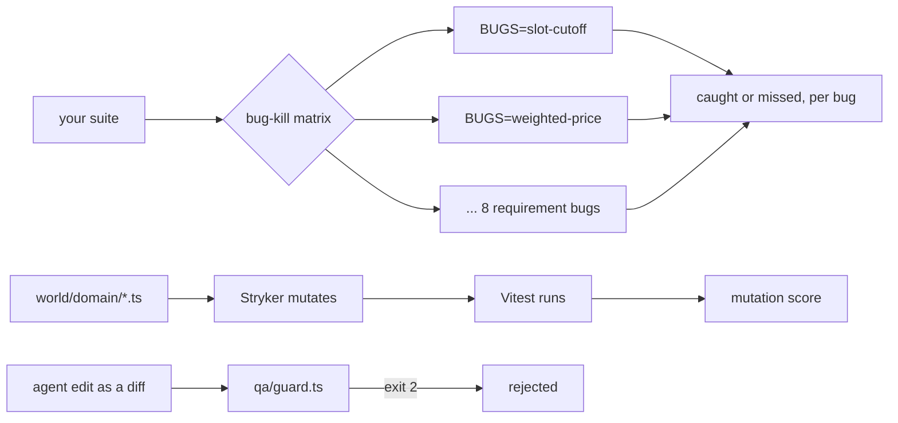

# Part 2: Prove the tests catch bugs

This part moves the transformation: from "all green" to "catches 7 of 8 planted bugs".

## The problem

Every test is green. That proves the tests run, not that they would catch anything. The mutate-test kata puts it
plainly: passing tests and high coverage can give "a false sense of security"
([vmzakharov/mutate-test-kata](https://raw.githubusercontent.com/vmzakharov/mutate-test-kata/master/README.md)).
With agent-written tests the gap is wider, because nobody wrote them with a bug in mind.

For example, a basket test can check that the total is shown, and never check the number. It stays green when
`BUGS=weighted-price` makes bananas cost too much.

## Why it matters

Meta built ACH, which writes mutants (small planted faults) first and then tests that kill them
([Meta engineering](https://engineering.fb.com/2025/02/05/security/revolutionizing-software-testing-llm-powered-bug-catchers-meta-ach/)).
Google runs mutation testing on changed code during code review
([Google research](https://research.google/pubs/practical-mutation-testing-at-scale-a-view-from-google/)).

TODO(part session): open both pages, and cite the number each one publishes (Meta: mutants and tests accepted;
Google: changes analysed and share of mutants developers found useful). The spine session could not load them,
so no number is quoted here yet.



In every step you type prompts and review. Claude Code makes each file below. The check reads what it made.

| Step                  | Minutes | Claude Code makes                                                                        | The check reads                                                                                            |
| --------------------- | ------- | ---------------------------------------------------------------------------------------- | ---------------------------------------------------------------------------------------------------------- |
| catch-the-seeded-bugs | 20      | more or better tests in `tests/`                                                         | the bug-kill matrix over the 8 requirement bugs: at least 7 caught, fixed build green                      |
| kill-the-mutants      | 25      | `world/domain` unit tests (Vitest) and `stryker.config.json` with `thresholds.break: 70` | Stryker's JSON report: score at least 70 on slots, basket and substitutions; each test file kills a mutant |
| guard-the-assertions  | 15      | `qa/guard.ts`: a diff on stdin, exit 0 to accept, exit 2 to reject                       | 8 planted diffs: the 5 that weaken a test rejected, the 3 safe ones accepted                               |

## Walkthrough

TODO(part session): the commands for each step, each followed by its Expect line.

```bash
bun run verify part prove-the-tests-catch-bugs
```

Expect: TODO(part session): `Part prove-the-tests-catch-bugs is done: 3/3 steps pass.`
