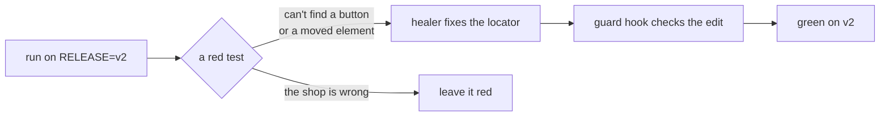
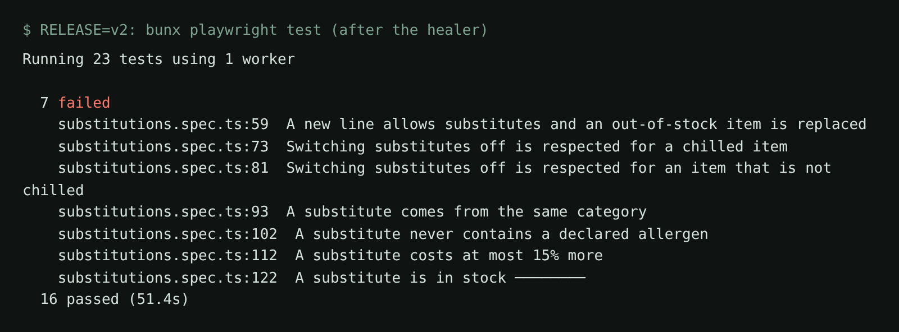

# Heal a renamed button

## The problem

Release v2 of Pantry Run renames "Book slot" to "Reserve". It also moves the slot picker into a dialog, behind a
"Choose a delivery time" button. Shoppers notice nothing, but 15 of your 23 tests go red.

For example, "Peak slots cost $4.99 and others $2.99" fails on v2. The price is right, but the slot list now sits
in a closed dialog.

A **healer** agent fixes tests like this. But some red tests are red for a real reason, and healing those hides a
bug. Heal the first kind, and leave the second kind red.



## Your challenge

Get Claude Code's healer to fix every test that broke only because something moved or was renamed. The Part 2
guard hook is already on.

Start the shop on release v2, and leave it running:

```bash
RELEASE=v2 bun run shop
```

Expect: `Pantry Run ready on http://localhost:4173 (bugs: none, release v2)`

In this folder, add Playwright's agents, then start Claude Code:

```bash
bunx playwright init-agents --loop=claude
claude
```

Expect: `.claude/agents/` and `.mcp.json` appear, then Claude Code opens. Allow the `playwright-test` MCP server.

Give it the job:

```text
Release v2 of Pantry Run is running on http://localhost:4173. Run bunx playwright test: many tests now fail.
Use the playwright-test-healer agent to fix them.
Rules for every fix:
- change only how a test finds things on the page: a locator, a renamed button, opening the dialog the slot picker now sits in;
- never change an expected value, never remove an expect, never add test.skip or test.fixme;
- if a test fails because the shop itself is wrong, leave it failing and tell me which requirement it breaks.
A guard hook checks every edit to a test. If it blocks an edit, do not work around it: tell me why it blocked.
At the end, run bunx playwright test and list which tests still fail and why.
```

Read each fix before you approve it. A good fix clicks "Choose a delivery time", or changes "Book slot"
to "Reserve". Reject any fix that changes what a test expects.



The 7 tests still red are in `substitutions.spec.ts`. They are red for a real reason: the next step.

## Done when

- Every test outside `substitutions.spec.ts` passes on release v2.
- Every test is still there, with every expect and every expected value.
- No test is marked `test.skip` or `test.fixme`, and no locator uses CSS or XPath.
- The guard hook is still in `.claude/settings.json`.

```bash
bun run verify heal-a-renamed-button
```

Expect: `Done. All 5 rules pass.`

## If you get stuck

| What you see                   | Fix                                                                           |
| ------------------------------ | ----------------------------------------------------------------------------- |
| `still red on v2: ...`         | Run that test alone. A timeout on `locator.check` means the dialog is closed. |
| `an expected value changed`    | The healer changed what a test expects. Undo that edit.                       |
| The healer's own run times out | Ask it to run one test file at a time.                                        |

## Words you will use

- **Heal**: fix a test that broke because the page changed, not because the rule broke.
- **Locator**: how a test finds an element, like `getByRole("button", { name: "Reserve" })`.
- **Release v2**: the next shop version, `RELEASE=v2`.
