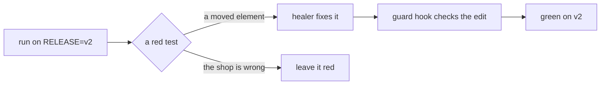
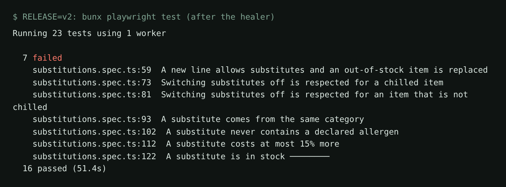

# Heal a renamed button

## The problem

The new release of Pantry Run renames "Book slot" to "Reserve". It also moves the slot picker into a dialog. Shoppers notice nothing, but 15 of your 23 tests go red. A **healer** agent fixes tests like this. Some red tests are red for a real reason. Heal the first kind and leave the second red.



## Watch it done

The slot picker now sits behind a "Choose a delivery time" button. For example, "Peak slots cost $4.99 and others $2.99" fails on the new release, because the slot list sits in a closed dialog.

## Your turn

Get Claude Code's healer to fix every test that broke only because something moved or was renamed. The guard hook is on.

Start the shop on the new release, and leave it running:

```bash
RELEASE=v2 bun run shop
```

Expect: `Pantry Run ready on http://localhost:4173 (bugs: none, release v2)`

In this folder, add Playwright's agents, then start Claude Code:

```bash
bunx playwright init-agents --loop=claude
claude
```

Expect: Claude Code opens. Allow the `playwright-test` MCP server.

Give it the job:

```text
Release v2 of Pantry Run is running on http://localhost:4173. Run bunx playwright test: many tests now fail.
Use the playwright-test-healer agent to fix them.
Rules for every fix:
- change only how a test finds things on the page: a locator, a renamed button, opening the dialog the slot picker now sits in;
- never change an expected value, never remove an expect, never add test.skip or test.fixme;
- if a test fails because the shop itself is wrong, leave it failing and tell me which requirement it breaks.
A guard hook checks every edit to a test. If it blocks an edit, do not work around it: tell me why it blocked.
At the end, run bunx playwright test and list which tests still fail and why.
```

A good fix clicks "Choose a delivery time" or changes "Book slot" to "Reserve". Reject any fix that changes what a test expects.



## Do it on your work

Ask Claude Code for a locator fix only, for one test a page change broke.

## Done when

- Every test outside `substitutions.spec.ts` passes on the new release.
- Every test is still there, with every expect and every expected value.
- No test is marked `test.skip` or `test.fixme`, and no locator uses CSS or XPath.
- The guard hook is still in `.claude/settings.json`.

Run the check from the repo root:

```bash
bun run verify heal-a-renamed-button
```

Expect: `Done. All 5 rules pass.`

## Solution

The finished answer is in `solution/`. Read it after you pass, not before.

## If you get stuck

| What you see                   | Fix                                                                           |
| ------------------------------ | ----------------------------------------------------------------------------- |
| `still red on v2: ...`         | Run that test alone. A timeout on `locator.check` means the dialog is closed. |
| An expected value changed      | The healer changed what a test expects. Undo that edit.                       |
| The healer's own run times out | Ask it to run one test file at a time.                                        |

## Words you will use

- **Heal**: fix a test that broke because the page changed, not because the rule broke.
- **Locator**: how a test finds an element.
