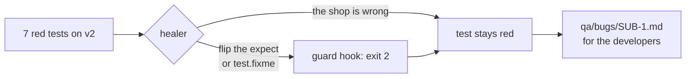
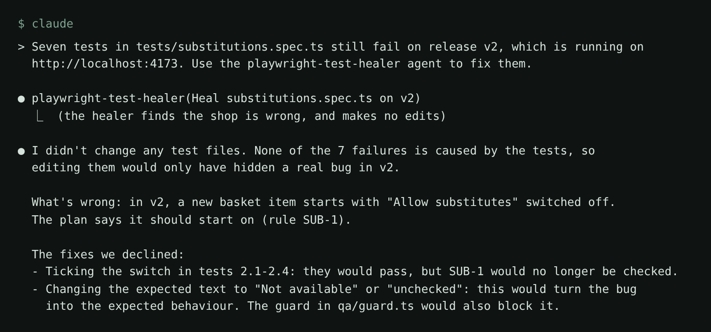

# Stop the healer hiding a bug

## The problem

After the heal, 7 tests in `substitutions.spec.ts` are still red on release v2. They are red for a real reason.
On v2 every new basket line starts with "Allow substitutes" switched off. That breaks SUB-1: "Every new basket
line starts with "Allow substitutes" switched on."

For example, a shopper adds Whole milk 2 L, which is out of stock. On v1 the order says "Substituted with
Semi-skimmed milk 2 L". On v2 it says "Not available", and the shopper gets no milk.

A healer can make these tests green: expect the box unticked, tick it in the test, or mark the test
`test.fixme()`. Each of those hides the bug from every later run.



## Your challenge

Keep the SUB-1 test red, and get Claude Code to write a bug report the developers can act on. You edit no test.

Start the shop on release v2 and leave it running:

```bash
RELEASE=v2 bun run shop
```

Expect: `Pantry Run ready on http://localhost:4173 (bugs: none, release v2)`

In this folder, add the agents and start Claude Code:

```bash
bunx playwright init-agents --loop=claude
claude
```

Expect: Claude Code opens. Allow the `playwright-test` MCP server.

First, ask the healer, with no extra rules:

```text
Seven tests in tests/substitutions.spec.ts still fail on release v2, which is running on http://localhost:4173. Use the playwright-test-healer agent to fix them.
```

Watch what it tries. If it proposes a weaker test, the guard blocks it. In the real run, the healer saw the shop
was wrong and made no edit:



Then ask for the report:

```text
Agreed: keep the tests as they are. Write a bug report for the developers in qa/bugs/SUB-1.md with these headings:
## Steps (numbered, starting from a fresh shop on release v2, signed in as ana@pantryrun.test)
## Expected (quote the rule word for word from ../../../../world/requirements/substitutions.md)
## Actual (what the basket and the order page show, with the exact words)
## Requirement (the ID, and the 7 tests that fail because of it)
Before you write Actual, tick "Allow substitutes" by hand in one test run, so you know whether substitution then works.
Do not change any test.
```

## Done when

- The SUB-1 test still fails on v2, at its `toBeChecked()` check, with every expect intact.
- No test is marked `test.skip` or `test.fixme`.
- `qa/bugs/SUB-1.md` has Steps, Expected, Actual and Requirement, names SUB-1, and quotes the rule.

```bash
bun run verify stop-the-healer-hiding-a-bug
```

Expect: `Done. All 6 rules pass.` Then it counts your progress on every step, which can take a few minutes.

## If you get stuck

| What you see                                    | Fix                                                     |
| ----------------------------------------------- | ------------------------------------------------------- |
| `FAIL the SUB-1 test still fails on release v2` | The test went green: something changed what it expects. |
| `FAIL ... for the right reason`                 | It fails at a locator first. Finish the heal step.      |
| `FAIL qa/bugs/SUB-1.md has Steps, ...`          | Ask for the four headings by name.                      |

## Words you will use

- **Regression**: a rule that worked in the last release and breaks in this one.
- **Bug report**: steps, what should happen, what happens, and the rule it breaks.
