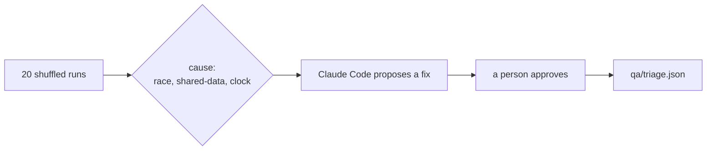
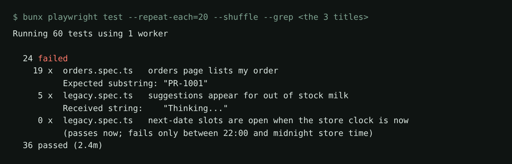

# Triage the flaky tests

## The problem

The 25 legacy tests in `tests/` are sometimes red, and a rerun is green. Nobody trusts a red run now, so a real
bug can hide. A **flaky test** passes and fails on the same code. For example, "orders page lists my order"
passes only when "place an order" runs just before it.

Three tests here are flaky, each for a different reason. Retries would hide them, not fix them.



## Your challenge

Get Claude Code to find the three flaky tests, name each cause, and fix them after you approve. Start the
shop (release v1) and leave it running:

```bash
bun run shop
```

Expect: `Pantry Run ready on http://localhost:4173 (bugs: none)`

Start Claude Code in this folder:

```bash
claude
```

Expect: Claude Code opens. Ask for a diagnosis first, and no changes:

```text
The legacy suite in tests/ fails now and then, and nobody trusts a red run any more.
Find the flaky tests. Run bunx playwright test --repeat-each=20 --shuffle, and run single tests with --grep.
For each flaky test, find the cause. Use one of these words: race (the test does not wait for what it checks), shared-data (it needs another test to run first), or clock (it depends on the real time of day). Some causes do not show up in every run, so read each test too.
For each one, show me the cause, the evidence and the fix you propose. Do not change any file yet.
```

This is what 20 shuffled runs of the three tests look like before the fix (a summary of a real run):



In the real run, Claude Code proposed `21:59:00-06:00` for the clock test. On March 10
that is 22:59 in Larkford, after the cutoff. Then approve, with your own name:

```text
Approved, with one change. For the clock test, 2026-03-10T21:59:00-06:00 is 22:59 in Larkford: on March 10 the store is on daylight time, -05:00. Use the shop's own seeded time instead, 2026-03-10T15:00:00-05:00.
Apply the three fixes. Rules: no retries, no waitForTimeout, no removed expect, and keep each test's title.
Then write qa/triage.json: an array with one entry per flaky test, { "test", "cause", "evidence", "fix", "approvedBy" }. "test" is the exact test title, "cause" is race, shared-data or clock, and "approvedBy" is "<your name>".
Prove it: run bunx playwright test --repeat-each=20 --shuffle --grep on the three titles, and show me the result.
```

## Done when

- The 3 tests keep their expects and pass 20 shuffled runs, with no retries, sleeps or real time.
- `qa/triage.json` gives each the right cause and a person in `approvedBy`.

```bash
bun run verify triage-the-flaky-tests
```

Expect: `Done. All 8 rules pass.`

## If you get stuck

| What you see                                   | Fix                                                                            |
| ---------------------------------------------- | ------------------------------------------------------------------------------ |
| `FAIL each flaky test passes 20 shuffled runs` | One test still depends on time or order. Run it alone with `--repeat-each=20`. |
| `FAIL no retries were added`                   | Take retries out of `playwright.config.ts`.                                    |
| `FAIL every fix was approved by a person`      | Use your own name. An agent cannot approve its own fix.                        |

## Words you will use

- **Flaky test**: a test that passes and fails on the same code.
- **Race**: the test checks before the page is ready.
- **Shared data**: the test needs another test to run first.
