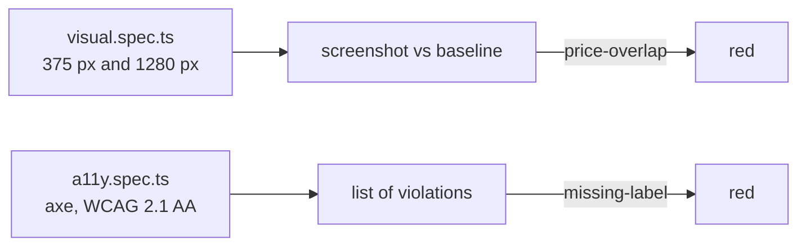
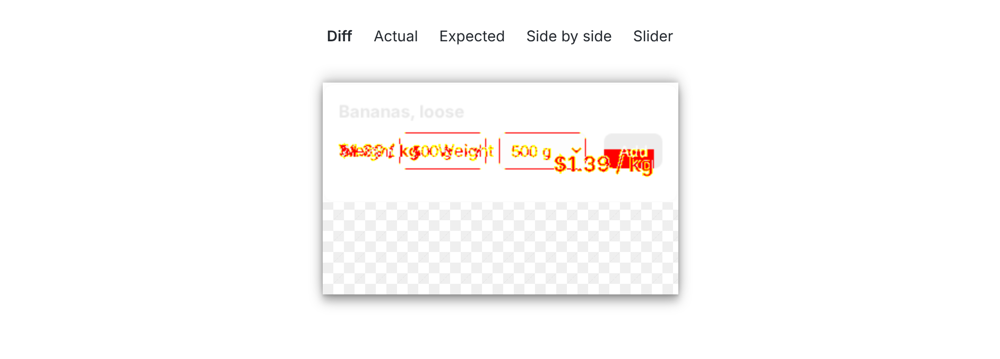

# Check looks and access

## The problem

Some bugs break no number. On a 375 px phone, a price can sit on top of its Add button. And a screen reader
can find slot radios with no name, so a blind shopper cannot pick a delivery time.

For example, with `BUGS=price-overlap` every functional test stays green. The total is right. The card just looks
broken on a phone.

Two kinds of test catch this. A **visual test** saves a screenshot and compares each run with it. An
**accessibility test** runs axe, a tool that checks the page against the WCAG rules for people with
disabilities.



## Your challenge

Get Claude Code to write `tests/visual.spec.ts` and `tests/a11y.spec.ts`. You write no test. Start the shop with
`bun run shop`, then start Claude Code in this folder:

```bash
claude
```

Expect: Claude Code opens in this folder. Give it the job:

```text
Pantry Run is running on http://localhost:4173. tests/seed.spec.ts shows how to reset the data and sign in.
Write two new test files:
1. tests/visual.spec.ts: toHaveScreenshot of the "Bananas, loose" product card and of the slot picker on /slots, each at 375 px and at 1280 px wide. Reset the shop data before each test.
2. tests/a11y.spec.ts: use @axe-core/playwright with the tags wcag2a, wcag2aa, wcag21a and wcag21aa on the shop page and on the slot picker, and expect no violations. Share the AxeBuilder setup through a makeAxeBuilder fixture, as the Playwright accessibility docs show.
Do not turn any axe rule off. If you ever must, add a comment that names the ticket.
Run bunx playwright test tests/visual.spec.ts --update-snapshots to make the baselines, then run both files twice more to show they are stable.
```

Then prove each test catches its bug. Stop the shop, and start it with the first bug on:

```bash
BUGS=price-overlap bun run shop
```

Expect: `Pantry Run ready on http://localhost:4173 (bugs: price-overlap)`

Run `bunx playwright test tests/visual.spec.ts` and open the report. The diff shows the price on the button:



Do the same with `BUGS=missing-label` and `tests/a11y.spec.ts`. Axe lists a violation.

Saved screenshots differ a little from one machine to the next. To share baselines with a team, make them in
Playwright's container, `mcr.microsoft.com/playwright:v1.65.0-noble`. The check makes its own fresh baselines,
so it works on any machine.

## Done when

- The visual test uses `toHaveScreenshot` at 375 px, passes on the fixed build, and fails on `price-overlap`.
- The accessibility test runs axe with the WCAG 2.1 AA tags, passes on the fixed build, and fails on
  `missing-label`.
- Any axe rule turned off has a comment that names a ticket.

```bash
bun run verify check-looks-and-access
```

Expect: `Done. All 7 rules pass.`

## If you get stuck

| What you see                                            | Fix                                                           |
| ------------------------------------------------------- | ------------------------------------------------------------- |
| `FAIL ... goes red when a price sits on its Add button` | The bug shows only on a phone. Screenshot the card at 375 px. |
| `FAIL ... goes red when the slot radios have no name`   | Scan `/slots` signed in, and keep the `label` rule on.        |
| The visual test fails on the fixed build                | Reset the shop data before each test.                         |

## Words you will use

- **Baseline**: the saved screenshot a visual test compares with.
- **Axe**: a tool that lists accessibility problems on a page.
- **WCAG 2.1 AA**: the usual accessibility rules.
