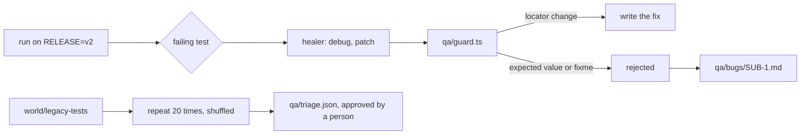

# Part 3: Keep the suite healthy

This part moves the outcome: a suite that stays honest when Claude Code heals it.

## The problem

Release v2 renames buttons and moves the slot picker into a dialog. Forty tests go red while shoppers notice
nothing. The healer agent can fix them. But its prompt also tells it to work on "Fixing assertions and expected
values". When it is stuck, it marks a test `test.fixme()`, so the test is skipped
([healer prompt, microsoft/playwright](https://raw.githubusercontent.com/microsoft/playwright/main/packages/playwright/src/agents/playwright-test-healer.agent.md)).

Release v2 also ships one real regression (SUB-1). A healer that "fixes" that test hides the bug. For example, on v2 a
new basket line starts with "Allow substitutes" off. The healer changes the test to expect the box off, and the
test goes green.

Meanwhile three tests in the legacy suite fail one run in a few. Nobody trusts a red run any more.

## Why it matters

Slack detects flaky tests from their history and suppresses them with an owner assigned
([Slack engineering](https://slack.engineering/handling-flaky-tests-at-scale-auto-detection-suppression)).

TODO(part session): open the Slack post and cite its before and after test job failure rates. The spine session
could not load it, so no number is quoted here yet. Kong's flaky-test agents
(konghq.com engineering blog) and Google's Auto-Diagnose paper are candidates for the triage step; open each before
using a number.



In every step you type prompts and review. Claude Code makes each file below. The check reads what it made.

| Step                         | Minutes | Claude Code makes                                    | The check reads                                                                                                                                              |
| ---------------------------- | ------- | ---------------------------------------------------- | ------------------------------------------------------------------------------------------------------------------------------------------------------------ |
| heal-a-renamed-button        | 15      | healed tests                                         | the suite on `RELEASE=v2`: locator-only failures now pass, the diff touches only locators, assertion count per file the same or higher, no `fixme` or `skip` |
| stop-the-healer-hiding-a-bug | 10      | the SUB-1 test still failing, and `qa/bugs/SUB-1.md` | the SUB-1 test fails on v2 and still asserts substitutes are allowed; the bug report has Steps, Expected, Actual, Requirement                                |
| triage-the-flaky-tests       | 20      | `qa/triage.json` and the fixes                       | `--repeat-each=20 --shuffle` on the 3 flaky legacy tests: 0 failures; causes match the planted ones (race, shared-data, clock); every entry has `approvedBy` |
| check-looks-and-access       | 15      | `tests/visual.spec.ts` and `tests/a11y.spec.ts`      | green on the fixed build, red on `price-overlap` and on `missing-label`                                                                                      |

## Walkthrough

TODO(part session): the commands for each step, each followed by its Expect line.

```bash
RELEASE=v2 bun run shop
```

Expect: `Pantry Run ready on http://localhost:4173 (bugs: none, release v2)`

```bash
bun run verify part keep-the-suite-healthy
```

Expect: TODO(part session): `Part keep-the-suite-healthy is done: 4/4 steps pass.`
