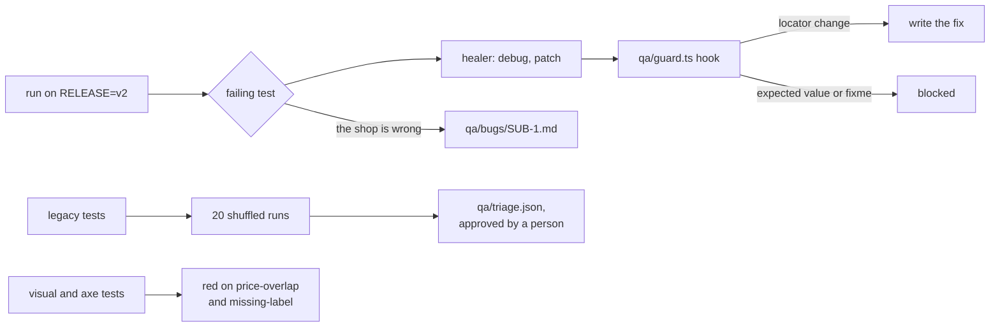

# Part 3: Keep the suite healthy

This part moves the outcome: a suite that stays honest when Claude Code heals it, and that the team trusts again.

## The problem

Release v2 of Pantry Run renames "Book slot" to "Reserve" and moves the slot picker into a dialog. 15 of your 23
tests go red, and shoppers notice nothing. A healer agent can fix those tests in minutes.

But release v2 also ships one real regression. For example, on v2 a new basket line starts with "Allow
substitutes" switched off. That breaks SUB-1. A healer that "fixes" that test, by expecting the box unticked,
hides the bug from every later run.

Meanwhile three old tests fail now and then. Once a red run means "just run it again", a real bug can hide in
plain sight.

## Why it matters

The healer is allowed to weaken tests. Its prompt lists "Fixing assertions and expected values" as a job. When it
is stuck, it may "mark this test as test.fixme()"
([healer prompt, microsoft/playwright](https://raw.githubusercontent.com/microsoft/playwright/main/packages/playwright/src/agents/playwright-test-healer.agent.md)).

And Playwright's own docs name the trap of retries. A "flaky" test is one that "failed on the first run, but
passed when retried"
([Playwright test retries](https://raw.githubusercontent.com/microsoft/playwright/main/docs/src/test-retries-js.md)).
A retry turns it green without fixing anything.

So the numbers this part moves are all yours, computed by the checks:

| Number                                  | Before | After this part      |
| --------------------------------------- | ------ | -------------------- |
| Tests red on v2 for a moved button      | 8      | 0                    |
| Tests red on v2 for the real SUB-1 bug  | 7      | 7, with a bug report |
| Failures in 60 shuffled runs of 3 tests | 24     | 0                    |
| Looks and access bugs caught            | 0 of 2 | 2 of 2               |



In every step you type prompts and review. Claude Code makes each file below. The check reads what it made.

| Step                                                                              | Minutes | Claude Code makes                                | The check reads                                                                                        |
| --------------------------------------------------------------------------------- | ------- | ------------------------------------------------ | ------------------------------------------------------------------------------------------------------ |
| [heal-a-renamed-button](01-heal-a-renamed-button/problem/README.md)               | 15      | healed tests                                     | the suite on `RELEASE=v2`: green outside `substitutions.spec.ts`; every expect and value kept; no skip |
| [stop-the-healer-hiding-a-bug](02-stop-the-healer-hiding-a-bug/problem/README.md) | 10      | the SUB-1 test still red, and `qa/bugs/SUB-1.md` | the SUB-1 test fails on v2 at `toBeChecked`; the report has Steps, Expected, Actual, Requirement       |
| [triage-the-flaky-tests](03-triage-the-flaky-tests/problem/README.md)             | 20      | the fixes and `qa/triage.json`                   | 20 shuffled runs of each flaky test: 0 failures, no retries or sleeps; right causes; a person approved |
| [check-looks-and-access](04-check-looks-and-access/problem/README.md)             | 15      | `tests/visual.spec.ts` and `tests/a11y.spec.ts`  | fresh baselines, then green on the fixed build, red on `price-overlap` and on `missing-label`          |

Total: 60 minutes. Each step's folder is self-contained: work in its `problem/` folder. The first two steps start
with the Part 2 guard hook already on.

Every sample solution here is a real Claude Code run. The recordings are in `recordings/`, and
`recordings/RECORD.md` says how to make them again.

## Walkthrough

The first two steps need the shop on release v2. Start it in one terminal and leave it running:

```bash
RELEASE=v2 bun run shop
```

Expect: `Pantry Run ready on http://localhost:4173 (bugs: none, release v2)`

In `01-heal-a-renamed-button/problem/`, add Playwright's agents and open Claude Code:

```bash
bunx playwright init-agents --loop=claude
claude
```

Expect: `.claude/agents/` and `.mcp.json` appear, then Claude Code opens. Give it the healer prompt from the step
README. Do the same in `02-stop-the-healer-hiding-a-bug/problem/`. Then check both from the repo root:

```bash
bun run verify heal-a-renamed-button
bun run verify stop-the-healer-hiding-a-bug
```

Expect: `Done. All 5 rules pass.` and `Done. All 6 rules pass.`

The last two steps need release v1. Stop the shop and start it again:

```bash
bun run shop
```

Expect: `Pantry Run ready on http://localhost:4173 (bugs: none)`

In `03-triage-the-flaky-tests/problem/`, see the flakes for yourself before Claude Code fixes them:

```bash
bunx playwright test --repeat-each=20 --shuffle --grep "suggestions appear|orders page lists|store clock is now"
```

Expect: some of the 60 runs fail, most of them `orders page lists my order`. After the fixes, the same
command prints `60 passed`.

Give Claude Code the prompts in each step README, then check from the repo root:

```bash
bun run verify triage-the-flaky-tests
bun run verify check-looks-and-access
```

Expect: `Done. All 8 rules pass.` and `Done. All 7 rules pass.`

When all four pass, the whole part passes:

```bash
bun run verify part keep-the-suite-healthy
```

Expect: `Part keep-the-suite-healthy is done: 4/4 steps pass.`

## Assignment

**Problem:** healing can hide a real regression, and flaky tests teach the team to ignore red runs.

**Hand in:** the four `problem/` folders as Claude Code left them: the healed tests, `qa/bugs/SUB-1.md`,
`qa/triage.json` with the fixes, and the visual and accessibility tests.

**Rubric (each line is yes or no):**

1. `bun run verify part keep-the-suite-healthy` prints `4/4 steps pass`.
2. `diff -r` of the healed tests against the start shows no changed `expect` line.
3. The SUB-1 bug report quotes the rule word for word and lists every test it breaks.
4. Every `approvedBy` in `qa/triage.json` is a person's name.

**Extension:** wire the Part 2 guard as a hook in a second coding agent you use. Show the same edit, `$1.04` to
`$1.05`, blocked there too.

## Recap

You can now let an agent heal a suite without letting it lie. The guard stops weakening edits. A red test that is
right becomes a bug report, not a `fixme`. Flaky tests get a cause, a fix and a person's sign-off. Part 4 tests
what no screen shows: the order API, bugs nobody wrote down, and the AI suggester.
