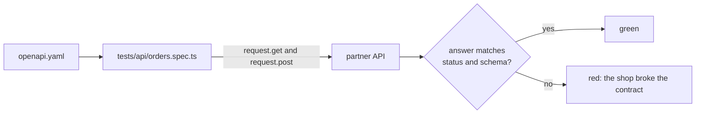
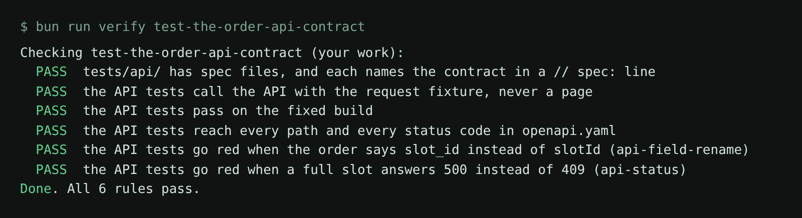

# Test the order API contract

## The problem

Partner apps place Pantry Run orders without a browser. They call the partner API, and they trust
`world/openapi.yaml`. That file is the contract: it lists every path, every status code and the shape of every
answer.

A partner app breaks when the shop drifts from the contract. For example, the contract says an order has
`slotId`. If the shop sends `slot_id`, a partner app reads no slot. And a full slot must answer `409`.



## Your challenge

Get Claude Code to write API tests for every path and every status code in the contract. You write no test
code. You read the plan, and you reject a test that copies what the shop does instead of what the contract says.

The `CLAUDE.md` in this folder already tells Claude Code where the contract is and how to call the API. Start
Claude Code in this folder:

```bash
claude
```

Expect: Claude Code opens in this folder and reads `CLAUDE.md`.

Then type this prompt:

```text
Read the contract in ../../../../world/openapi.yaml. Plan one API test for every path and
every status code it lists. Then write them in tests/api/orders.spec.ts with the request
fixture. Check every order body with a strict zod schema made from the Order in the contract,
so an extra or renamed field fails. Use slot 2026-03-11T18, which is full, for the 409.
Show me the plan first: one line per path and status code.
```

Read the plan. It should have 12 lines. Say no if a line expects `500`, or if the plan only checks status codes.

Then run the tests:

```bash
bunx playwright test tests/api
```

Expect: `12 passed`

Prove the tests catch the API bugs. Start the shop with one bug on, and run the tests again:

```bash
BUGS=api-field-rename bun run shop
```

Expect: `Pantry Run ready on http://localhost:4173 (bugs: api-field-rename)`

The order tests should now go red. Stop the shop and do the same with `BUGS=api-status`.

## Done when

- Every file in `tests/api/` starts with `// spec: world/openapi.yaml` and uses only the `request` fixture.
- The tests pass on the fixed build and reach all 12 path and status pairs in the contract.
- The tests go red on `api-field-rename` and on `api-status`.

Ask Claude Code:

```text
Run `bun run verify test-the-order-api-contract` from the repo root and tell me what it printed. Do not change anything to make it pass.
```

Or run it yourself:

```bash
bun run verify test-the-order-api-contract
```

Expect: `Done. All 6 rules pass.`



## If you get stuck

| What you see                                 | Fix                                                                                  |
| -------------------------------------------- | ------------------------------------------------------------------------------------ |
| `Not reached yet: POST /api/orders 404`      | Ask Claude Code for an order to a slot that does not exist, such as `2026-04-30T09`. |
| `FAIL ... api-field-rename`                  | The tests read the status but not the body. Ask for a strict schema on every order.  |
| `FAIL the API tests pass on the fixed build` | A test expects what a buggy shop did. The contract wins. Ask Claude Code to fix it.  |

## Words you will use

- **Contract**: a file that says what an API promises. Here it is `openapi.yaml`.
- **Schema**: the shape of an answer: which fields, and of which type.
- **Strict schema**: a schema that also fails on a field it does not name, such as `slot_id`.
