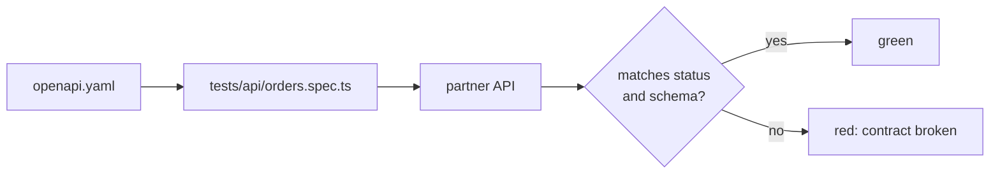
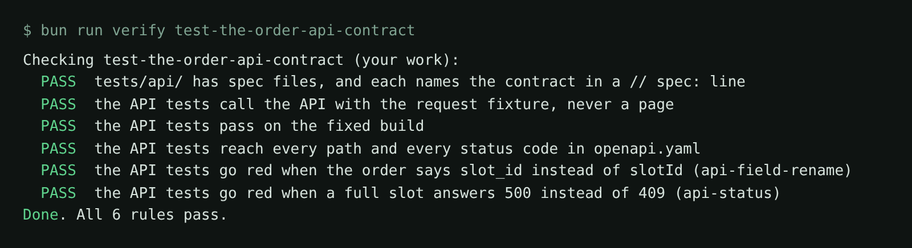

# Test the order API contract

## The problem

Partner apps order without a browser. They trust `world/openapi.yaml`, the contract for every path and status code. A partner app breaks when the shop drifts from it. For example, a shop that sends `slot_id` instead of `slotId` leaves the partner app with no slot.



## Watch it done

Claude Code plans one test for each path and status code. A full slot must answer `409`.

## Your turn

Get Claude Code to write API tests for every path and status code in the contract. You write no test code. Reject any test that copies what the shop does.

Start Claude Code in this folder:

```bash
claude
```

Expect: Claude Code opens and reads `CLAUDE.md`.

Then type this prompt:

```text
Read the contract in ../../../../world/openapi.yaml. Plan one API test for every path and
every status code it lists. Then write them in tests/api/orders.spec.ts with the request
fixture. Check every order body with a strict zod schema made from the Order in the contract,
so an extra or renamed field fails. Use slot 2026-03-11T18, which is full, for the 409.
Show me the plan first.
```

Read the plan. It should have 12 lines. Say no if a line expects `500`, or only checks status codes.

```bash
bunx playwright test tests/api
```

Expect: `12 passed`

Start the shop with one bug on, and run the tests again:

```bash
BUGS=api-field-rename bun run shop
```

Expect: `Pantry Run ready on http://localhost:4173 (bugs: api-field-rename)`

The order tests should now go red. Do the same with `BUGS=api-status`.

## Teach the repo in two files

Claude Code forgets between sessions. Run `/init` to write a short `CLAUDE.md`. Keep it under 200 lines, with a line on how to run the tests: `bunx playwright test`. Put API-only rules in `.claude/rules/api-tests.md`, starting with a `paths:` line for `tests/api/**`.

## Do it on your work

Ask Claude Code for a contract test for one API your team calls. Read the plan first.

## Done when

- Every file in `tests/api/` starts with `// spec: world/openapi.yaml` and uses only the `request` fixture.
- The tests pass on the fixed build and reach all 12 path and status pairs in the contract.
- The tests go red on `api-field-rename` and on `api-status`.
- `tests/mocked/` has a browser test that mocks a failed booking with `page.route` and passes. Steps: [the second half](MORE.md).
- `CLAUDE.md` is under 200 lines and says how to run the tests, and `.claude/rules/api-tests.md` loads only for `tests/api`.

Run the check from the repo root:

```bash
bun run verify test-the-order-api-contract
```

Expect: `Done. All 10 rules pass.`



## Solution

The finished answer is in `solution/`. Read it after you pass, not before.

## If you get stuck

| What you see                            | Fix                                                                                  |
| --------------------------------------- | ------------------------------------------------------------------------------------ |
| `Not reached yet: POST /api/orders 404` | Ask Claude Code for an order to a slot that does not exist, such as `2026-04-30T09`. |
| `FAIL ... api-field-rename`             | The tests read the status but not the body. Ask for a strict schema on every order.  |

## Words you will use

- **Mock**: a call your test answers itself, so a service can fail on purpose.
- **Contract**: a file that says what an API promises. Here it is `openapi.yaml`.
- **Strict schema**: a schema that also fails on a field it does not name, such as `slot_id`.
