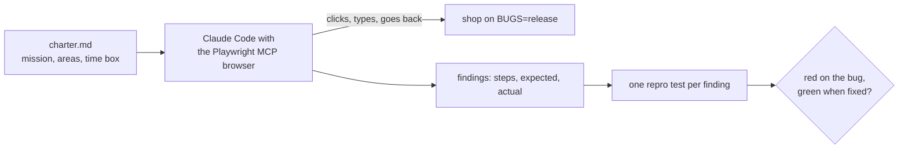
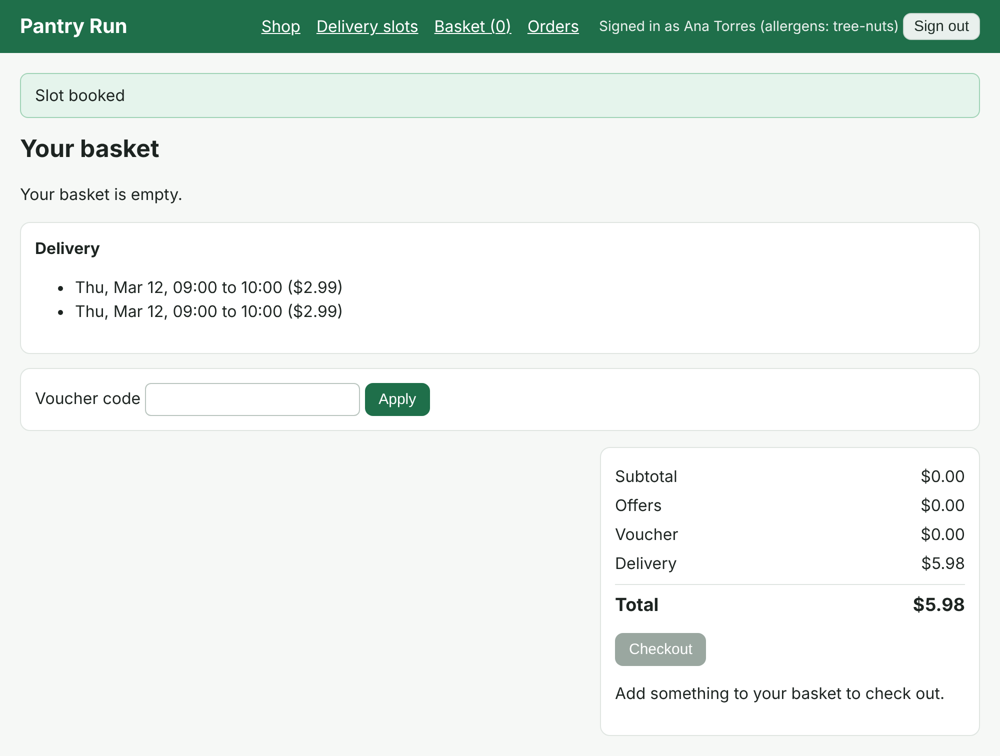

# Explore with an agent

## The problem

Planned tests only find what someone wrote down. The release candidate has three bugs that break no written
requirement. People find such bugs by exploring. For example, a shopper on a
slow phone taps "Book slot" twice. Does the shop book two slots and charge the $2.99 fee twice?



## Your challenge

Get Claude Code to write a charter, explore the release candidate in a real browser, and turn each finding
into a repro test. You type prompts and judge each finding. You write no test code.

This folder has a `.mcp.json` that gives Claude Code a browser through Playwright MCP. Start the release
candidate in one terminal:

```bash
BUGS=release bun run shop
```

Expect: `Pantry Run ready on http://localhost:4173 (bugs: 16 on)`

Start Claude Code here in a second terminal. Say yes to the `playwright` MCP server.

```bash
claude
```

Expect: Claude Code opens and lists the `playwright` MCP server as connected when you type `/mcp`.

Then type this prompt:

```text
Fill in qa/explore/charter.md: a Mission, the Areas to try and a Time box of 40 browser
actions. Aim at ways a shopper pays twice, pays the wrong amount or gets two orders:
double clicks, odd numbers in boxes, and the Back button. Show me the charter, then
explore the shop at http://localhost:4173 with the playwright browser. Report each finding
as steps, expected and actual. Do not write tests yet.
```

Read each finding: would a shopper or the shop lose money? Then ask for the repro tests:

```text
Write one repro test per finding in qa/explore/, as CLAUDE.md says. Each test checks what
should happen, so it fails on this shop and passes once the bug is fixed.
```

Each should go red on the release candidate:

```bash
bunx playwright test
```

Expect: each repro test fails, with the bug it describes in its error.

## Done when

- `qa/explore/charter.md` has a Mission, Areas and a Time box.
- Each repro test starts with `// finding:`, passes on the fixed build and goes red with its bug on.
- The repro tests find at least 2 of the 3 unwritten bugs.

Ask Claude Code:

```text
Run `bun run verify explore-with-an-agent` from the repo root and tell me what it printed. Do not change anything to make it pass.
```

Or run it yourself:

```bash
bun run verify explore-with-an-agent
```

Expect: `Done. All 5 rules pass.`

After a double click on Book slot, you should see two held slots:



## If you get stuck

| What you see                                      | Fix                                                                              |
| ------------------------------------------------- | -------------------------------------------------------------------------------- |
| `/mcp` shows `playwright` as failed               | Run `bun run setup` at the repo root, then restart Claude Code.                  |
| `FAIL every repro test passes on the fixed build` | The test expects what the bug did. Ask Claude Code to expect what should happen. |
| `Found 1 of 3`                                    | Explore again. Try a double click on Book slot, or Back after checkout.          |

## Words you will use

- **Charter**: one short page with a mission, areas and a time box.
- **Finding**: something odd you saw, written as steps, expected and actual.
- **Repro test**: a test that reproduces one finding. Red with the bug, green without it.
