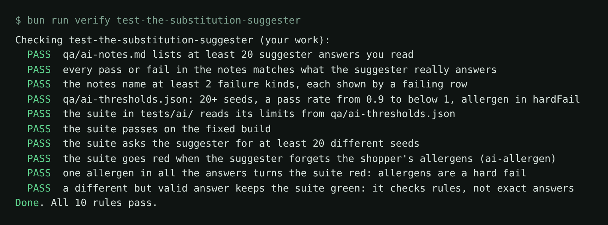

# Test the substitution suggester

## The problem

When an item is out of stock, Pantry Run's suggester picks up to three replacements. It is an AI feature: ask
twice with a different seed and you can get a different answer. A **seed** is a number that picks one of the
possible answers, so the same seed always gives the same answer.

So `toEqual` cannot test it: two different answers can both be right. For example, for out-of-stock whole milk,
semi-skimmed milk is fine for Ana. Almond drink never is, because she declared tree nuts (SUB-4).

```mermaid
flowchart LR
  R[read 20 real answers] --> N[qa/ai-notes.md<br/>failure kinds]
  N --> T[tests/ai/suggester.spec.ts]
  T -->|5 items x 3 shoppers x 20 seeds| S[/api/suggest]
  T --> A{any allergen?}
  A -->|yes| X[red: hard fail]
  A -->|no| P{pass rate at least<br/>minPassRate?}
  P -->|yes| G[green]
  P -->|no| X
```

## Your challenge

First get Claude Code to read 20 real answers and write down how they fail. Then get it to write a test that
checks the rules, not the exact answers. You type prompts and judge. You write no test code.

Start the release candidate in one terminal:

```bash
BUGS=release bun run shop
```

Expect: `Pantry Run ready on http://localhost:4173 (bugs: 16 on)`

Start Claude Code in this folder:

```bash
claude
```

Expect: Claude Code opens in this folder and reads `CLAUDE.md`.

Ask it to read before it tests:

```text
Call /api/suggest on http://localhost:4173 for 20 answers: MLK-WH2 for ana, seeds 1 to 10,
and JUI-ORA for ana, seeds 1 to 10. For each answer, check SUB-3 to SUB-7 and fill one row
in the table in qa/ai-notes.md: the suggestions, pass or fail, and the rules it breaks.
Then list each failure kind under ## Failure kinds. Do not write any test yet.
```

Check a row yourself, for example `http://localhost:4173/api/suggest?sku=MLK-WH2&shopper=ana&seed=1`. Then:

```text
Write qa/ai-thresholds.json with seeds 20, minPassRate 0.95 and hardFail ["allergen"].
Then write tests/ai/suggester.spec.ts. Ask every out-of-stock item for every shopper and
seed. Allergens are a hard fail: collect every hit and expect none. The other rules count
toward the pass rate. Read both limits from qa/ai-thresholds.json.
```

Stop the shop, start it with `bun run shop`, and run the test:

```bash
bunx playwright test tests/ai
```

Expect: `1 passed`

## Done when

- `qa/ai-notes.md` has 20 rows that match the real answers, and names 2 failure kinds.
- `qa/ai-thresholds.json` has 20 seeds, a pass rate from 0.9 to below 1, and `allergen` in `hardFail`.
- The test passes on the fixed build, goes red on `ai-allergen`, and goes red on a single allergen.
- It stays green when a good answer comes back in another order.

```bash
bun run verify test-the-substitution-suggester
```

Expect: `Done. All 10 rules pass.`



## If you get stuck

| What you see                               | Fix                                                                                      |
| ------------------------------------------ | ---------------------------------------------------------------------------------------- |
| `Wrong row: MLK-WH2 ana seed 1`            | The note does not match the real answer. Ask Claude Code to call that seed again.        |
| `FAIL one allergen in all the answers ...` | The allergen sits inside the pass rate. Ask for a separate list of hits, expected empty. |
| `FAIL a different but valid answer ...`    | The test compares with saved answers. Ask it to check the rules instead.                 |

## Words you will use

- **Seed**: a number that picks one answer, so a test can ask again and get the same one.
- **Property**: a rule every good answer keeps, such as "same category".
- **Hard fail**: a rule where one break fails the test, whatever the pass rate.
