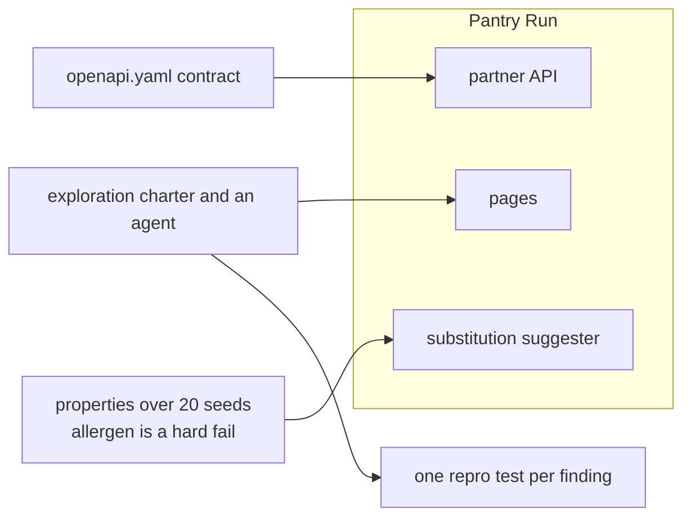

# Part 4: Test beyond the UI

This part moves the outcome: tests for the API, for unwritten bugs and for the AI feature.

## The problem

The shop's pages are one way in. Partner apps place orders through the API in `world/openapi.yaml`. Some bugs
break no written requirement at all, so no planned test will ever find them. And the substitution suggester
gives a different answer per seed, so `toEqual` cannot test it.

For example, for out-of-stock whole milk, one seed may suggest one milk and another seed a different milk. Both
can be fine. A substitute with an allergen the shopper declared, such as gluten, is never fine (SUB-4).

## Why it matters

Slack compared an agent driving Playwright MCP, an agent on the Playwright CLI, and AI-generated Playwright tests,
and kept deterministic tests in CI
([Slack engineering](https://slack.engineering/agentic-testing-where-agents-fit-in-the-e2e-testing-stack/)).
DoorDash tests its support bot with a simulator where a model plays the customer
([DoorDash engineering](https://careersatdoordash.com/?p=15635)).

TODO(part session): open both posts and cite the numbers they publish (Slack: how many runs; DoorDash: how many
simulated conversations and how fast). The spine session could not load them, so no number is quoted here yet.



In every step you type prompts and review. Claude Code makes each file below. The check reads what it made.

| Step                            | Minutes | Claude Code makes                                                                     | The check reads                                                                                                         |
| ------------------------------- | ------- | ------------------------------------------------------------------------------------ | ----------------------------------------------------------------------------------------------------------------------- |
| test-the-order-api-contract     | 20      | `tests/api/orders.spec.ts` with the `request` fixture and zod schemas                | green on the fixed build, red on `api-field-rename` and `api-status`, every path and status in `openapi.yaml` exercised |
| explore-with-an-agent           | 15      | `qa/explore/charter.md` and one repro test per finding                               | each repro fails on `BUGS=release` and passes with only its bug off; at least 2 of the 3 unwritten bugs found           |
| test-the-substitution-suggester | 25      | `tests/ai/suggester.spec.ts`, `qa/ai-thresholds.json`, notes from reading 20 outputs | at least 95% pass on the fixed build, red on `ai-allergen`, the allergen check a hard fail                              |

## Walkthrough

TODO(part session): the commands for each step, each followed by its Expect line.

```bash
bun run verify part test-beyond-the-ui
```

Expect: TODO(part session): `Part test-beyond-the-ui is done: 3/3 steps pass.`
