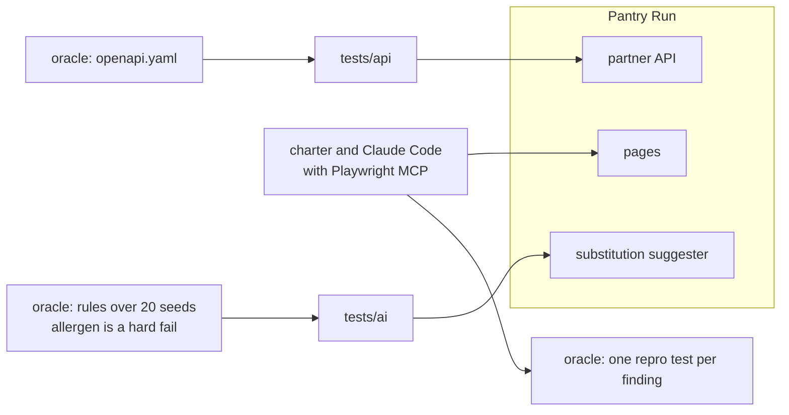

# Part 4: Test beyond the UI

This part moves the outcome: tests for the partner API, for bugs nobody wrote down, and for the AI feature.

## The problem

The shop's pages are one way in, but not the only one. Partner apps place orders through the API in
`world/openapi.yaml`. Some bugs break no written requirement at all, so no planned test will ever find them.
And the substitution suggester gives a different answer per seed, so `toEqual` cannot test it.

For example, for out-of-stock whole milk, seed 2 suggests semi-skimmed milk and oat drink. Both are fine for
Ana. On the release candidate, seed 1 also suggests almond drink. That is never fine for Ana, because she
declared tree nuts (SUB-4).

## Why it matters

Each way into the shop needs its own oracle. An **oracle** is the thing a test compares with to decide pass or
fail. Microsoft's Playwright team says the same about agents and browsers. Their Playwright MCP README says MCP
suits "exploratory automation, self-healing tests, or long-running autonomous workflows"
([microsoft/playwright-mcp README](https://raw.githubusercontent.com/microsoft/playwright-mcp/main/README.md)).
So in this part the agent explores, and deterministic tests hold what it found.



In every step you type prompts and review. Claude Code makes each file below. The check reads what it made.

| Step                                                                                    | Minutes | Claude Code makes                                                        | The check reads                                                                                             |
| --------------------------------------------------------------------------------------- | ------- | ------------------------------------------------------------------------ | ----------------------------------------------------------------------------------------------------------- |
| [test-the-order-api-contract](01-test-the-order-api-contract/problem/README.md)         | 20      | `tests/api/orders.spec.ts` with the `request` fixture and strict schemas | every call the tests make; green on the fixed build; red on `api-field-rename` and `api-status`             |
| [explore-with-an-agent](02-explore-with-an-agent/problem/README.md)                     | 15      | `qa/explore/charter.md` and one repro test per finding                   | each repro green on the fixed build and red with its bug on; at least 2 of the 3 unwritten bugs found       |
| [test-the-substitution-suggester](03-test-the-substitution-suggester/problem/README.md) | 25      | `qa/ai-notes.md`, `qa/ai-thresholds.json`, `tests/ai/suggester.spec.ts`  | notes against real answers; red on `ai-allergen` and on a single allergen; green on a reordered good answer |

Total: 60 minutes. Each step's folder is self-contained: work in its `problem/` folder.

## How the checks see your tests

The checks for the API and the suggester put a recording door between your tests and the shop. Your tests talk
to the door, and the door passes every call on. So the check sees every call your tests really make. For example,
it can tell that no test ever got a `404` from `GET /api/orders/{orderId}`.

For the suggester, the door can also bend an answer on its way back. It slips one allergen into one answer out of
300, or turns a good answer around. A strong test goes red on the first and stays green on the second.

## Walkthrough

Start the shop in one terminal and leave it running.

```bash
bun run shop
```

Expect: `Pantry Run ready on http://localhost:4173 (bugs: none)`

Then, for each step, work in its `problem/` folder with Claude Code and check it from the repo root. The
explore step and the first half of the suggester step use the release candidate,
`BUGS=release bun run shop`, as their READMEs say.

```bash
bun run verify test-the-order-api-contract
bun run verify explore-with-an-agent
bun run verify test-the-substitution-suggester
```

Expect: `Done.` on each step once its work is in place, and a `Progress:` line after each.

You can check any sample solution the same way. For example:

```bash
bun run verify test-the-order-api-contract solution
```

Expect: `Done. All 6 rules pass.`

When all three pass, the whole part passes.

```bash
bun run verify part test-beyond-the-ui
```

Expect: `Part test-beyond-the-ui is done: 3/3 steps pass.`

```text
Part test-beyond-the-ui:
  PASS   test-the-order-api-contract  (6/6 rules)
  PASS   explore-with-an-agent  (5/5 rules)
  PASS   test-the-substitution-suggester  (10/10 rules)
Part test-beyond-the-ui is done: 3/3 steps pass.
```

## Assignment

**Problem.** Some bugs are in no requirement, and the AI feature answers differently each run.

**Hand in** the three `problem/` folders: the API contract tests, the exploration charter and repro tests, and the
suggester notes, thresholds and test.

**Rubric.** Each line is yes or no.

1. Does `bun run verify test-the-order-api-contract` print `Done.`?
2. Does `bun run verify explore-with-an-agent` print `Found 2 of 3` or `Found 3 of 3`?
3. Does `bun run verify test-the-substitution-suggester` print `Done.`, with allergen in `hardFail`?
4. Does every repro test expect what should happen, not what the buggy shop did?

**Go further.** Run the same exploration once through Playwright MCP and once through the Playwright CLI, and
keep the token counts. Part 5 starts from that comparison. For judging AI answers with labels and judges, see the
Evals for Engineers course.

## Finished

You now have tests for three ways into Pantry Run. The API tests hold the shop to its contract. The repro tests
hold three bugs that no plan named. And the suggester test judges an AI feature by rules over 300 answers, with
one rule that can never bend.

Part 5 turns this into a team practice. You compare MCP and the CLI by measured tokens, and fuzz the API from
the schema. Then you count what agent runs cost, and build one pull request gate that reports the numbers.
