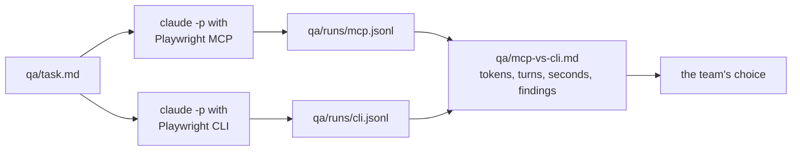
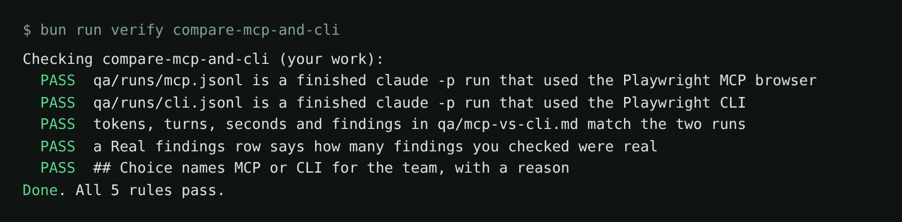

# Compare MCP and CLI

## The problem

Claude Code can drive a browser in two ways. **Playwright MCP** gives it browser tools that send a snapshot of
the page after each step. The **Playwright CLI** gives it short shell commands, such as `bunx playwright cli
click e21`. It saves snapshots to files that Claude Code reads only when it needs to.

Playwright's own README says the CLI is "more token-efficient". But your team pays for your shop, not theirs.
For example, an MCP run may use fewer turns and still read more tokens. Measure the same task both ways.



## Your challenge

Run the task in `qa/task.md` twice with `claude -p`, once per browser. Then get Claude Code to fill in the table
from the two runs. You judge which findings are real and write the choice. Start the release candidate first:

```bash
BUGS=release bun run shop
```

Expect: `Pantry Run ready on http://localhost:4173 (bugs: 16 on)`

In a second terminal, in this folder, make the folder for the runs and run the task with Playwright MCP only:

```bash
mkdir -p qa/runs
claude -p "$(cat qa/task.md) Use only the playwright MCP browser tools." --output-format stream-json --verbose --max-turns 40 --strict-mcp-config --mcp-config .mcp.json --allowedTools "mcp__playwright__*" < /dev/null > qa/runs/mcp.jsonl
```

Expect: no output on screen. `qa/runs/mcp.jsonl` ends with a line that starts `{"type":"result"`.

Then with the Playwright CLI only:

```bash
claude -p "$(cat qa/task.md) Use only the Playwright CLI through Bash: run bunx playwright cli --help first to see its commands." --output-format stream-json --verbose --max-turns 40 --strict-mcp-config --allowedTools "Bash(bunx playwright cli:*)" "Bash(curl:*)" < /dev/null > qa/runs/cli.jsonl
```

Expect: the same, in `qa/runs/cli.jsonl`.

Now open `claude` in this folder and type:

```text
Read the last line of qa/runs/mcp.jsonl and qa/runs/cli.jsonl. Fill the table in
qa/mcp-vs-cli.md: Tokens is input + output + cache creation + cache read tokens, Turns is
num_turns, Seconds is duration_ms / 1000 rounded, Cost is total_cost_usd, Findings is the
number of FINDING: lines. Leave Real findings and Choice to me. List each finding under
## What we saw.
```

Try each finding in the shop yourself. Fill in Real findings, then write the choice.

## Done when

- Each run is a finished `claude -p` transcript that used its own browser.
- The table's tokens, turns, seconds and findings match the runs.
- You counted the real findings and wrote a choice with a reason.

Ask Claude Code:

```text
Run `bun run verify compare-mcp-and-cli` from the repo root and tell me what it printed. Do not change anything to make it pass.
```

Or run it yourself:

```bash
bun run verify compare-mcp-and-cli
```

Expect: `Done. All 5 rules pass.`



## If you get stuck

| What you see                   | Fix                                                                     |
| ------------------------------ | ----------------------------------------------------------------------- |
| `Tokens for MCP: the run says` | A number was typed or rounded. Ask Claude Code to read it from the run. |
| The run stops at max turns     | Raise `--max-turns`, or make the task in `qa/task.md` smaller.          |
| `Cost (USD)` looks high        | On a Claude plan it is Claude Code's estimate, not a bill.              |

## Words you will use

- **Token**: a small piece of text a model reads or writes.
- **Turn**: one step where Claude Code thinks and calls a tool.
- **Headless run**: `claude -p`, Claude Code with no chat window.
