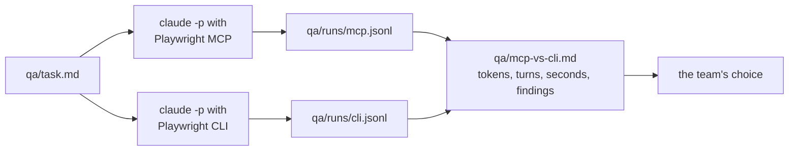
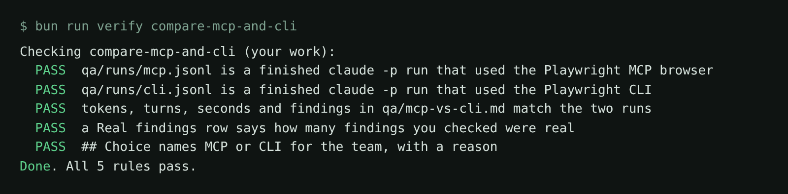

# Compare MCP and CLI

## The problem

Claude Code can drive a browser two ways. **Playwright MCP** sends a page snapshot after each step. The **Playwright CLI** uses short shell commands. Its README calls it "more token-efficient". But your team pays for every run, so measure the same task both ways.



## Watch it done

For example, `bunx playwright cli click e21` is one CLI command. An MCP run may use fewer turns and still read more tokens.

## Your turn

Run the task in `qa/task.md` twice with `claude -p`, once per browser. Then get Claude Code to fill in the table. You judge which findings are real and write the choice. Start the release candidate first:

```bash
BUGS=release bun run shop
```

Expect: `Pantry Run ready on http://localhost:4173 (bugs: 16 on)`

In a second terminal, in this folder, make the folder for the runs and run the task with Playwright MCP only:

```bash
mkdir -p qa/runs
claude -p "$(cat qa/task.md) Use only the playwright MCP browser tools." --output-format stream-json --verbose --max-turns 40 --strict-mcp-config --mcp-config .mcp.json --allowedTools "mcp__playwright__*" < /dev/null > qa/runs/mcp.jsonl
```

Expect: no output on screen. `qa/runs/mcp.jsonl` ends with a line that starts `{"type":"result"`.

Then with the Playwright CLI only:

```bash
claude -p "$(cat qa/task.md) Use only the Playwright CLI through Bash: run bunx playwright cli --help first to see its commands." --output-format stream-json --verbose --max-turns 40 --strict-mcp-config --allowedTools "Bash(bunx playwright cli:*)" "Bash(curl:*)" < /dev/null > qa/runs/cli.jsonl
```

Expect: the same, in `qa/runs/cli.jsonl`.

Now open `claude` in this folder and type:

```text
Read the last line of qa/runs/mcp.jsonl and qa/runs/cli.jsonl. Fill the table in
qa/mcp-vs-cli.md: Tokens is input + output + cache creation + cache read tokens, Turns is
num_turns, Seconds is duration_ms / 1000 rounded, Cost is total_cost_usd, Findings is the
number of FINDING: lines. Leave Real findings and Choice to me. List each finding under
## What we saw.
```

Try each finding in the shop yourself. Fill in Real findings, then write the choice.

## Save the winner as a skill

Save your choice as `.claude/skills/<name>/SKILL.md`. The file starts with a `name` that matches the folder and a `description` that says when to use it. Then it lists the steps.

## Do it on your work

Run one browser task from your own app both ways. Compare the tokens.

## Done when

- Each run is a finished `claude -p` transcript that used its own browser.
- The table's tokens, turns, seconds and findings match the runs.
- You counted the real findings and wrote a choice with a reason.
- A skill in `.claude/skills` has a name, a description of when to use it, and three steps.

Run the check from the repo root:

```bash
bun run verify compare-mcp-and-cli
```

Expect: `Done. All 6 rules pass.`



## Solution

The finished answer is in `solution/`. Read it after you pass, not before.

## If you get stuck

| What you see                                       | Fix                                                                     |
| -------------------------------------------------- | ----------------------------------------------------------------------- |
| The check says the MCP tokens do not match the run | A number was typed or rounded. Ask Claude Code to read it from the run. |
| The run stops at max turns                         | Raise `--max-turns`, or make the task in `qa/task.md` smaller.          |
| `Cost (USD)` looks high                            | On a Claude plan it is Claude Code's estimate, not a bill.              |
