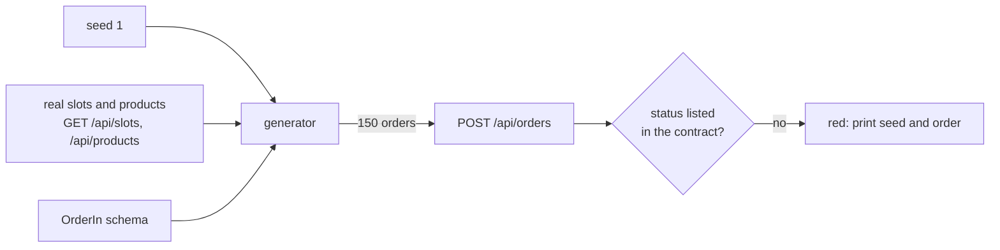
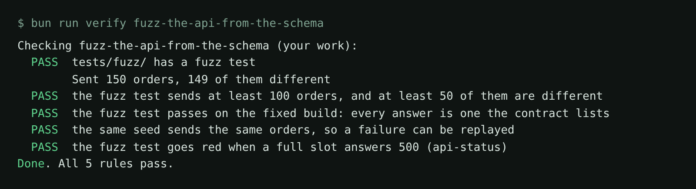

# Fuzz the API from the schema

## The problem

In Part 4 you wrote one test per status code. Each test is one order that a person thought of. Bugs hide in the
orders nobody thought of: an empty line list, a quantity of 22, a full slot with a voucher.

**Fuzzing** sends many generated inputs and checks one simple rule for all of them. Here the rule is: every
answer is a status the contract lists. For example, `openapi.yaml` lists 201, 400, 401, 404, 409 and 422 for
`POST /api/orders`. A `500` is never on that list, whatever order caused it.



## Your challenge

Get Claude Code to write a seeded fuzz test for `POST /api/orders`. You write no code. You check the plan: where
the values come from, and how a failure can be replayed.

Start Claude Code in this folder:

```bash
claude
```

Expect: Claude Code opens in this folder and reads `CLAUDE.md`.

Then type this prompt:

```text
Write tests/fuzz/orders.spec.ts. Make 150 orders from the OrderIn schema in
../../../../world/openapi.yaml with a seeded random generator, seed 1 by default. Draw slot
ids and skus from GET /api/slots and GET /api/products, and mix in odd values: unknown
slots and skus, quantities out of range, no lines, no partner key. Expect every answer to be
a status the contract lists for POST /api/orders. On a failure, print the seed and the body.
Show me the plan first.
```

Say no if the plan uses `Math.random`, or only random text for slot ids.

Run it on the fixed build, then on the bug:

```bash
bunx playwright test tests/fuzz
```

Expect: `1 passed`

```bash
BUGS=api-status bun run shop
```

Expect: `Pantry Run ready on http://localhost:4173 (bugs: api-status)`

Run the fuzz test again in a second terminal. It goes red, and prints a seed and an order with a `500`.

## Done when

- `tests/fuzz/` sends at least 100 orders, at least 50 of them different.
- It passes on the fixed build, and the same seed sends the same orders.
- It goes red on `api-status`.

Ask Claude Code:

```text
Run `bun run verify fuzz-the-api-from-the-schema` from the repo root and tell me what it printed. Do not change anything to make it pass.
```

Or run it yourself:

```bash
bun run verify fuzz-the-api-from-the-schema
```

Expect: `Done. All 5 rules pass.`



## If you get stuck

| What you see                           | Fix                                                                         |
| -------------------------------------- | --------------------------------------------------------------------------- |
| `FAIL the same seed sends the same...` | The test uses `Math.random`. Ask for a small seeded generator.              |
| `FAIL ... (api-status)`                | No order reaches a full slot. Ask Claude Code to use slot ids from the API. |
| A red test on the fixed build          | Read the printed body. Either the shop or the contract is wrong. Tell both. |

## Words you will use

- **Fuzzing**: sending many generated inputs and checking one rule for all of them.
- **Seed**: the number a random generator starts from. The same seed gives the same orders.
- **Replay**: running a failed case again with its seed, to see the same failure.

Go further: Schemathesis makes the same kind of test straight from `openapi.yaml`, with `uv`. Point it at a copy
of the contract with real slot ids as examples, or it rarely reaches a full slot.
