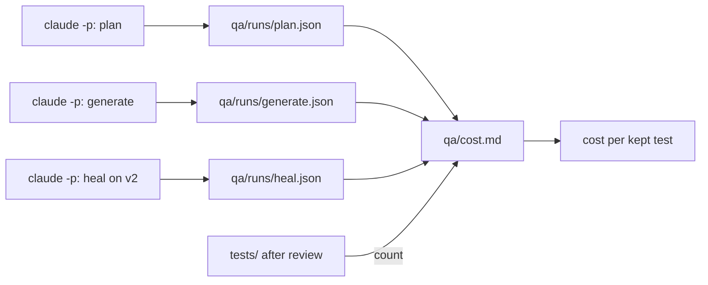
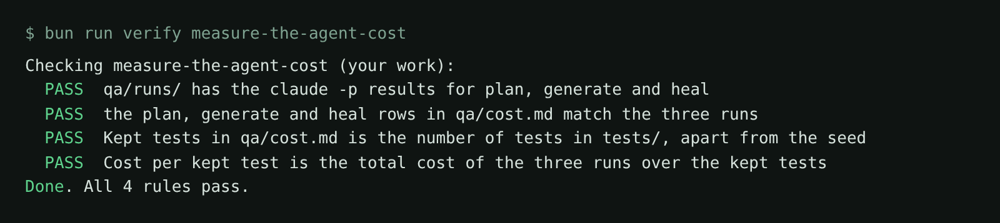

# Measure the agent cost

## The problem

Every agent run costs tokens, and tokens cost money or plan limits. When a manager asks "was it worth it?", "the agent wrote 21 tests" is no answer.

A better number is **cost per kept test**: what the runs cost, divided by the tests still in the suite after
review. For example, if plan, generate and heal cost $1.70 together and 21 tests are kept, each kept test cost
about $0.08. If review drops 11 of them, each kept test costs $0.17.



## Your challenge

Run the planner, the generator and the healer on the basket with `claude -p`, and save each result. Then get
Claude Code to fill in `qa/cost.md` from the results and from the tests still in `tests/`.

In this folder, add Playwright's agents and start the shop:

```bash
bunx playwright init-agents --loop=claude
```

Expect: `✅ Done.`

```bash
bun run shop
```

Expect: `Pantry Run ready on http://localhost:4173 (bugs: none)`

Leave the shop running. In a second terminal, run the planner:

```bash
mkdir -p qa/runs
claude -p "Use the playwright-test-planner agent to plan the basket from requirements/basket.md, with tests/seed.spec.ts as the seed, following CLAUDE.md. Save the plan as specs/basket.md." --output-format json --permission-mode acceptEdits --max-turns 80 < /dev/null > qa/runs/plan.json
```

Expect: no output on screen, and `specs/basket.md` with one scenario per heading.

Run the generator the same way, with this prompt, saved to `qa/runs/generate.json`:

```text
Use the playwright-test-generator agent to write tests/basket.spec.ts from specs/basket.md,
following CLAUDE.md. Run bunx playwright test until every test passes, then say how many
tests you wrote.
```

Then restart the shop with `RELEASE=v2 bun run shop` and run the healer, saved to `qa/runs/heal.json`:

```text
The shop is release v2. Use the playwright-test-healer agent to make tests/basket.spec.ts
pass again. Fix locators only. Never change an expected value or remove an expect.
```

Delete any test you would not keep. Then open `claude` and type:

```text
Fill in qa/cost.md from qa/runs/plan.json, generate.json and heal.json: Tokens is input +
output + cache creation + cache read tokens, Minutes is duration_ms in minutes to one
decimal, Cost is total_cost_usd. Kept tests is the tests in tests/ apart from the seed.
Cost per kept test is the three costs added up, divided by Kept tests, to the cent.
```

## Done when

- `qa/runs/` holds the three results, and the three rows in `qa/cost.md` match them.
- Kept tests counts the tests still in `tests/`, and the cost per kept test is right to the cent.

Ask Claude Code:

```text
Run `bun run verify measure-the-agent-cost` from the repo root and tell me what it printed. Do not change anything to make it pass.
```

Or run it yourself:

```bash
bun run verify measure-the-agent-cost
```

Expect: `Done. All 4 rules pass.`



## If you get stuck

| What you see               | Fix                                                                        |
| -------------------------- | -------------------------------------------------------------------------- |
| `plan: the run says ...`   | A number was typed or rounded. Ask Claude Code to read it from the result. |
| `FAIL Kept tests ...`      | Do not count the seed or deleted tests.                                    |
| The run stops at max turns | Raise `--max-turns`.                                                       |

## Words you will use

- **Cost per kept test**: the run cost divided by kept tests.
- **Kept test**: a test that is still in `tests/` after your review.
