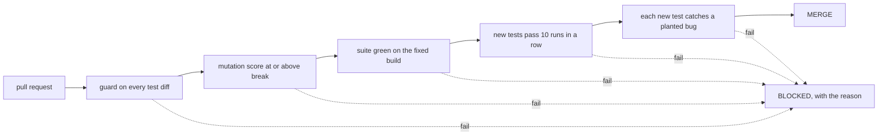
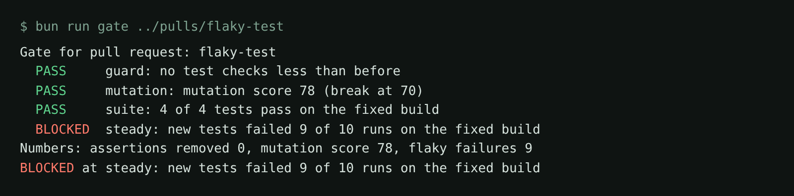

# Gate the pull request

## The problem

An agent opens a pull request. Today Pantry Run's gate only runs the tests: green means merge. But green hides
the four things this course is about. For example, an agent can delete the `expect` that checks $1.04 for
bananas. Every test stays green, and the gate merges a suite that checks less.

`../pulls/` holds five planted pull requests. One is clean. The other four are the agent mistakes from this
course: an `expect` removed, a new test that catches no bug, a flaky test, and a mutation score under the break
threshold.



## Your challenge

Get Claude Code to turn `qa/gate.ts` into a gate that merges the clean pull request and blocks the other four.
It also writes a CI file that runs the gate. You write no code. You read the plan and try the gate on each pull request.

First see the problem. The gate today merges the pull request that removed an `expect`:

```bash
bun run gate ../pulls/removes-an-expect
```

Expect: `MERGE: the tests pass.`

Start Claude Code in this folder:

```bash
claude
```

Expect: Claude Code opens in this folder and reads `CLAUDE.md`.

Then type this prompt:

```text
Rewrite qa/gate.ts as CLAUDE.md describes. Run these stages in order and stop at the first
block: 1. qa/guard.ts on the diff of every test file between tests/ and the pull's tests/.
2. the mutation score from the pull's report against thresholds.break. 3. the pull's suite
on a fixed shop. 4. the new tests 10 times in a row on one shop. 5. each new test with each
requirement bug on: it must go red at least once. Print PASS or BLOCKED per stage and the
numbers. Then write ci/pull-request.yml that runs bun run gate on every pull request.
Show me the plan first.
```

Check the plan's order: the cheap stages come first. Then try the gate on every pull request:

```bash
bun run gate ../pulls/clean-pull
```

Expect: `MERGE: every stage passed.`

Run it on the four others. Each must print `BLOCKED`, with the stage that caught it.

## Done when

- The gate merges `clean-pull` and blocks the four bad pull requests.
- `ci/pull-request.yml` runs `bun run gate` on every pull request.

```bash
bun run verify gate-the-pull-request
```

Expect: `Done. All 6 rules pass.`



## If you get stuck

| What you see                              | Fix                                                                       |
| ----------------------------------------- | ------------------------------------------------------------------------- |
| `flaky-test` merges                       | The new test ran once. Ask for `--repeat-each=10` on one shop.            |
| `clean-pull` is blocked at `suite`        | The gate ran no tests. Check that it sets `TESTS_DIR` and `BASE_URL`.     |
| The gate takes minutes                    | Run the cheap stages first, and stop at the first block.                  |

## Words you will use

- **Gate**: a script that decides if a pull request may merge.
- **Stage**: one check inside the gate. The first stage that fails blocks the merge.
- **Break threshold**: the lowest mutation score Stryker accepts, `thresholds.break`.
