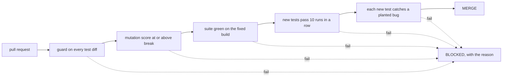
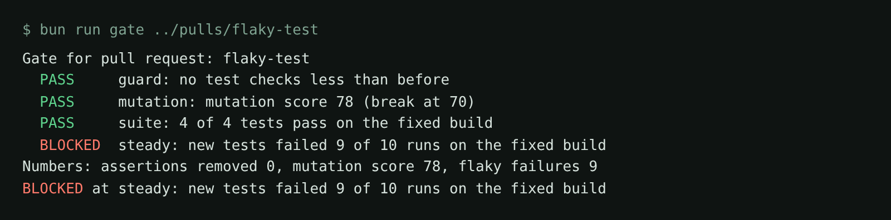

# Gate the pull request

## The problem

An agent opens a pull request. Today the gate only runs the tests, so green means merge. But green hides mistakes. An agent can delete an expect, and every test stays green.

`../pulls/` holds five planted pull requests. One is clean.



## Watch it done

The other four hide one mistake each. It is an expect removed, a new test that catches no bug, a flaky test, or a score under the break threshold. For example, an agent can delete the expect that checks $1.04 for bananas, and the gate must catch it.

First see the problem. The gate today merges the pull request that removed an `expect`:

```bash
bun run gate ../pulls/removes-an-expect
```

Expect: `MERGE: the tests pass.`

## Your turn

Get Claude Code to turn `qa/gate.ts` into a gate that merges the clean pull request and blocks the other four. You read the plan and try each pull request.

Start Claude Code in this folder:

```bash
claude
```

Expect: Claude Code reads `CLAUDE.md`.

Then type this prompt:

```text
Rewrite qa/gate.ts as CLAUDE.md describes. Run five stages in order and stop at the first
block: 1. qa/guard.ts on every test diff. 2. the mutation score against thresholds.break.
3. the pull's suite on a fixed shop. 4. the new tests 10 times in a row. 5. each new test with
each requirement bug on: it must go red at least once. Print PASS or BLOCKED per stage with
the numbers. Then write ci/pull-request.yml that runs bun run gate on every pull request.
Show me the plan first.
```

Check the plan's order: the cheap stages come first. Then try the gate on every pull request:

```bash
bun run gate ../pulls/clean-pull
```

Expect: `MERGE: every stage passed.`

Run it on the four others. Each must print `BLOCKED`, with the stage that caught it.

## Stop Claude Code when the gate says no

Add a Stop hook in `.claude/settings.json` that runs `bun qa/gate.ts`. If the gate blocks, Claude Code keeps working. Save `.claude/agents/test-reviewer.md` with Read, Grep, Glob and Bash, and no editing tool. Run `/code-review` through it on your diff.

## Do it on your work

Ask whether one check your team runs would catch a deleted expect.

## Done when

- The gate merges `clean-pull` and blocks the four bad pull requests.
- `ci/pull-request.yml` runs `bun run gate` on every pull request.
- The CI file shards the suite and keeps traces of a red run. A flake policy limits the quarantine. Steps: [the second half](MORE.md).
- `.claude/settings.json` has a Stop hook that runs the gate, and `test-reviewer` can read but not edit.

Run the check from the repo root:

```bash
bun run verify gate-the-pull-request
```

Expect: `Done. All 13 rules pass.`



## Solution

The finished answer is in `solution/`. Read it after you pass, not before.

## If you get stuck

| What you see                       | Fix                                                                   |
| ---------------------------------- | --------------------------------------------------------------------- |
| `flaky-test` merges                | The new test ran once. Ask for `--repeat-each=10` on one shop.        |
| `clean-pull` is blocked at `suite` | The gate ran no tests. Check that it sets `TESTS_DIR` and `BASE_URL`. |
