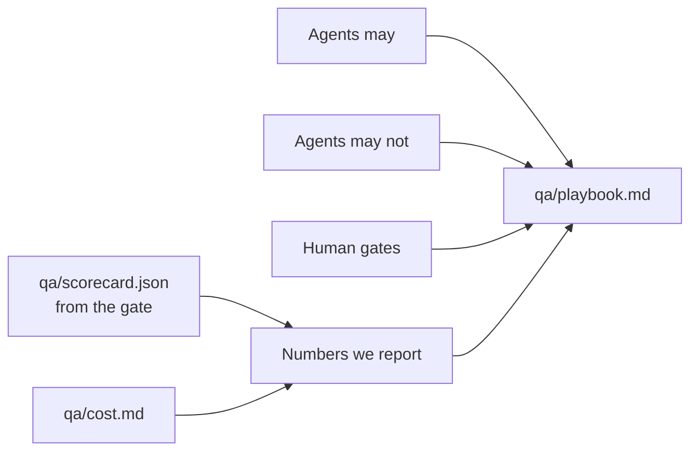

# Write the team playbook

## The problem

You have a gate, a cost per kept test, and habits from every part of this course. But they live in your head.
A new teammate, or a new agent, does not know them. And unless the team agrees on numbers, leadership will pick
one for you, usually "tests written by AI".

That number grows when the suite gets worse. For example, the `catches-nothing` pull request adds a test, so
"tests written" goes up. The gate blocks it, because "new tests that catch a planted bug" says 0 of 1.



## Your challenge

Get Claude Code to draft `qa/playbook.md`, then make it yours. You decide every rule. Claude Code drafts and
checks the numbers against what the gate really computes.

Start Claude Code in this folder:

```bash
claude
```

Expect: Claude Code opens in this folder.

Then type this prompt:

```text
Draft qa/playbook.md with four sections: Agents may, Agents may not, Human gates and
Numbers we report. Agents may not must forbid removing or changing an expect, and adding
skip, fixme or retries. Each human gate names who approves. Numbers we report uses only
the numbers in qa/scorecard.json, word for word, plus cost per kept test from qa/cost.md.
Do not report tests written. Show me the draft.
```

Read every rule. Would your team follow it? Change any rule you do not agree with, in your own words or by asking
Claude Code.

## Done when

- The four sections each have at least two rules.
- Agents may not forbids weakening an expect and skipping a test.
- Every human gate names who approves.
- At least 4 numbers, each one the gate or the cost step computes, and none counts tests written.

```bash
bun run verify write-the-team-playbook
```

Expect: `Done. All 5 rules pass.`

## If you get stuck

| What you see                      | Fix                                                                           |
| --------------------------------- | ----------------------------------------------------------------------------- |
| `FAIL at least 4 numbers ...`     | Use the names in `qa/scorecard.json` word for word, such as "mutation score". |
| `FAIL every human gate names who` | Each gate says who signs off: the QA lead, a reviewer, a developer.           |
| `FAIL no number counts tests ...` | Drop "tests written". Report what the tests catch instead.                    |

## Words you will use

- **Playbook**: the team's written rules for a kind of work, kept in the repo next to the tests.
- **Human gate**: a step where a named person must approve before work moves on.
- **Vanity number**: a number that looks good but does not tell you if quality went up.
