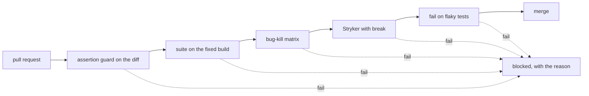

# Part 5: Run it as a team

This part moves the goal: one pull request gate that reports four numbers.

## The problem

One person's strong suite is not a team practice. Agent runs cost money per run, and nobody has budgeted for
them. Unless the team picks better numbers, leadership will count "tests written by AI" and call it quality.

For example, "the agent wrote 120 tests" says nothing. "The agent's tests catch 15 of 16 planted bugs, and each
kept test cost this much" tells a manager what they paid for.

## Why it matters

GitHub cut its flaky builds by tracking and owning them
([GitHub engineering blog](https://github.blog/engineering/engineering-principles/reducing-flaky-builds-by-18x/)).
Microsoft's Playwright MCP README now points coding agents to the Playwright CLI first, as "more token-efficient"
([microsoft/playwright-mcp](https://raw.githubusercontent.com/microsoft/playwright-mcp/main/README.md)).

TODO(part session): open the GitHub post and cite its before and after flaky build numbers, and open Slack's
agentic testing post before using any cost per run. The spine session could not load either page.



In every step you type prompts and review. Claude Code makes each file below. The check reads what it made.

| Step                         | Minutes | Claude Code makes                                                                       | The check reads                                                                                           |
| ---------------------------- | ------- | -------------------------------------------------------------------------------------- | --------------------------------------------------------------------------------------------------------- |
| compare-mcp-and-cli          | 20      | `qa/mcp-vs-cli.md`: tokens, time and findings for one task both ways                   | both columns have numbers, and a choice with a reason                                                     |
| fuzz-the-api-from-the-schema | 20      | a Schemathesis run on `openapi.yaml`, or a TypeScript property test                    | finds `api-status` on `BUGS=release`, zero failures on the fixed build                                    |
| measure-the-agent-cost       | 15      | `qa/cost.md`: tokens and minutes for plan, generate and heal, and a cost per kept test | numbers for the three agents; kept tests counted from git                                                 |
| gate-the-pull-request        | 25      | `bun run gate` and a CI file that calls it                                             | fails on 4 planted bad pull requests, passes on a clean one                                               |
| write-the-team-playbook      | 20      | `qa/playbook.md`                                                                       | sections Agents may, Agents may not, Human gates, Numbers we report; each number is one the gate computes |

## Walkthrough

TODO(part session): the commands for each step, each followed by its Expect line.

```bash
bun run verify part run-it-as-a-team
```

Expect: TODO(part session): `Part run-it-as-a-team is done: 5/5 steps pass.`
