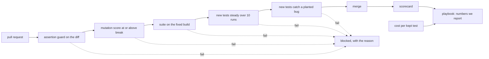

# Part 5: Run it as a team

This part moves the goal: one pull request gate, run on every change, that reports the numbers that matter.

## The problem

One person's strong suite is not a team practice. Agent runs cost money, and nobody has measured how much. The
browser tool an agent uses was picked by habit. And unless the team picks better numbers, leadership will count
"tests written by AI" and call it quality.

For example, "the agent wrote 21 tests" says nothing. Compare "each kept test cost $0.08, and the mutation score
is 78". That tells a manager what they paid for and what they got.

## Why it matters

Playwright's own README says coding agents "increasingly favor CLI-based workflows" because "CLI invocations are
more token-efficient". It also says MCP "remains relevant" for "exploratory automation"
([microsoft/playwright-mcp README](https://raw.githubusercontent.com/microsoft/playwright-mcp/main/README.md)).
On Pantry Run, the measured runs in this part disagree with the first claim: the MCP run used fewer tokens. So the
team measures on its own shop before it picks.



In every step you type prompts, run `claude -p`, and review. Claude Code makes each file below. The check reads
what it made.

| Step                                                                              | Minutes | Claude Code makes                                  | The check reads                                                                            |
| --------------------------------------------------------------------------------- | ------- | -------------------------------------------------- | ------------------------------------------------------------------------------------------ |
| [compare-mcp-and-cli](01-compare-mcp-and-cli/problem/README.md)                   | 20      | two `claude -p` transcripts and `qa/mcp-vs-cli.md` | the tools each run used; tokens, turns, seconds and findings against the transcripts       |
| [fuzz-the-api-from-the-schema](02-fuzz-the-api-from-the-schema/problem/README.md) | 20      | `tests/fuzz/orders.spec.ts`, a seeded fuzz test    | every order it sends; green on the fixed build, the same orders twice, red on `api-status` |
| [measure-the-agent-cost](03-measure-the-agent-cost/problem/README.md)             | 15      | three `claude -p` results and `qa/cost.md`         | each row against its result; kept tests counted from `tests/`; cost per kept test          |
| [gate-the-pull-request](04-gate-the-pull-request/problem/README.md)               | 25      | `qa/gate.ts` and `ci/pull-request.yml`             | the gate merges 1 planted pull request and blocks 4                                        |
| [write-the-team-playbook](05-write-the-team-playbook/problem/README.md)           | 20      | `qa/playbook.md`                                   | four sections; every reported number is one the gate or the cost step computes             |

Total: 100 minutes. Each step's folder is self-contained: work in its `problem/` folder.

## Real runs, and replays

Two steps run Claude Code headless with `claude -p` and save what it prints. Each `solution/qa/runs/` folder
holds real runs of the README's commands, with model names and folder paths removed. The checks read those files,
so `bun run verify` needs no Claude Code and no key. Your own runs give different numbers. That is the point:
you measure your shop.

## Walkthrough

Check each step from the repo root once its work is in place. The README of each step has the commands to run
first. For example, the first step runs `claude -p` twice against `BUGS=release bun run shop`.

```bash
bun run verify compare-mcp-and-cli
bun run verify fuzz-the-api-from-the-schema
bun run verify measure-the-agent-cost
bun run verify gate-the-pull-request
bun run verify write-the-team-playbook
```

Expect: `Done.` on each step once its work is in place, and a `Progress:` line after each.

Try the sample gate on one planted pull request, from the gate step's `solution/` folder:

```bash
bun run gate ../pulls/catches-nothing
```

Expect: `BLOCKED at catches: "the shop lists bananas" catches no planted bug`

When all five steps pass, the whole part passes.

```bash
bun run verify part run-it-as-a-team
```

Expect: `Part run-it-as-a-team is done: 5/5 steps pass.`

```text
Part run-it-as-a-team:
  PASS   compare-mcp-and-cli  (5/5 rules)
  PASS   fuzz-the-api-from-the-schema  (5/5 rules)
  PASS   measure-the-agent-cost  (4/4 rules)
  PASS   gate-the-pull-request  (6/6 rules)
  PASS   write-the-team-playbook  (5/5 rules)
Part run-it-as-a-team is done: 5/5 steps pass.
```

## Assignment

**Problem.** One good suite is not a team practice.

**Hand in** the gate, the CI file, `qa/cost.md`, `qa/mcp-vs-cli.md` and `qa/playbook.md`, from your five
`problem/` folders.

**Rubric.** Each line is yes or no.

1. Does `bun run verify gate-the-pull-request` print `Done.`: 4 bad pull requests blocked, 1 merged?
2. Does every number in `qa/cost.md` and `qa/mcp-vs-cli.md` come from a saved `claude -p` run?
3. Does `qa/playbook.md` report only numbers the gate or the cost step computes?
4. Does the fuzz test find `api-status` with no test written for it by hand?

**Go further.** Run the gate on a real repo at work with one planted bug, and bring the gate's output to the
cohort call.

## Finished

You now have a team practice, not only a suite. The gate blocks the four ways an agent can make a suite look
better while it gets worse. The cost of agent work is a number per kept test. And the playbook says, in the
team's own words, what agents may do and who signs off.

This is the course goal: a suite an agent wrote, with a gate and numbers that prove it works. Take the gate and
the playbook to your own repo next.
