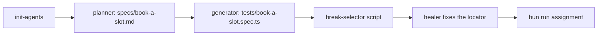

# Redo the flow with agents

## The problem

A hand-written spec for "book a delivery slot" takes time to write and time to repair. Playwright's agents can do
both. But an agent that "fixes" a red test by deleting its assertion hides a bug. For example, if the healer drops the check that the basket shows the slot fee, the spec turns green and tests
nothing. You let the agents work, and you prove they did the job.



## Your challenge

This step is optional in the live session and expected as homework. You type prompts and review. Claude Code and
Playwright's agents write every file. Work in this `problem/` folder.

Add the agents and start Claude Code:

```bash
bunx playwright init-agents --loop=claude
claude
```

Expect: `.claude/agents/` and `.mcp.json` appear, then Claude Code opens.

Ask the planner for the plan, then the generator for the spec:

```text
Use the playwright-test-planner agent to plan the flow "book a delivery slot" from
world/requirements/slots.md. Save it as specs/book-a-slot.md with at least 3 scenarios.
Then use the playwright-test-generator agent to write tests/book-a-slot.spec.ts, with
tests/seed.spec.ts as the seed. Start the file with // spec: specs/book-a-slot.md.
```

Run the spec, then break one selector with the script from the repo root:

```bash
bunx playwright test
bun ../../../assignment/break-selector.ts .
```

Expect: `passed` for every test, then `Broke one selector: { name: "Book slot" } is now { name: "Reserve slot" }`.

Run the tests again and watch one go red. Then ask the healer to fix it, and keep every assertion:

```text
Use the playwright-test-healer agent on tests/book-a-slot.spec.ts. Fix the locator only.
Do not remove or weaken any expect.
```

Last, write `CHOICE.md` in this folder: when is a hand-written spec the better choice? Compare the generated spec
with the hand-written tests in `parts/01-write-tests-with-agents/03-generate-tests-from-the-plan/solution/tests`.

## Done when

- `@playwright/test` resolves to 1.65.0.
- A plan file exists for the chosen flow, with at least 3 scenarios.
- The generated spec names its plan and passes.
- After the scripted selector break, the healed spec passes and no assertion is lost.

```bash
bun run assignment
```

Expect: `Done. All Done-when lines pass.` and a new `assignment/result.json`.

## If you get stuck

| What you see                                 | Fix                                                                                         |
| -------------------------------------------- | ------------------------------------------------------------------------------------------- |
| `FAIL a plan file with at least 3 scenarios` | Ask the planner to use `####` headings for each scenario, like the plans in part 1.         |
| `FAIL the generated spec names its plan`     | The first line must be `// spec: specs/book-a-slot.md`.                                     |
| `Is it already broken?` from the script      | The selector is already renamed. Heal the spec, or restore it from git, then rerun.         |
| `FAIL after the scripted selector break`     | Check `tests/book-a-slot.spec.ts` for a removed `expect`. The healer may only fix locators. |

## Words you will use

- **Planner agent**: the Playwright agent that explores the shop and writes a Markdown test plan.
- **Healer agent**: the Playwright agent that runs a red test, finds what changed on the page and fixes the locator.
- **Selector**: how a test finds an element, such as a button's name.
- **Reference solution**: a finished answer in `solution/`. Read it after you pass, not before.
