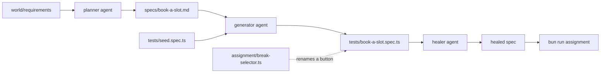

# Part 6: Do it with the tools teams run

This part redoes one thing you built by hand, with the open-source tool teams run in production. It is optional in
the live session and expected as homework. Nothing in parts 1 to 5 changes.

## The problem

You wrote a test plan and specs with Claude Code earlier in this course. Many teams skip that and hand-write each
spec instead. That works for a short, stable flow. It stops working when the pages change often, because every
renamed button means a manual hunt through the specs.

For example, in release v2 the button "Book slot" is called "Reserve". One renamed button turns every spec that
clicks it red.

## Why it matters

Playwright ships three agents for this loop. The planner explores the shop and writes a Markdown plan. The
generator turns the plan into a spec. The healer runs a red spec, finds what changed on the page and fixes the
locator. A team that trusts the loop spends its time reviewing, not typing.



## What we teach

You run Playwright's own agents on one flow, "book a delivery slot". You compare the result with the hand-written
tests from part 1. The tool is `@playwright/test` 1.65.0, under the Apache-2.0 licence. The course already pins that
version.

| Step                                                                        | Minutes | Claude Code makes                                         | The check reads                                               |
| --------------------------------------------------------------------------- | ------- | --------------------------------------------------------- | ------------------------------------------------------------- |
| [redo-the-flow-with-agents](01-redo-the-flow-with-agents/problem/README.md) | 15      | a plan, a spec, then a healed spec after a scripted break | the version, the plan, the generated spec and the healed spec |

## Options

**Hand-written specs only**

- **Choose when** the flow is short and stable, and one person owns it.
- **Trade-off:** you type more, and you have no plan file to review.

Playwright Test Agents is the better pick when many people share the flow, or when the pages change often.

## Walkthrough

Check the reference solution, then the starter you work in. Both run the real shop and a real browser.

```bash
bun run verify redo-the-flow-with-agents solution
```

Expect: `Done.` after four `PASS` lines.

```bash
bun run assignment
```

Expect: four `FAIL` lines with a `Try next:` sentence each, and `Not done yet.`, until you finish the step.

When the step passes, the whole part passes.

```bash
bun run verify part do-it-with-the-tools-teams-run
```

Expect: `Part do-it-with-the-tools-teams-run is done: 1/1 steps pass.`
