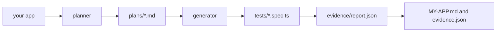

# Run the agents on your own app

## The problem

You ran Playwright's agents on a shop we made. Your own app has surprises. For example, a form that needs a
code from an email. A plan you did not read is a risk, so a person stays in charge here.



## Your challenge

Pick one flow in an app you may test. It can be a work app, a side project or a site you own. Do not use the
course shop. This folder is a template: work here, or copy it next to your app.

Add the agents and open Claude Code:

```bash
bunx playwright init-agents --loop=claude
claude
```

Expect: `.claude/agents/` appears, then Claude Code opens.

Set your app address, then ask for the seed, the plan and the specs. Read every scenario before you say yes. Say no to any scenario that could damage real data:

```text
Write tests/seed.spec.ts for my app at $APP_URL: open the first page of my flow and expect one thing a user sees.
Then use the playwright-test-planner agent on this flow: <your flow>. Save the plan in plans/ with at least three scenarios: one that works, one that is refused, one at a limit.
Then use the playwright-test-generator agent on that plan. Start each spec with // spec: plans/<name>.md. Every test needs an expect and no fixed sleeps.
Show me your plan first.
```

Expect: a plan in `plans/` and specs in `tests/`.

If a test is red because the page changed, use the healer agent. Never let it remove an `expect`. Then save the report:

```bash
APP_URL=https://your-app.example bunx playwright test --reporter=json > evidence/report.json
```

Expect: a report where every test passed.

Fill in `MY-APP.md` and `evidence.json` in your own words. Put your own name in `approvedBy`.

## Do it on your work

The check reads your files only. To check a folder outside this repo:

```bash
MY_APP_DIR=../my-app-tests bun run verify run-agents-on-your-own-app
```

Expect: `Done. All 9 rules pass.`

## Done when

- `MY-APP.md` has five answered sections, and nothing in your files names the course shop.
- `plans/` has three or more scenarios, and each spec names its plan.
- There are three or more tests with an `expect` and no fixed sleep.
- `evidence.json` has your app address, your agents and your name.
- `evidence/report.json` shows every test passed, for the tests you have now.

```bash
bun run verify run-agents-on-your-own-app
```

Expect: `Done. All 9 rules pass.`

## If you get stuck

| What you see                             | Fix                                                                |
| ---------------------------------------- | ------------------------------------------------------------------ |
| `FAIL the files describe your own app`   | A file still has a Pantry Run name or the course shop address.     |
| `FAIL the saved report lists every test` | You changed a test after the run. Save a new report.               |
| `FAIL the saved Playwright report`       | A test is red or flaky. Fix it, or ask the healer if a name moved. |

## Words you will use

- **Planner**: the agent that explores your app and writes a plan.
- **Generator**: the agent that turns a plan into a spec.
- **Healer**: the agent that fixes a spec when the page changed.
- **Evidence**: a saved file that proves the run happened, such as the report.
