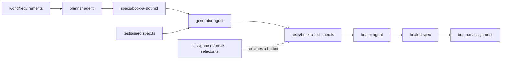

# Redo a flow with Playwright Test Agents

This part redoes one thing you built by hand, with the open-source tool teams run in production. It is optional in
the live session and expected as homework. Nothing in parts 1 to 5 changes.

## After this part you can

- Run Playwright's planner, generator and healer on one flow.
- Check that a healed spec keeps every assertion.

## You leave with

- A plan file for one flow.
- A generated spec that passes, and a healed spec after a scripted break.

## The problem

You wrote a test plan and specs with Claude Code earlier in this course. Many teams skip that and hand-write each
spec instead. That works for a short, stable flow. It stops working when the pages change often, because every
renamed button means a manual hunt through the specs.

For example, in the new release the button "Book slot" is called "Reserve". One renamed button turns every spec that
clicks it red.

## Why it matters

Playwright ships three agents for this loop. The planner explores the shop and writes a Markdown plan. The
generator turns the plan into a spec. The healer runs a red spec, finds what changed on the page and fixes the
locator. A team that trusts the loop spends its time reviewing, not typing.



## What we teach

You run Playwright's own agents on one flow, "book a delivery slot". You compare the result with the hand-written
tests from part 1. The tool is `@playwright/test`, under the Apache-2.0 licence. The course already pins that
version.

| Step                                                                        | Minutes | Claude Code makes                                                         | The check reads                                               |
| --------------------------------------------------------------------------- | ------- | ------------------------------------------------------------------------- | ------------------------------------------------------------- |
| [redo-the-flow-with-agents](01-redo-the-flow-with-agents/problem/README.md) | 15      | a plan, a spec, then a healed spec after a scripted break                 | the version, the plan, the generated spec and the healed spec |
| [capstone: run agents on your own app](../../capstone/template/README.md)   | 30      | the same three agents on your own app, with your notes and a saved report | `bun capstone/check.ts <your folder>`: your files only        |

## Options

**Hand-written specs only**

- **Choose when** the flow is short and stable, and one person owns it.
- **Trade-off:** you type more, and you have no plan file to review.

Playwright Test Agents is the better pick when many people share the flow, or when the pages change often.

## Walkthrough

Check the reference solution, then the starter you work in. Both run the real shop and a real browser.

```bash
bun run verify redo-the-flow-with-agents solution
```

Expect: `Done.` after four `PASS` lines.

```bash
bun run assignment
```

Expect: four `FAIL` lines with a `Try next:` sentence each, and `Not done yet.`, until you finish the step.

When the step passes, the whole part passes.

Ask Claude Code:

```text
Run `bun run verify part redo-a-flow-with-playwright-test-agents` from the repo root and tell me what it printed. Do not change anything to make it pass.
```

Or run it yourself:

```bash
bun run verify part redo-a-flow-with-playwright-test-agents
```

Expect: `Part redo-a-flow-with-playwright-test-agents is done: 1/1 steps pass.`

## Watch and read

| Kind  | Title                           | Author              | Why                                                               | Link                                               |
| ----- | ------------------------------- | ------------------- | ----------------------------------------------------------------- | -------------------------------------------------- |
| video | Playwright Live: agents and MCP | The Playwright team | A walk through the planner and the generator on a real app.       | <https://www.youtube.com/watch?v=S4qzP07ZkOg>      |
| video | Playwright CLI vs MCP           | The Playwright team | Shows what each browser tool costs an agent.                      | <https://www.youtube.com/watch?v=Be0ceKN81S8>      |
| read  | Test agents                     | The Playwright team | The reference for init-agents and what each agent writes.         | <https://playwright.dev/docs/test-agents>          |
| read  | Best practices                  | The Playwright team | Advice on tests that stay stable when the page changes.           | <https://playwright.dev/docs/best-practices>       |
| read  | Common workflows                | Anthropic           | Docs for plan mode and other habits that keep a person in charge. | <https://code.claude.com/docs/en/common-workflows> |

## Project

Your project is the capstone in the table above. Run the three agents on your own app.
